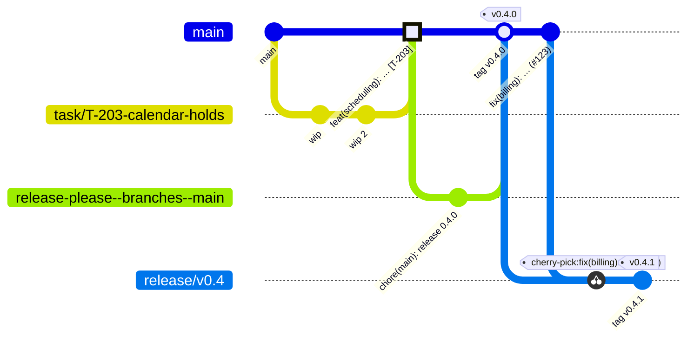

# Branching strategy

Ritma uses **trunk-based development with short-lived branches and squash merges** ([ADR-0015](spec/adr/0015-trunk-based-branching.md)). This file is the single source of truth for branch names, lifetimes, protection and the release, hotfix and backport flows. Other documents link here and don't repeat the rules.

## 1. Model in one picture



- **`main` is the trunk.** It is always releasable: CI green, migrations forward-only, docs current. Nothing lands on `main` without a PR.
- **Work happens on short-lived branches**, one task or issue per branch, merged within days (target ≤ 3 working days; a branch older than 14 days without activity is closed, §7).
- **One task = one squashed commit on `main`.** The PR title becomes the commit header (COMMIT_CONVENTION §9). History on `main` is linear.
- **Releases are tags on `main`** created by release-please (RELEASING.md). Maintenance branches exist only to patch a previous minor (§5).

## 2. Branch names

`<kind>/<ref>-<slug>`, lowercase ASCII, words separated by `-`, at most 60 characters. `<ref>` is the task id or the issue number when there is one.

| Kind | Pattern | Use | Base | Merges into |
|---|---|---|---|---|
| Task | `task/T-xxx-<slug>` | Work from a task file (WORKFLOW.md Step 0) | `main` | `main` |
| Feature | `feat/<issue>-<slug>` | A capability with no task file (rare: open a task instead) | `main` | `main` |
| Fix | `fix/<issue>-<slug>` | A bug fix | `main` | `main` |
| Docs | `docs/<slug>` or `docs/<issue>-<slug>` | Spec, tasks, brand, README, governance | `main` | `main` |
| CI | `ci/<slug>` | Workflows, guard scripts | `main` | `main` |
| Build / deps | `build/<slug>`; Dependabot uses `dependabot/**` | Toolchain, dependency bumps | `main` | `main` |
| Hotfix | `hotfix/v<X.Y.Z>-<slug>` | A fix that must ship before the next regular release (§6) | `main` | `main` |
| Backport | `backport/<PR>-to-v<X.Y>` | Cherry-pick of a merged fix onto a maintenance branch (§5) | `release/vX.Y` | `release/vX.Y` |
| Maintenance | `release/v<X.Y>` | Patch line for a previous minor (§5) | tag `vX.Y.0` | never merged back |
| Release PR | `release-please--branches--main` | Owned by release-please, never edited by hand | `main` | `main` |
| Archive | `archive/<name>` | Frozen history (e.g. `archive/v0-capstone`) | — | never |

Rules:
- One branch per task. Rework after review continues on the **same** branch (WORKFLOW.md §5).
- No personal long-lived branches (`dev`, `develop`, `staging`, `<name>/playground`). Use a draft PR or a fork.
- Contributors from forks use the same names in their fork.

## 3. Lifetime of a branch

1. **Create** from an up-to-date `main`: `git switch main && git pull --ff-only && git switch -c task/T-203-calendar-holds`.
2. **Commit freely.** Local WIP commits can say anything; they are squashed on merge (COMMIT_CONVENTION §8). Every commit is signed off (`git commit -s`).
3. **Stay current by rebasing**, not merging: `git fetch origin && git rebase origin/main`, then `git push --force-with-lease`. Never `--force` without `-with-lease`. Never rebase a branch someone else is also pushing to without asking.
4. **Open the PR early as a draft** if the work spans more than a day, so CI runs and others see it.
5. **Mark ready** when the task Report is filled and every check is green (WORKFLOW.md Step 12).
6. **Merge** with "Squash and merge" after approval and a green `ci-ok`. The branch is deleted automatically.

## 4. Stacked PRs

Use a stack only when a second change genuinely needs the first one and the first one is still in review (for example, docs that build on a spec PR).

- Base the second branch on the first, and open its PR **against the first branch**, not `main`. Say "Stacked on #N" at the top of the description.
- When the bottom PR is squash-merged, GitHub retargets the next PR to `main`. Then rebase it: `git rebase --onto origin/main <old-base-branch> <branch>` and `git push --force-with-lease`.
- Maximum stack depth: 2. Deeper stacks mean the work wasn't split well; merge or close the bottom first.

## 5. Maintenance branches and backports

SECURITY.md promises security fixes for the previous minor for 90 days after a new minor ships. That is the only reason maintenance branches exist.

- **Before v1.0:** no maintenance branches. Fixes ship in the next release from `main`.
- **From v1.0:** when `vX.(Y+1).0` is tagged, a maintainer creates `release/vX.Y` from tag `vX.Y.0`'s latest patch (`git switch -c release/vX.Y vX.Y.Z && git push -u origin release/vX.Y`). It lives 90 days, then it is deleted (the tags stay).
- **Fix on `main` first.** Every fix lands on `main` through a normal PR. Only then is it backported, so nothing is fixed in an old line and forgotten in the trunk.
- **Backport:** `git switch -c backport/<PR>-to-vX.Y origin/release/vX.Y && git cherry-pick -x <squash-sha>`, then open a PR against `release/vX.Y` titled like the original with the suffix ` (backport #<PR>)`. Add the label `backport`.
- **Patch release from a maintenance branch:** run the `release-please` workflow manually with `target-branch: release/vX.Y` (RELEASING.md, maintenance releases). It tags `vX.Y.(Z+1)` on that branch and `release.yml` publishes it. A patch from `release/**` must not move the GitHub "latest" release, the `latest` image tag or `latest.json` (T-704 adds this before the first maintenance release).
- Only `fix`, `perf` with a security reason, and `build(deps)` security bumps are backported. Never features, never migrations that aren't also on `main` in the same order.

## 6. Hotfixes

A hotfix is a fix that can't wait for the next regular release (a security issue, data corruption, a broken install).

1. Branch `hotfix/v<next-patch>-<slug>` from `main`. Security fixes follow SECURITY.md first: they are prepared in a **private fork from a GitHub Security Advisory**, not on a public branch, until the advisory is published.
2. PR to `main` with the `hotfix` label. One maintainer approval is enough; CI must still be green. No CI check may be skipped.
3. Merge, then merge the release-please PR straight away to tag the patch.
4. Backport (§5) if a supported maintenance branch exists.

## 7. Protection and repository settings

`main` and `release/**` are protected with a **repository ruleset**. The maintainer applies these settings (GitHub web UI → Settings → Rules, or the `gh api` call below):

| Setting | `main` | `release/**` |
|---|---|---|
| Require a pull request before merging | ✅, 1 approval (2 after the council forms, GOVERNANCE.md) | ✅, 1 approval |
| Dismiss stale approvals on new commits | ✅ | ✅ |
| Require review from Code Owners | ✅ (CODEOWNERS) | ✅ |
| Require conversation resolution | ✅ | ✅ |
| Required status checks | `ci-ok` (the single gate job), DCO | `ci-ok`, DCO |
| Require branches to be up to date | ✅ | ✅ |
| Require linear history | ✅ | ✅ |
| Allowed merge method | Squash only | Squash only |
| Block force pushes and deletions | ✅ | ✅ (deletion allowed for admins after 90 days) |
| Bypass | Nobody, release-please app only for its own PR | Nobody |

Repository settings: squash merge only, PR title as the default commit message, **automatically delete head branches**, Dependabot security updates on, private vulnerability reporting on.

```sh
# Apply the main ruleset (run once by a repo admin; adjust REPO).
REPO=sedam-or/Equalizer-Stake
gh repo edit "$REPO" --enable-squash-merge --enable-merge-commit=false \
  --enable-rebase-merge=false --delete-branch-on-merge
gh api -X POST "repos/$REPO/rulesets" --input - <<'JSON'
{
  "name": "main",
  "target": "branch",
  "enforcement": "active",
  "conditions": { "ref_name": { "include": ["~DEFAULT_BRANCH", "refs/heads/release/**"], "exclude": [] } },
  "rules": [
    { "type": "deletion" },
    { "type": "non_fast_forward" },
    { "type": "required_linear_history" },
    { "type": "pull_request", "parameters": {
        "required_approving_review_count": 1,
        "dismiss_stale_reviews_on_push": true,
        "require_code_owner_review": true,
        "require_last_push_approval": false,
        "required_review_thread_resolution": true,
        "allowed_merge_methods": ["squash"] } },
    { "type": "required_status_checks", "parameters": {
        "strict_required_status_checks_policy": true,
        "required_status_checks": [ { "context": "ci-ok" } ] } }
  ]
}
JSON
```

**Hygiene:**
- Merged branches are deleted automatically. A maintainer closes PRs inactive for 14 days with a friendly note (stale bot comment at 10 days).
- Tags `v*` are immutable: a tag ruleset blocks updates and deletions of `refs/tags/v*`.
- `archive/*` branches are read-only by convention and never receive commits.

## 8. CI on branches

- `ci.yml` runs on every pull request (any base) and on pushes to `main` and `release/**`. `ci-ok` is the only required check, so adding a job never requires changing the ruleset.
- `release-please.yml` runs on pushes to `main`, and manually for maintenance branches.
- Workflows never run with write permissions on pull requests from forks (`pull_request`, not `pull_request_target`; spec 24 OSS §6).

## 9. Quick reference

```sh
git switch main && git pull --ff-only
git switch -c task/T-203-calendar-holds        # or fix/123-…, docs/…
git commit -s -m "wip"                          # as often as you like
git fetch origin && git rebase origin/main      # stay current
git push --force-with-lease -u origin HEAD      # open a draft PR
# PR title: feat(scheduling): add calendar holds [T-203]   → squash-merged as that commit
```
