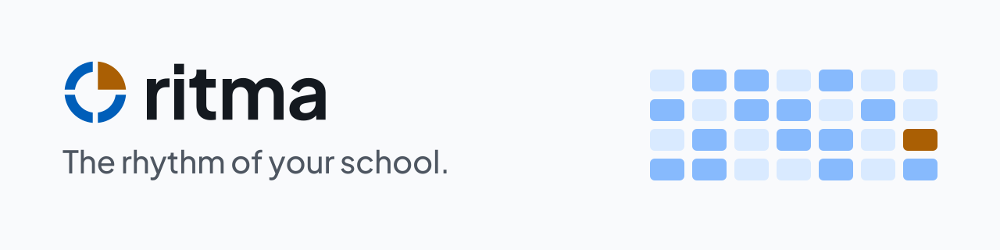

  <picture>
    <source media="(prefers-color-scheme: dark)" srcset="brand/assets/banner-dark.svg">
    
  </picture>

<h3 align="center">The open-source operating system for course schools and studios.</h3>

  Lessons, enrolment, monthly fees, attendance and parent messages in one place. 
  Set up in three steps. Run it on your own PC, your own server, or our cloud.

  
  
  

<a href="README.id.md">Baca dalam Bahasa Indonesia</a>

> [!IMPORTANT]
> **Ritma is pre-release. There is nothing to install yet.** The specification is complete and the implementation starts with milestone M0. The demo, cloud and downloads below go live at v1.0. Follow progress in [ROADMAP.md](ROADMAP.md) and [tasks/INDEX.md](tasks/INDEX.md), or watch the repository for releases.

**Try the demo** · **Start free in the cloud** · **[Self-host](#self-host)** · Download for Windows / macOS / Linux *(at v1.0)*

<!-- Hero GIF of the 3-step setup goes here once the setup wizard exists (milestone M3, brand/BRAND.md §8). -->

## Why Ritma

Most small schools run on WhatsApp, spreadsheets and a paper attendance book. It works until two lessons land in the same room, a parent pays the wrong amount, or the person who knows the spreadsheet is on leave. Ritma replaces that pile with one system that follows **your** rules.

- **Set up your school in three steps.** Pick a template, switch on the features you need, review the rules. Every rule has a safe default, so "Next, Next, Finish" gives you a working school. The target is your first lesson booked in under 10 minutes. → [spec 01](spec/01-product.md), [spec 05](spec/05-presets-and-setup.md)
- **No double bookings, enforced by the database.** A PostgreSQL exclusion constraint makes a clash impossible, not just unlikely. A test fires 50 simultaneous bookings at one slot on every pull request: exactly one succeeds. → [scheduling](spec/modules/scheduling.md), [TST-05](spec/12-testing.md)
- **Your rules, in plain words.** Fees, due dates, late fees, opening hours, cancellation credits and the check-in radius are settings, not code. Each rule screen tells you what it means in a sentence, and old invoices keep the rules they were issued under. → [spec 04](spec/04-policy-engine.md)
- **Made for how small schools really work.** WhatsApp reminders with email and in-app fallback, one invoice per parent for all their children, transfer reference codes, and Indonesian and English from day one. → [billing](spec/modules/billing.md), [notifications](spec/modules/notify.md)
- **Your data, your choice of home.** The same software runs on the front-desk PC, your own server or our cloud. Export everything at any time and move between them. → [spec 14](spec/14-distribution.md)

## Who it is for

Independent schools and studios with one to three locations and 20 to 500 students: **music, dance, martial arts, tutoring, art, swimming**, and studios that rent rooms by the hour.

| You are | Ritma gives you |
|---|---|
| **The owner** | A school that runs on your rules, a dashboard of income and attendance, and rule changes that never rewrite old invoices |
| **The front desk** | One "needs attention" list instead of 40 messages, schedule changes in a click, payments matched to invoices |
| **A teacher** | Today's lessons on your phone, check-in in seconds (even with weak signal), attendance and progress notes |
| **A parent** | Registration from home, all your children in one place, one invoice, reminders on WhatsApp |
| **The IT person** | One binary and PostgreSQL, automatic HTTPS, encrypted backups, signed images, updates without manual migrations |

Walk through a full day for each of them in the [user journeys](spec/28-user-journeys.md).

## Set up in three steps

| Step | You do | Ritma does |
|---|---|---|
| **1. Pick a template** | Choose *Music school*, *Dance or martial arts*, *Tutoring*, *Studio rental* or *Blank* | Loads the features, rules, words ("teacher" or "coach") and currency for your kind of school |
| **2. Choose features** | Switch modules on or off | Explains what depends on what, so nothing breaks |
| **3. Review the rules** | Read the summary and change anything that doesn't fit | Saves version 1 of your rules and opens your dashboard with a short checklist |

You can change any of it later on the same screens, in the same three steps.

## Features

Switch on only what you need. Modules you don't use stay out of the menus.

| Module | What it does |
|---|---|
| **Scheduling** *(always on)* | Rooms, courses, recurring weekly lessons, clash-free booking with suggested alternatives, holidays |
| **Enrolment** | Online registration, parents with several children, levels, leave, make-up credits |
| **Billing** | Monthly invoices, transfer reference codes, receipt upload and verification, late fees, freezing and unfreezing accounts |
| **Attendance** | Teacher check-in by time, location and photo, student attendance, offline queue |
| **Studio rental** | Hourly room bookings with approval, deposits and holds that expire |
| **Notifications** | WhatsApp, email and in-app, with retries, fallback and quiet hours |
| **Reports** | Owner dashboard, room use, money owed, printable reports |
| **Feedback** | Progress notes to parents, teacher ratings |

## How Ritma compares

| | Spreadsheets + WhatsApp | Global school SaaS | Appointment booking tools | **Ritma** |
|---|---|---|---|---|
| Clash-free schedule | Manual | Usually | Yes | **Yes, enforced by the database** |
| Recurring lessons, enrolment, monthly fees | Manual | Yes | No | **Yes** |
| Parents with several children, one invoice | Manual | Varies | No | **Yes** |
| Local currency, bank transfer codes, WhatsApp | Partly | Rarely | Rarely | **Yes** |
| Self-host, or move your data out | Yes | No | Some | **Yes, export everything** |
| Price | Free | Monthly subscription | Varies | **Free to self-host**, optional cloud |
| Open source | — | No | Some | **AGPL-3.0** |

## Self-host

One binary plus PostgreSQL. Pick the option that suits you (available from v1.0):

- **Docker one-liner** on any Linux server: `curl -fsSL https://get.<domain>/ | sh`. It sets up Ritma, PostgreSQL and automatic HTTPS, then prints your setup link.
- **One-click templates:** Railway, Render, DigitalOcean, Coolify, CasaOS, YunoHost.
- **Desktop app** for the school's PC (Windows, macOS, Linux), with secure access from teachers' and parents' phones.

Every option ends in the same three-step setup. Releases are signed with cosign and ship an SBOM and build provenance ([spec 26](spec/26-containers-and-caching.md)).

## Built with

Rust (axum, sqlx) · PostgreSQL · React, Vite and Tailwind · Tauri for the desktop app.

Built on well-known open-source tools instead of home-made ones ([spec 24](spec/24-open-source-stack.md)). Security is designed in from the start: encrypted personal data, a tamper-evident audit log, short-lived sessions and a published permission matrix ([spec 18](spec/18-security-by-design.md), [spec 25](spec/25-auth-and-access-control.md)). Read the [architecture and specification](spec/00-index.md) and the [decision records](spec/adr/).

## Roadmap

| Milestone | You get |
|---|---|
| M0–M2 | The engine: accounts, rules, modules and a clash-free schedule (the 50 → 1 test goes green) |
| M3 | **A school set up in three steps**, with the web app and the schedule screen |
| M4–M6 | Enrolment, billing, attendance, notifications, rental, reports, privacy tools |
| M7 | **v1.0 public release**: Docker, one-click templates, docs and a live demo |
| M8 / M9 | Desktop app / Ritma Cloud |

Details in [ROADMAP.md](ROADMAP.md).

## Contributing

- **Add a template for your kind of school in YAML, no Rust needed.** A swimming school, a language course, a coding club: [CONTRIBUTING.md](CONTRIBUTING.md) shows how.
- **Translate** Ritma into your language.
- **Write code:** the work is split into small, self-contained task files. Pick one from [tasks/INDEX.md](tasks/INDEX.md) or a `good first issue`, and follow [WORKFLOW.md](WORKFLOW.md).

Please read the [Code of Conduct](CODE_OF_CONDUCT.md), [GOVERNANCE.md](GOVERNANCE.md) and [SECURITY.md](SECURITY.md) (report vulnerabilities privately).

## Story

Ritma began as a university capstone project for a real Indonesian music school, where the timetable lived in WhatsApp and the fees in a spreadsheet. It is being rebuilt as open source so that any course school, anywhere, can run on it.

## License

Ritma v2 is licensed under [AGPL-3.0](LICENSE). The archived v0 capstone in `legacy/` stays MIT. The name and logo are trademarks of the project; see [TRADEMARK.md](TRADEMARK.md) and the [brand guidelines](brand/GUIDELINES.md).
