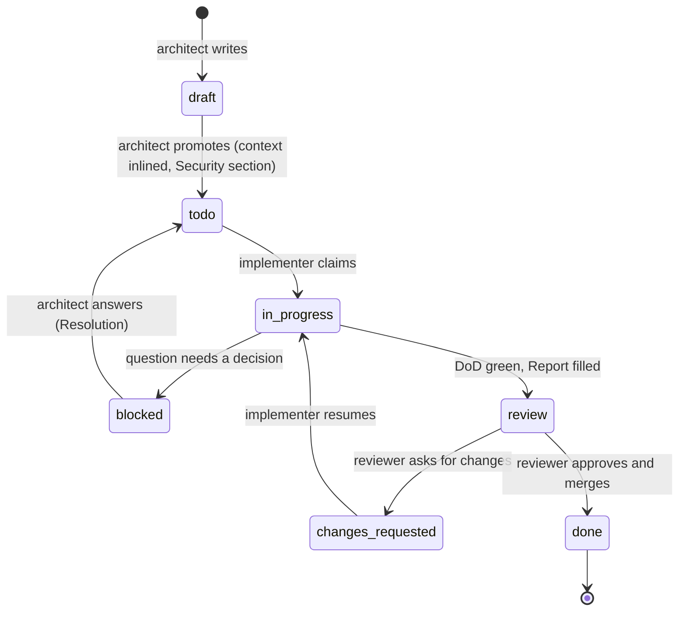

# WORKFLOW — executing tasks one by one

This is the **standard operating procedure** for every task in `tasks/**/T-*.md`. Codex follows it on every run, and so do human contributors working from a task file.

`AGENTS.md` holds the engineering rules. This file holds the **process**: which task to pick, the order of steps, what to write down, when to stop and how review works.

> **Golden rules**
> 1. **One task at a time, one task per session.** WIP = 1. Finish (→ `review`) or block (→ `blocked`), then stop.
> 2. **The task file is the contract.** Build Scope → In, nothing more. If it's unclear, block. Don't guess.
> 3. **Never claim a check you didn't run.** An unticked box with a reason is fine. A false tick isn't.

## 1. Roles

| Role | Who | Does |
|---|---|---|
| **Architect** | Spec author (Claude, with the maintainer) | Writes and maintains `spec/` and task files, answers `blocked` questions, promotes `draft` → `todo` |
| **Implementer** | Codex (or a human contributor) | Executes exactly one task with this workflow |
| **Reviewer / maintainer** | A human listed in `MAINTAINERS.md` | Reviews, requests changes or approves, merges, and sets `done` |

## 2. Task status lifecycle



| Status | Meaning | Who sets it |
|---|---|---|
| `draft` | Written but not ready. **Never start it** | Architect |
| `todo` | Ready to pick | Architect |
| `in_progress` | Being implemented. **At most one task in the whole repo** | Implementer |
| `blocked` | Waiting for an answer in `## Questions` | Implementer |
| `review` | Implementation finished, waiting for a human | Implementer |
| `changes_requested` | Review feedback in `## Review` needs work | Reviewer |
| `done` | Merged to `main` | Reviewer |

**Status is changed only in the task's frontmatter.** Then run `scripts/tasks-index.sh` to regenerate `tasks/INDEX.md`. Never edit `INDEX.md` by hand (CQ-15). `scripts/tasks-index.sh --check` fails on stale indexes, unknown statuses, or more than one `in_progress` task.

## 3. The loop (one session = one task)

### Step 0 — Preflight

```bash
git switch main && git pull --ff-only     # if a remote is available
git status --short                        # must be empty; if not, stop and report what's there
scripts/tasks-index.sh --check            # index consistent, WIP ≤ 1
```

If the working tree isn't clean, or another task is `in_progress`, **stop**. Report it, and don't touch anything.

### Step 1 — Pick

Pick the first match, in this priority order:
1. A task in `changes_requested` (rework comes before new work). Take the lowest ID.
2. The **lowest-ID** `todo` task whose `depends_on` are **all `done`**.

If nothing matches, stop and report "no ready task" with the list of blockers (`blocked`, `review`, or dependencies not done).

### Step 2 — Claim

```bash
git switch -c task/T-xxx-<short-slug>     # for rework, switch to the existing branch instead
# set `status: in_progress` in the task frontmatter
scripts/tasks-index.sh
```

### Step 3 — Understand (before writing any code)

1. Read the **whole** task file: Context, Scope, Files, Interfaces, Business rules, Security, Acceptance criteria, Tests, DoD. For rework, read `## Review` first.
2. Read the cross-cutting rules that apply to every task:
   - `AGENTS.md` §4;
   - `spec/16-code-quality.md` §12;
   - `spec/17-clean-architecture.md` §1 and §4;
   - `spec/18-security-by-design.md` §5, and §4 if the task has triggers.
3. Read `spec/` sections only when the inlined context isn't enough. Cite what you read in the Report.
4. Inspect the existing code you'll touch. Follow its patterns (CQ-02).
5. Write a short **Plan** at the top of `## Report`: the files you'll touch, the order of work, and the tests. Keep it to 5–10 lines.

**Block now** (§4) if any of these is true:
- The task contradicts the spec, the code, or another task.
- A business value, schema detail, money rule or security control is missing or ambiguous.
- A dependency the task assumes doesn't exist, or doesn't behave as the task says.
- The work clearly exceeds size M, or needs files well outside **Files**.
- The task hits a security trigger (SBD-30) but doesn't say how it's protected.

### Step 4 — Implement

- Work inside Scope → In. Anything else you notice goes to **Follow-ups** in the Report, not into the code.
- Follow this order, so each step compiles and is tested before the next:
  1. migration;
  2. `domain/` with its unit and property tests (tests first is recommended);
  3. `repo.rs`;
  4. `service.rs` with integration tests;
  5. `http.rs` with API tests;
  6. web.
- Write **every** test in "Tests to write", with the **exact names** given, plus the abuse-case tests from `## Security`.
- Don't do these unless the task says so:
  - upgrade dependencies;
  - reformat unrelated files;
  - rename public items;
  - edit `spec/`, `brand/`, `legacy/` or other tasks.
- Local work-in-progress commits are fine. They're squashed into one in Step 7.

### Step 5 — Verify

Run everything, then fix until it's green:

```bash
cargo fmt --all --check
cargo clippy --workspace --all-targets -- -D warnings
cargo test --workspace
pnpm -C web lint && pnpm -C web typecheck && pnpm -C web test && pnpm -C web i18n:check   # if web/ touched
scripts/check-deps.sh && scripts/check-literals.sh && scripts/check-web-boundaries.sh && scripts/check-layers.sh
make api && cargo sqlx prepare --workspace     # if the API or queries changed; commit the regenerated files
scripts/tasks-index.sh --check
```

- Scripts that don't exist yet (before T-006) are skipped. Note them in the Report.
- If a check can't run in your environment (for example, no Docker for testcontainers), **leave its box unticked** and say why in the Report. Never fake it.
- **Flaky tests:** don't rerun until green. Report the test name and how it failed.

**Self-review the diff** before writing the Report:
- `git diff main...HEAD --stat`: about 400 changed lines or less, excluding generated files (CQ-101).
- Walk the checklists: `spec/16-code-quality.md` §9, and also `spec/18-security-by-design.md` §8 if the task has triggers.
- Grep your diff for leftovers: `dbg!`, `todo!`, `unwrap()` outside tests, `#[allow`, `console.log`, a bare `TODO`, and commented-out code.

### Step 6 — Report

Fill in `## Report` in the task file with this structure:

```markdown
## Report
**Plan** (written in Step 3)
**Summary** — 2–4 sentences on what now works.
**Files** — created / modified, one line each.
**Acceptance criteria → tests**
| AC | Test | Result |
|---|---|---|
**Checks run** — each DoD command, with ✅, ❌ or "not run: <reason>".
**Spec read** — sections consulted beyond the task file.
**Deviations** — anything different from the task, and why. "None" if none.
**Security** — triggers (T1–T8), controls implemented, abuse-case tests. "No triggers" if none.
**Follow-ups** — things noticed but out of scope (proposed as new tasks; never done here).
```

Tick the DoD boxes that really passed. Set `status: review`, then run `scripts/tasks-index.sh`.

### Step 7 — Commit

Squash into **one commit** for the task:

```bash
git add -A
git commit -s -m "<type>(<scope>): <task title> [T-xxx]"
```

- Use the exact message from the task's DoD if it gives one. The format is CQ-100.
- The commit contains the code, the tests, the generated files, the task file (Report and status) and `tasks/INDEX.md`.
- Push and open a PR (with the template) **only if the operator's instructions allow it.** Otherwise, leave the branch for the maintainer.

### Step 8 — Stop

End the session with a short message:
- the task id and its new status;
- the branch;
- the checks that weren't run;
- the follow-ups.

**Don't start the next task in the same session.** Fresh context per task keeps work focused and reviews small.

## 4. When blocked

1. Under `## Questions`, add one entry per question:

```markdown
- **Q1 (blocking):** <the question, one sentence>
  - Context: <what the task, spec or code says; file:line or spec ID; what you verified>
  - Options: (a) … (b) …
  - Recommendation: (a), because …
```

2. Record in `## Report` what you analysed and verified. Revert any half-done code, so the branch holds only the task file change.
3. Set `status: blocked`, then run `scripts/tasks-index.sh`.
4. Commit on the task branch: `docs(tasks): block T-xxx with questions [T-xxx]`. Stop.

**The architect answers on `main`.** That means:
- a `- **Resolved (<who>, <date>):** Q1 — …` line above the question;
- any spec or task fixes, made in the same commit (spec and tasks never drift apart);
- `status: todo`.

The implementer later starts fresh from `main`, and abandons the old branch.

## 5. Review (human)

1. Check out the branch. Run the Step 5 commands. Read the Report first, then the diff.
2. Use the checklists: `spec/16-code-quality.md` §9, plus `spec/18-security-by-design.md` §8 for PRs labelled `security-review`. Confirm that every AC maps to a passing test, and that every unticked box has a reason.
3. Decide:
   - **Changes needed:** add or extend a `## Review` section at the end of the task file. Use one bullet per point, prefixed `blocking:` / `should:` / `nit:` (CQ-102). Set `status: changes_requested`, regenerate the index, and commit `docs(tasks): review feedback [T-xxx]` on the branch. The implementer resumes in a new session (Step 1, priority 1). In the rework, each point gets a reply below it: "done in <commit>" or "won't do: <reason>".
   - **Approve:** set `status: done`, regenerate the index, and **squash-merge** to `main` with the task's commit message. `main` then has exactly one commit per task, including its `done` status.
4. Delete the branch after merging.

## 6. Milestones and drafts

- Each milestone ends with its **integration task**. The next milestone's drafts aren't promoted until that integration task is `done`.
- **Promoting a draft** (architect):
  1. inline the cited spec (DDL, structs, rules);
  2. reconcile it with what earlier milestones actually shipped;
  3. write `## Security` if any trigger applies (SBD-31);
  4. remove the "Draft" note and set `status: todo`;
  5. run `scripts/tasks-index.sh --check`.
- **Spec changes** go through the architect only. A spec change updates every task that cites the changed IDs, in the same commit.

## 7. Quick reference

| Situation | Commit message | Status after |
|---|---|---|
| Task done | `<type>(<scope>): <title> [T-xxx]` | `review` |
| Blocked | `docs(tasks): block T-xxx with questions [T-xxx]` | `blocked` |
| Reviewer feedback | `docs(tasks): review feedback [T-xxx]` | `changes_requested` |
| Rework done | squashed into the task commit | `review` |
| Merged | the task commit, with `done` | `done` |
| Answering a block (architect) | `docs(tasks): resolve T-xxx questions` | `todo` |

```
preflight → pick → claim (branch, in_progress) → understand (plan | block) → implement (scope only, tests by name)
→ verify (all checks, self-review) → report → status review → one signed commit → stop
```
