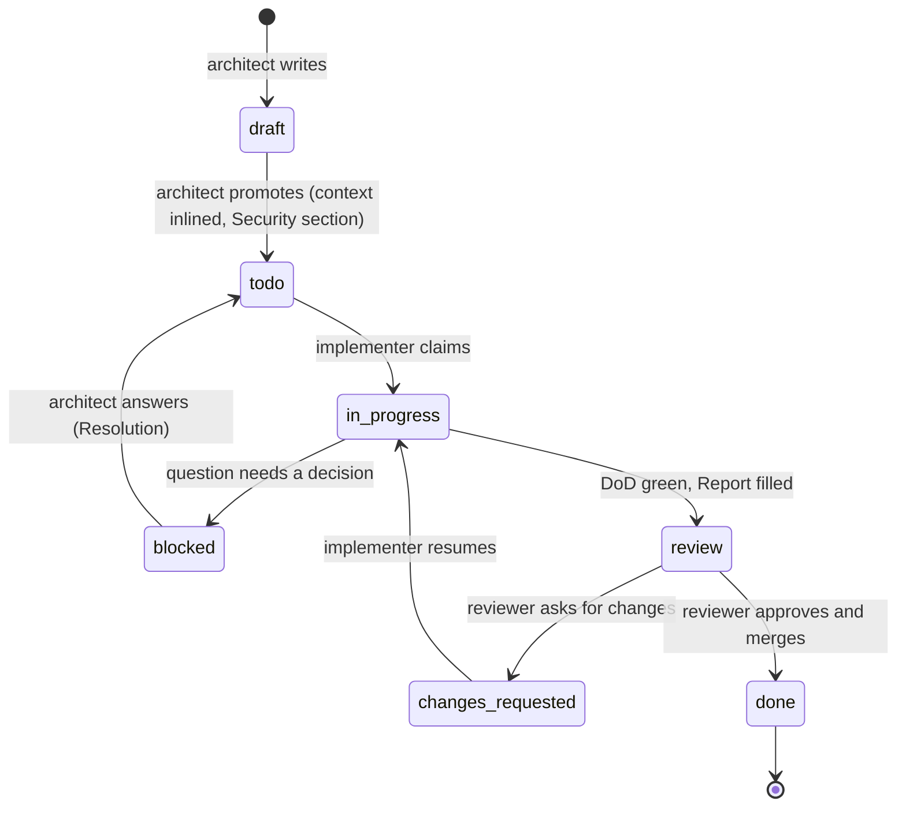

# WORKFLOW — executing tasks one by one

This is the **standard operating procedure** for every task in `tasks/**/T-*.md`. Codex follows it on every run, and so do human contributors working from a task file. **No step may be skipped.** If a step doesn't apply (for example, design reference for a backend-only task), write "n/a" for it in the Report.

`AGENTS.md` holds the engineering rules. This file holds the **process**: which task to pick, the order of steps, what to write down, when to stop and how review works.

> **Golden rules**
> 1. **One task at a time, one task per session.** WIP = 1. Finish (→ `review`) or block (→ `blocked`), then stop.
> 2. **The task file is the contract.** Build Scope → In, nothing more. If it's unclear, block. Don't guess.
> 3. **Never claim a check you didn't run.** An unticked box with a reason is fine. A false tick isn't.

*(This 12-step flow is adapted from the v0 capstone's `TASK_WORKFLOW.md`, mapped onto the v2 spec, tools and task files.)*

## 1. Roles

| Role | Who | Does |
|---|---|---|
| **Architect** | Spec author (Claude, with the maintainer) | Writes and maintains `spec/` and task files, answers `blocked` questions, promotes `draft` → `todo` |
| **Implementer** | Codex (or a human contributor) | Executes exactly one task with this workflow |
| **Reviewer / maintainer** | A human listed in `MAINTAINERS.md` | Reviews, requests changes or approves, merges, and sets `done` |

## 2. Task status lifecycle



| Status | Meaning | Who sets it |
|---|---|---|
| `draft` | Written but not ready. **Never start it** | Architect |
| `todo` | Ready to pick | Architect |
| `in_progress` | Being implemented. **At most one task in the whole repo** | Implementer |
| `blocked` | Waiting for an answer in `## Questions` | Implementer |
| `review` | Implementation finished, waiting for a human | Implementer |
| `changes_requested` | Review feedback in `## Review` needs work | Reviewer |
| `done` | Merged to `main` | Reviewer |

**Status is changed only in the task's frontmatter.** Then run `scripts/tasks-index.sh` to regenerate `tasks/INDEX.md`. Never edit `INDEX.md` by hand (CQ-15). `scripts/tasks-index.sh --check` fails on stale indexes, unknown statuses, or more than one `in_progress` task.

## 3. The loop: Step 0 + 12 steps (one session = one task)

```
┌──────────────────────────────────────────────────────────────────────────────┐
│ STEP 0  START          preflight → pick → claim (branch, in_progress)        │
├──────────────────────────────────────────────────────────────────────────────┤
│ PRE-IMPLEMENTATION                                                           │
│  1. Read the task & spec      IDs, business rules, NFR targets               │
│  2. Read dependencies         their Reports, shipped code, follow-ups        │
│  3. Read design reference     UI tasks: spec 09 tokens, states, a11y, i18n   │
│  4. Plan & test plan          files, order, AC → tests, edge & abuse cases   │
├──────────────────────────────────────────────────────────────────────────────┤
│ IMPLEMENTATION                                                               │
│  5. Implement                 scope only, layer order, tests by exact name   │
│  6. Run it locally            make dev; exercise happy + error paths         │
│  7. Debug loop                max 3 attempts per failure → then block        │
├──────────────────────────────────────────────────────────────────────────────┤
│ POST-IMPLEMENTATION                                                          │
│  8. Self code review          spec 16 §9, 17, 19 checklists                  │
│  9. Optimize (measured)       queries, N+1, indexes, bundle; no guesswork    │
│ 10. Security audit            spec 18 §8 (SBD-81) if triggers; secrets scan  │
│ 11. Revise & full verify      fix findings; rerun every check; no regression │
│ 12. Report, commit, stop      Report → status review → one signed commit     │
└──────────────────────────────────────────────────────────────────────────────┘
```

### Step 0 — Start: preflight, pick, claim

```bash
git switch main && git pull --ff-only     # if a remote is available
git status --short                        # must be empty; if not, stop and report what's there
scripts/tasks-index.sh --check            # index consistent, WIP ≤ 1
```

**Pick** the first match, in this priority order:
1. A task in `changes_requested` (rework comes before new work). Take the lowest ID.
2. The **lowest-ID** `todo` task whose `depends_on` are **all `done`**.

If nothing matches, stop and report "no ready task" with the list of blockers (`blocked`, `review`, or dependencies not done).

**Claim:**

```bash
git switch -c task/T-xxx-<short-slug>     # names: BRANCHING.md §2; for rework, switch to the existing branch instead
# set `status: in_progress` in the task frontmatter
scripts/tasks-index.sh
```

### PRE-IMPLEMENTATION

#### Step 1 — Read the task and the spec

- Read the **whole** task file: Context, Scope, Files, Interfaces, Business rules, Security, Acceptance criteria, Tests, DoD. For rework, read `## Review` first.
- Note the **spec IDs**, every **business rule** with its policy key (never a literal, POL-02), and the **constraints** (Scope → Out, size).
- Note the **non-functional targets** that apply:
  - performance: OPS-07 p95 latency, FE-02 bundle ≤ 200 KB gzip;
  - security: spec 18;
  - accessibility: WCAG 2.2 AA (TST-11);
  - i18n: `en` + `id`.
- Read `spec/` sections only when the inlined context isn't enough, and list them in the Report under **Spec read**.
- Read the cross-cutting rules: `AGENTS.md` §4, `spec/16` §12, `spec/17` §1 and §4, `spec/18` §5 (and §4 if there are triggers), `spec/19` §10.
- You must understand the task fully before writing code. If you can't, block (§4).

#### Step 2 — Read the dependencies

- Each task in `depends_on` must be `done`. For each one, read its `## Report`, especially **Deviations** and **Follow-ups**, because they may change what this task can assume.
- Look at the code those tasks shipped (`git log --oneline --grep "T-0yy"`), and confirm that the interfaces this task relies on exist and match the task file.
- **Block** if a dependency deviated in a way this task doesn't account for.

#### Step 3 — Read the design reference (UI tasks; otherwise "n/a")

- Read `spec/09-design-system.md` for the components and tokens involved. Use semantic tokens only (DS-02, CQ-65).
- Write down for each screen: its states (loading, empty, error, disabled; FE-34), the error UX (ERR-61), the i18n keys (`en` + `id`) and the `t('term.*')` terminology.
- Mobile-first: 320 px → 768 px → 1024 px+. Touch targets are at least 44 px. WCAG 2.2 AA.

#### Step 4 — Plan and test plan

Write these at the top of `## Report` **before coding** (`CLAUDE.md` §1 and §4: assumptions out loud, goals as checks):
- **Plan** (5–10 lines): the files to touch and the order of work, each step with its `→ verify:` check.
- **Assumptions:** anything the task doesn't say explicitly that you rely on. An assumption about business rules, money, security or schema is a block, not an assumption.
- **Test plan:**
  - every AC in Given/When/Then form, mapped to its exact test name;
  - **edge cases** (boundaries such as `max` and `max + 1`, empty, timezone and month-end, concurrency);
  - **error cases**, by problem code (spec 19);
  - **abuse cases** from `## Security`.

**Block now** (§4) if any of these is true:
- The task contradicts the spec, the code, or another task.
- A business value, schema detail, money rule or security control is missing or ambiguous.
- A dependency the task assumes doesn't exist, or doesn't behave as the task says.
- The work clearly exceeds size M, or needs files well outside **Files**.
- The task hits a security trigger (SBD-30) but doesn't say how it's protected.

### IMPLEMENTATION

#### Step 5 — Implement

- Work inside Scope → In. Anything else you notice goes to **Follow-ups**, not into the code (`CLAUDE.md` §2 simplicity, §3 surgical changes).
- Follow this order, so each step compiles and is tested before the next:
  1. migration;
  2. `domain/` with its unit and property tests (tests first is recommended);
  3. `repo.rs`;
  4. `service.rs` with integration tests;
  5. `http.rs` with API tests;
  6. web.
- Follow the non-negotiables while you code:
  - PII is encrypted (SEC-03), and every state change is audited in the same transaction (ARC-04/05);
  - errors use registered codes, translated in `en` + `id` (ERR-21/22);
  - no hard-coded business values (POL-02).
- Write **every** test in "Tests to write", with the **exact names** given, plus the abuse-case tests.
- Don't do these unless the task says so:
  - upgrade dependencies;
  - reformat unrelated files;
  - rename public items;
  - edit `spec/`, `brand/`, `legacy/` or other tasks.
- Commit locally after each finished subtask, so a broken step can be rolled back. These commits are squashed in Step 12.

#### Step 6 — Run it locally

Tests passing isn't the same as the feature working. Start the app and use it:

```bash
make dev-db && make dev        # server :8080, web :5173
```

- **API work:** call the new endpoints (curl or httpie) for the happy path and **at least one error path per new problem code**. Check the status, the `code` and the absence of PII in `detail` (ERR-30).
- **UI work:** walk through the flow at 390 px and at 1280 px, in light and dark, and in `en` and `id`. Trigger loading, empty and error states. Check keyboard-only navigation.
- **Jobs and events:** trigger them with time travel (`JobRunner::run_due`), or through the dev seed.
- Write what you exercised under **Manual checks** in the Report. If running locally isn't possible (for example, no Docker), say so there.

#### Step 7 — Debug loop

- When something fails: read the whole error, form **one hypothesis**, change **one thing**, and rerun.
- **At most 3 attempts per distinct failure**, and each attempt must try a different hypothesis. Rerunning without changing anything doesn't count as an attempt (and flaky tests are reported, not rerun until green).
- If you're still stuck after 3 attempts, stop and **block** (§4). In `## Report → Debug log`, record the failure, the three hypotheses and what each attempt showed.
- Loop until every test passes, or until you block.

### POST-IMPLEMENTATION

#### Step 8 — Self code review

Review your own diff (`git diff main...HEAD`) as a strict reviewer would:
- **Quality:** the `spec/16-code-quality.md` §9 checklist.
- **Architecture:** `spec/17` §7 anti-patterns. Decisions belong in `domain/`, and the module touches only its own tables.
- **Errors:** `spec/19` (registered codes, exhaustive mapping, no swallowed errors, one log at the edge).
- **Privacy (UU PDP):** collect only what the policy needs, classify every new field (SBD-10), protect children's data, respect retention.
- **Hygiene:** grep for `dbg!`, `todo!`, `unwrap()` outside tests, `#[allow`, `console.log`, a bare `TODO`, commented-out code, and hard-coded secrets.
- **Size:** `git diff main...HEAD --stat` ≤ about 400 changed lines, excluding generated files (CQ-101).
- **Surgical diff (`CLAUDE.md` §3):** every changed line traces to an AC or a listed file. Revert drive-by formatting, renames and refactors. Remove only the orphans your change created.

#### Step 9 — Optimize (only what you measured)

- **Queries:** no N+1 queries (CQ-42). Run `EXPLAIN` on each new list or lookup query against seeded data, and add indexes for the filters and joins you use. Use keyset pagination.
- **Latency:** for new endpoints on hot paths, compare against the OPS-07 targets using the API test timing or a quick `oha` run.
- **Frontend:** `pnpm -C web size` stays within FE-02. Heavy libraries load lazily on their route only.
- **No speculative caching.** v2 is Postgres-only (ADR-0002), with no Redis. Optimise only with a measurement, and record it in the Report under **Performance** (CQ-01).

#### Step 10 — Security audit

- If the task has triggers (SBD-30), walk through the **SBD-81 checklist** in `spec/18` §8 item by item. Confirm that the abuse-case tests **fail without the control**.
- For every task, regardless of triggers:
  - input is validated server-side, at the boundary (SBD-44);
  - SQL is parameterised (CQ-42), and HTML/CSV output is encoded (SBD-45/46);
  - rate limits and auth are applied on new endpoints (API-15, SBD-40);
  - no secret is in the diff (`gitleaks detect --redact` if installed; CI runs it anyway).
- Record the findings and how you fixed them under **Security** in the Report.

#### Step 11 — Revise and run the full verification

Fix every finding from Steps 8–10, then rerun **everything** to rule out regressions:

```bash
cargo fmt --all --check
cargo clippy --workspace --all-targets -- -D warnings
cargo test --workspace
pnpm -C web lint && pnpm -C web typecheck && pnpm -C web test && pnpm -C web i18n:check   # if web/ touched
scripts/check-deps.sh && scripts/check-literals.sh && scripts/check-web-boundaries.sh && scripts/check-layers.sh
make api && cargo sqlx prepare --workspace     # if the API or queries changed; commit the regenerated files
scripts/tasks-index.sh --check
```

- Scripts that don't exist yet (before T-006) are skipped. Note them in the Report.
- If a check can't run in your environment, **leave its box unticked** and say why. Never fake it.

#### Step 12 — Report, commit, stop

**Report.** Fill in `## Report` with this structure:

```markdown
## Report
**Plan** — (Step 4)
**Assumptions** — (Step 4; "none" is a valid answer)
**Test plan** — AC (Given/When/Then) → test names; edge, error and abuse cases (Step 4)
**Summary** — 2–4 sentences on what now works.
**Spec read** — sections consulted beyond the task file.
**Files** — created / modified, one line each.
**Acceptance criteria → tests**
| AC | Test | Result |
|---|---|---|
**Checks run** — each Step 11 command, with ✅, ❌ or "not run: <reason>".
**Manual checks** — what was exercised locally (Step 6).
**Debug log** — failures that needed more than one attempt, with hypotheses (Step 7). "None" if none.
**Performance** — measurements taken (Step 9), or "n/a".
**Security** — triggers (T1–T8), controls, abuse-case tests, audit findings and fixes (Step 10). "No triggers" if none.
**Deviations** — anything different from the task, and why. "None" if none.
**Dependencies affected** — later tasks whose assumptions this work changes (by id), or "none".
**Rollback plan** — how to undo this safely: revert the commit; for migrations (forward-only), the compensating migration or the reason none is needed.
**Follow-ups** — things noticed but out of scope (proposed as new tasks; never done here).
```

Tick the DoD boxes that really passed. Set `status: review`, then run `scripts/tasks-index.sh`.

**Commit.** Squash into **one commit** for the task, using `COMMIT_CONVENTION.md`:

```bash
git add -A
git commit -s -m "<type>(<scope>): <task title> [T-xxx]"
```

- Use the exact message from the task's DoD if it gives one.
- The commit contains the code, the tests, the generated files, the task file (Report and status) and `tasks/INDEX.md`.
- Push and open a PR (with the template) **only if the operator's instructions allow it.** Otherwise, leave the branch for the maintainer.

**Stop.** End the session with a short message:
- the task id and its new status;
- the branch;
- the checks that weren't run;
- the follow-ups.

**Don't start the next task in the same session.**

## 4. When blocked

1. Under `## Questions`, add one entry per question:

```markdown
- **Q1 (blocking):** <the question, one sentence>
  - Context: <what the task, spec or code says; file:line or spec ID; what you verified>
  - Options: (a) … (b) …
  - Recommendation: (a), because …
```

2. Record in `## Report` what you analysed and verified (plus the Debug log if Step 7 led here). Revert any half-done code, so the branch holds only the task file change.
3. Set `status: blocked`, then run `scripts/tasks-index.sh`.
4. Commit on the task branch: `docs(tasks): block T-xxx with questions [T-xxx]`. Stop.

**The architect answers on `main`.** That means:
- a `- **Resolved (<who>, <date>):** Q1 — …` line above the question;
- any spec or task fixes, made in the same commit (spec and tasks never drift apart);
- `status: todo`.

The commit message is `docs(tasks): resolve T-xxx questions [T-xxx]`. The implementer later starts fresh from `main`, and abandons the old branch.

## 5. Review (human)

1. Check out the branch. Run the Step 11 commands. Read the Report first, then the diff.
2. Use the checklists: `spec/16-code-quality.md` §9, plus `spec/18-security-by-design.md` §8 for PRs labelled `security-review`. Confirm that:
   - every AC maps to a passing test;
   - every unticked box has a reason;
   - the Rollback plan is credible.
3. Decide:
   - **Changes needed:** add or extend a `## Review` section at the end of the task file. Use one bullet per point, prefixed `blocking:` / `should:` / `nit:` (CQ-102). Set `status: changes_requested`, regenerate the index, and commit `docs(tasks): review feedback [T-xxx]` on the branch. The implementer resumes in a new session (Step 0, priority 1). In the rework, each point gets a reply below it: "done in <commit>" or "won't do: <reason>".
   - **Approve:** set `status: done`, regenerate the index, and **squash-merge** to `main` with the task's commit message. `main` then has exactly one commit per task, including its `done` status.
4. Delete the branch after merging.

## 6. Milestones and drafts

- Each milestone ends with its **integration task**. The next milestone's drafts aren't promoted until that integration task is `done`.
- **Promoting a draft** (architect):
  1. inline the cited spec (DDL, structs, rules);
  2. reconcile it with what earlier milestones actually shipped, including their Deviations and Follow-ups;
  3. write `## Security` if any trigger applies (SBD-31);
  4. remove the "Draft" note and set `status: todo`;
  5. run `scripts/tasks-index.sh --check`.

  The commit message is `docs(tasks): promote M<n> drafts to todo`.
- **Spec changes** go through the architect only. A spec change updates every task that cites the changed IDs, in the same commit.

## 7. Quick reference

| Situation | Commit message (`COMMIT_CONVENTION.md` §8) | Status after |
|---|---|---|
| Task done | `<type>(<scope>): <title> [T-xxx]` | `review` |
| Blocked | `docs(tasks): block T-xxx with questions [T-xxx]` | `blocked` |
| Reviewer feedback | `docs(tasks): review feedback [T-xxx]` | `changes_requested` |
| Rework done | squashed into the task commit | `review` |
| Merged | the task commit, with `done` | `done` |
| Answering a block (architect) | `docs(tasks): resolve T-xxx questions [T-xxx]` | `todo` |

## 8. Implementer checklist

**Before coding** (Steps 0–4)
- [ ] Clean tree, index check green, no other task `in_progress`; the task is claimed on its own branch
- [ ] Task read end to end; spec IDs, business rules (policy keys) and NFR targets noted
- [ ] Every dependency is `done`; its Report (Deviations, Follow-ups) was read; the interfaces exist
- [ ] Design reference read (UI): tokens, states, error UX, i18n keys, mobile-first, WCAG 2.2 AA
- [ ] Plan and test plan written in the Report (AC → tests, edge, error and abuse cases)

**While coding** (Steps 5–7)
- [ ] Only Scope → In; layer order followed; tests use the exact names
- [ ] PII encrypted, state changes audited, error codes registered and translated, no business literals
- [ ] App run locally; happy and error paths exercised (or the reason it wasn't possible recorded)
- [ ] At most 3 attempts per failure, then block, with the Debug log filled

**After coding** (Steps 8–12)
- [ ] Self-review against spec 16 §9, 17 §7 and 19; UU PDP privacy; hygiene greps; size ≤ about 400 lines
- [ ] Optimisations measured, with the numbers recorded
- [ ] Security audit done (SBD-81 if triggers); abuse-case tests fail without their control
- [ ] All findings fixed; the full verification rerun and green (or honestly marked not run)
- [ ] Report complete (including Rollback plan and Dependencies affected); `status: review`; index regenerated
- [ ] One signed commit per `COMMIT_CONVENTION.md`; session ended without starting another task
