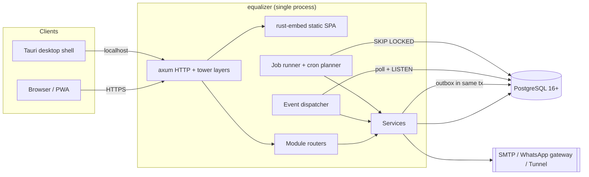

# 02 — Architecture

## 1. Shape: a modular monolith in one binary

**ARC-01.** The backend is **one Rust binary** (`equalizer`) that serves:
- the JSON API under `/api/v1`,
- the embedded SPA (static files) under `/`,
- background jobs and the event dispatcher, running in-process on tokio tasks.

There are no microservices, no Redis and no message broker. PostgreSQL is the only stateful dependency (ADR-0001, ADR-0002).



## 2. Repository layout (normative)

```
/
├── Cargo.toml                 # [workspace], shared deps + lints
├── rust-toolchain.toml        # pinned stable
├── crates/
│   ├── eq-core/               # primitives + shared infrastructure (no business features)
│   ├── eq-identity/           # always on
│   ├── eq-audit/              # always on
│   ├── eq-scheduling/         # always on
│   ├── eq-enrollment/         # feature "enrollment"
│   ├── eq-billing/            # feature "billing"
│   ├── eq-attendance/         # feature "attendance"
│   ├── eq-rental/             # feature "rental"
│   ├── eq-notify/             # feature "notify"
│   ├── eq-reports/            # feature "reports"
│   ├── eq-feedback/           # feature "feedback"
│   ├── eq-api/                # router assembly, middleware, OpenAPI, SPA serving
│   └── eq-server/             # bin "equalizer": config, migrate, serve, jobs, CLI
├── migrations/                # ONE ordered sqlx migration set for all modules (ADR-0012)
├── presets/                   # *.yaml presets, embedded at compile time
├── web/                       # React + Vite SPA (pnpm)
├── apps/desktop/              # Tauri shell (M8)
├── deploy/                    # docker, compose, 1-click templates, installer script
├── docs/                      # user and developer docs site (Starlight), M7+
├── spec/  tasks/  brand/  legacy/
└── .github/
```

**ARC-02.** Crate dependency rules. CI enforces them with `cargo-deny` bans plus a `scripts/check-deps.sh` check that parses `cargo metadata`.
- `eq-core` depends on no other `eq-*` crate.
- An always-on crate (`eq-identity`, `eq-audit`, `eq-scheduling`) may depend on `eq-core` and on lower always-on crates, in the order core → audit → identity → scheduling.
- An optional feature crate (`eq-enrollment` … `eq-feedback`) may depend on `eq-core` and on any always-on crate. Example: enrollment calls `eq_scheduling::series::add_member`.
- **Optional feature crates MUST NOT depend on each other.** Cross-module needs go through (a) domain events (ARC-07) or (b) **ports**: traits defined in `eq-core::ports` and implemented by the owning module, registered at startup (ARC-08).
- `eq-api` depends on all feature crates, behind Cargo features.
- `eq-server` depends on `eq-api`.

## 3. Crate internals (every feature crate uses the same layout)

```
crates/eq-billing/
├── Cargo.toml
└── src/
    ├── lib.rs          # pub struct BillingModule; impl Module
    ├── policy.rs       # BillingPolicy (+ JsonSchema, Default, summarize, validate)
    ├── domain/         # pure types + state machines + calculations (no IO), heavily unit-tested
    ├── repo.rs         # sqlx queries (query_as! macros, offline mode)
    ├── service.rs      # use-cases: open tx, call domain, write audit + outbox, commit
    ├── http.rs         # axum handlers + utoipa annotations + DTOs
    ├── events.rs       # event payload structs emitted/consumed
    ├── jobs.rs         # job kinds + handlers
    └── perms.rs        # permission constants
```

**ARC-03.** The `domain/` code is pure: no `sqlx`, no `axum`, no clock reads. Time comes in as a parameter (`now: Timestamp`), so the logic is deterministic and testable.

## 4. Request lifecycle

**ARC-04.** Every API request goes through these steps, in order:

1. `tower_http::request_id` (UUIDv7) → `TraceLayer` (span carries `request_id`, `tenant_id`, `actor_id`).
2. `CompressionLayer`, a security-headers layer (SEC-20), a body limit (default 1 MiB; uploads 10 MiB on file routes).
3. **Tenant resolution** (`TenantCtx` extractor): in `EQ_MODE=single`, the only tenant; in `EQ_MODE=multi`, the subdomain of `Host`. An unknown tenant returns 404.
4. **Rate limit** (`tower_governor`, per IP plus per user, SEC-11).
5. **Auth** (`Actor` extractor): verify the access JWT (IDN-03), load the membership roles, and reject frozen or deactivated actors where the route requires it.
6. **Module gate**: a router built by a module is wrapped in `ModuleGate(module_id)`. If the module is disabled for the tenant, the response is `404 problem+json type=module-disabled`.
7. **Permission check** in the handler: `actor.require(perm::billing::INVOICE_WRITE)?`.
8. The **service** opens a transaction through `core::db::begin(&pool, &tenant, &actor)`. That call runs `SET LOCAL app.tenant_id = ..., app.actor_id = ...` (RLS, SEC-05).
9. Domain logic, then the repo writes, then **`audit::record(...)` in the same tx**, then **`outbox::emit(...)` in the same tx**, then commit.
10. The handler maps the result to a DTO. Errors go to `problem+json` (API-04).

**ARC-05.** If the audit write fails, the transaction rolls back. There is no "best-effort" audit (this keeps the v0 rule).

## 5. Tenancy

**ARC-06.** Every tenant-owned table has `tenant_id uuid NOT NULL` and Postgres Row-Level Security enabled with `USING (tenant_id = current_setting('app.tenant_id')::uuid)`. The app connects as a non-superuser role `eq_app` that does not bypass RLS. The cross-tenant cloud admin uses a separate role `eq_platform` that is never used by request handlers. Single-tenant installs use the same mechanism with one row in `tenants`.

## 6. Events (inter-module communication)

**ARC-07.** Modules communicate asynchronously through **domain events** using the transactional outbox:
- `outbox(id uuidv7, tenant_id, event_type text, payload jsonb, occurred_at, dispatched_at null)`.
- Events are emitted inside the same tx as the state change (`core::outbox::emit(&mut tx, &Event)`).
- The dispatcher loop does `LISTEN eq_outbox` (a trigger on insert does `NOTIFY`) and also polls every 2 s as a fallback. It takes up to 100 rows with `FOR UPDATE SKIP LOCKED` and calls the registered handlers.
- **Handlers are idempotent.** Each handler records `(handler_id, event_id)` in `event_receipts` in its own tx and skips the event if it's already present. Failed handlers retry with backoff (1 s, 5 s, 30 s, 5 min, 30 min), then the row goes to `dead_letter` and admins are alerted (OPS-08).
- Delivery is at-least-once. Within one `(tenant, aggregate)`, order is preserved because rows are dispatched in id order and handlers for the same aggregate run sequentially.
- Event payloads are versioned: `event_type = "billing.invoice_overdue.v1"`.

The canonical event catalog is in `03-module-system.md` §6.

**ARC-08.** **Ports** are synchronous queries across modules, used only when an event is not enough (e.g. billing needs the list of active enrollments to issue invoices). A port is a trait in `eq-core::ports`, for example:

```rust
#[async_trait]
pub trait BillableSource: Send + Sync {
    /// Lines to bill for `payer` in `period`; called inside the billing tx (read-only).
    async fn billable_lines(&self, tx: &mut Tx, period: &BillingPeriod) -> Result<Vec<BillableLine>>;
}
```

Modules register implementations in a `PortRegistry` during startup. If the owning module is disabled, the registry returns an empty implementation, never an error.

## 7. Jobs and scheduled work

**ARC-09.** A Postgres-backed job queue lives in `eq-core::jobs`:
- `jobs(id, tenant_id, kind, payload jsonb, run_at, attempts, max_attempts, locked_until, last_error, dedupe_key unique nullable, status)`.
- Workers claim jobs with `UPDATE … WHERE id IN (SELECT … FOR UPDATE SKIP LOCKED LIMIT n) RETURNING`.
- **The cron planner** runs once a minute. For each tenant and each registered `CronSpec { kind, schedule (cron expr evaluated in tenant TZ), dedupe_key_fn }`, it inserts due jobs with `ON CONFLICT (dedupe_key) DO NOTHING`. Example dedupe key: `billing.issue:{tenant}:{2026-11}`. This makes month-end jobs exactly-once even if several instances run.
- Policy-driven schedules (e.g. issue invoices on day `billing.cycle.issue_day`) are planned by a **daily** cron that checks the policy for "is today the day". There is never a hard-coded day in code.

## 8. Time

**ARC-10.** All instants are stored as `timestamptz` and handled in Rust as `chrono::DateTime<Utc>`. Local-calendar logic (opening hours, "the 5th of the month", weekdays, holidays) runs in the tenant's IANA timezone via `chrono-tz`. The timezone comes from `tenants.timezone`, which a location can override. Ranges are half-open `[start, end)` and stored as `tstzrange`. **Code MUST NOT call `Utc::now()` in `domain/`.** Services get time from `core::clock::Clock`, which is mockable in tests.

## 9. Money

**ARC-11.** Use `core::money::Money { amount_minor: i64, currency: Currency }`. Arithmetic between different currencies is a compile-time-impossible API (a `Money<C>` phantom-type is NOT required; a runtime check returning `Err(CurrencyMismatch)` is sufficient). Floats are banned for money (clippy `float_arithmetic` deny in `eq-billing`). Percentages are basis points (`u32`, 10000 = 100%). Rounding is half-up to the minor unit and happens only in `core::money::apply_bps`.

## 10. Errors

**ARC-12.** Each crate has `thiserror` errors that convert into `core::error::AppError`:

```rust
pub enum AppError {
    NotFound { entity: &'static str },
    Conflict { code: &'static str, detail: String, alternatives: Option<serde_json::Value> },
    Validation { errors: Vec<FieldError> },      // 422
    Forbidden { perm: &'static str },            // 403
    Unauthenticated,                             // 401
    ModuleDisabled { module: ModuleId },         // 404
    PolicyViolation { rule: &'static str, detail: String }, // 422, rule = policy key
    RateLimited { retry_after_s: u64 },          // 429
    Internal(anyhow::Error),                     // 500, detail hidden
}
```

These map to RFC 9457 `application/problem+json` (API-04). The `code` and `rule` values are stable strings that the SPA translates.

## 11. Technology pins (versions are minimums; use the latest compatible patch)

| Concern | Choice |
|---|---|
| Language | Rust stable (edition 2024), MSRV pinned in `rust-toolchain.toml` |
| HTTP | `axum` 0.8, `tower` 0.5, `tower-http` 0.6, `tower_governor` 0.7 |
| Async | `tokio` 1 (multi-thread) |
| DB | PostgreSQL ≥ 16 with `btree_gist`, `pgcrypto`; `sqlx` 0.8 (postgres, uuid, chrono, json, migrate, offline) |
| Serialization | `serde`, `serde_json`, `serde_yaml_ng` (presets) |
| Schema | `schemars` 1.x (policy JSON Schema), `utoipa` 5 + `utoipa-axum` (OpenAPI 3.1) |
| Time | `chrono` 0.4, `chrono-tz`, `cron` (expression parsing) |
| IDs | `uuid` 1 with `v7` |
| Auth/crypto | `jsonwebtoken` 9, `argon2` 0.5, `aes-gcm` 0.10, `rand` 0.8, `sha2`, `hmac`, `zeroize` |
| Errors/logs | `thiserror` 2, `anyhow`, `tracing`, `tracing-subscriber` (json) |
| Email | `lettre` 0.11 (SMTP, rustls) |
| HTTP client | `reqwest` 0.12 (rustls) |
| Static | `rust-embed` 8, `mime_guess` |
| Images | `image` 0.25 (photo validation, resize, EXIF strip) |
| Tests | `tokio::test`, `testcontainers` + `testcontainers-modules` (postgres), `proptest`, `insta` (snapshots), `axum-test` |
| Frontend | see `08-frontend.md` |
