# 05 — Presets & the 3-Step Setup Wizard

## 1. Presets

**SET-01.** A preset is a YAML file in `presets/`, embedded into the binary with `include_str!` through a generated `presets.rs`. It is **data only**. Non-programmers can contribute presets ("swimming school") with a PR. CI validates every preset (TST-08).

**SET-02.** A preset is applied **once**, at setup step 1. The tenant stores `preset_id` and `preset_version`. Later preset updates never change an existing tenant. The only use of the stored preset after that is as the merge base when a module is enabled for the first time (MOD-06 step 4).

### 1.1 Preset file schema (normative; JSON Schema at `presets/preset.schema.json`)

```yaml
id: music_school                 # slug, unique, = filename without .yaml
version: 1                       # bump on any change
name:        { en: "Music school", id: "Sekolah musik" }
description: { en: "Weekly private & group lessons, monthly fees, teacher check-in.", id: "..." }
icon: music                      # lucide icon
order: 10                        # card order in step 1
modules: [enrollment, billing, attendance, notify, reports, feedback]   # optional modules ON by default
terminology:                     # CorePolicy.terminology.overrides
  instructor: { en: "Teacher", id: "Guru" }
policies:                        # per module: JSON Merge Patch over XPolicy::default()
  scheduling: { buffer_minutes: 10 }
catalog:                         # seeded once into the tenant catalog (editable later)
  resources:
    ask_count: true              # step 1 shows "How many rooms?" (1..50)
    default_count: 3
    name_pattern: { en: "Room {n}", id: "Ruang {n}" }
    capacity: 6
  level_tracks: []               # see music example
  offerings: []
sample: false                    # if true, wizard offers "Add sample students & schedule" (demo instance only)
```

Catalog prices in presets are `sample_price: { IDR: 42000000, USD: 6000 }`, which maps currency to minor units. If the tenant currency isn't listed, the price is seeded as `0` and the offering is flagged `price_needs_review`. The setup summary then shows "Set your prices" as the first checklist item on the dashboard.

### 1.2 Shipped presets (v1)

| id | Modules on | Highlights |
|---|---|---|
| `music_school` | enrollment, billing, attendance, notify, reports, feedback | v0 behaviour, fully parameterised |
| `dance_martial_arts` | enrollment, billing, attendance, notify, reports | Group classes (capacity 20), class passes, no instructor GPS |
| `tutoring` | enrollment, billing, attendance, notify, reports, feedback | Subjects and grades, 60/90 min sessions, small groups |
| `studio_rental` | rental, billing, notify, reports | Hourly rehearsal (auto) + recording (approval), deposits |
| `blank` | notify | Generic defaults only, everything else off |

### 1.3 `presets/music_school.yaml` (complete)

```yaml
id: music_school
version: 1
name:        { en: "Music school", id: "Sekolah musik" }
description: { en: "Weekly private & group lessons, monthly fees, teacher check-in.",
               id: "Les privat & grup mingguan, SPP bulanan, absensi guru." }
icon: music
order: 10
modules: [enrollment, billing, attendance, notify, reports, feedback]
terminology:
  instructor: { en: "Teacher", id: "Guru" }
  guardian:   { en: "Parent",  id: "Wali murid" }
  student:    { en: "Student", id: "Murid" }
  offering:   { en: "Course",  id: "Kursus" }
  session:    { en: "Lesson",  id: "Pertemuan" }
  resource:   { en: "Room",    id: "Ruang" }
policies:
  scheduling:
    opening_hours:
      - { weekday: mon, open: true,  intervals: [{ start: "14:30", end: "17:00" }] }
      - { weekday: tue, open: true,  intervals: [{ start: "14:30", end: "17:00" }] }
      - { weekday: wed, open: true,  intervals: [{ start: "14:30", end: "17:00" }] }
      - { weekday: thu, open: true,  intervals: [{ start: "14:30", end: "17:00" }] }
      - { weekday: fri, open: true,  intervals: [{ start: "14:30", end: "17:00" }] }
      - { weekday: sat, open: true,  intervals: [{ start: "08:00", end: "12:00" }] }
      - { weekday: sun, open: false, intervals: [] }
    buffer_minutes: 10
    default_durations_minutes: [30, 45]
    holidays: { on_closure: skip, when_no_slot: skip }
    recurrence:
      materialize_weeks_ahead: 6
      sessions_per_cycle: 4
      extra_occurrence: { substitute: { offering_key: theory_class, duration_minutes: 30, consumes_credit: false } }
    cancellation:
      payer_can_cancel: true
      notice_tiers: []
      staff_cancel_credit_bps: 10000
      instructor_absence: substitute_then_reschedule
      student_no_show: forfeit
      reason_required: true
  enrollment:
    registration: { public_form: true, approval: admin_approval, placement: audition,
                    collect_address: optional, collect_birth_date: required, payment_proof: optional }
    guardians: { required_under_age_years: 18, invoices_to_primary_only: true }
    age: { enforcement: block }
    leave: { enabled: true, max_days_per_year: 30, min_notice_days: 0, fee: 0,
             billing_during_leave: suspend, over_limit: end_and_require_reregistration }
    eligibility: { enabled: true, label: { en: "Exam eligibility", id: "Kelayakan ujian" },
                   min_tenure_months: 3, min_attendance_bps: 9000, max_no_shows: 1, window_months: 3 }
  billing:
    cycle: { issue_day: 5, due_day: 10 }
    grouping: per_payer
    first_cycle: prorated_by_sessions
    payment_reference: { unique_code: { digits: 3 } }
    partial_payment: { allowed: true, min_first_payment_bps: 7000 }
    late_fee: { enabled: true, kind: { flat: { amount: 10000000 } }, days_after_due: 1, once_per_invoice: true }
    overdue: { action: freeze, days_after_due: 1, unfreeze: admin_manual, skip_issuing_while_frozen: true }
    reminders_days_from_due: [-5, 0]
    payment_methods:
      - { kind: bank_transfer, enabled: true,
          instructions: { en: "Transfer to <bank> <account no.> a.n. <name>. Include your code.",
                          id: "Transfer ke <bank> <no. rekening> a.n. <nama>. Cantumkan kode unik." } }
      - { kind: cash, enabled: true, instructions: { en: "Pay at the front desk.", id: "Bayar di resepsionis." } }
  attendance:
    instructor_checkin:
      enabled: true
      window_before_start_minutes: 30
      window_after_start_minutes: 15
      gps: { enabled: true, radius_m: 150, jitter_allowance_m: 15 }
      photo: { required: true, max_bytes: 2000000, min_width: 640, min_height: 480 }
      face: { enabled: true, min_face_ratio_bps: 3000 }
      on_failed_check: pending_review
    review: { sla_minutes: 120, remind_after_minutes: 60, escalate_to_owner: true }
    student_marks: { enabled: true, marked_by: instructor, lock_after_hours: 48, late_after_minutes: 10 }
  identity:
    idle_timeout_minutes: { owner: 30, admin: 30, instructor: 30, guardian: 60, student: 60 }
    password_min_length: 8
  notify:
    routing: { critical: [email, whatsapp], standard: [whatsapp, email] }
    retry: { attempts_per_channel: 3, backoff_seconds: [10, 20, 40] }
    circuit_breaker: { failure_threshold: 5, cooldown_minutes: 30 }
    session_reminders_minutes_before: [60]
    aggregate_per_payer: true
  feedback:
    progress_notes:
      enabled: true
      publish: immediate
      categories:
        - { key: progress,       label: { en: "Progress",       id: "Kemajuan" },   scale_max: 5 }
        - { key: behaviour,      label: { en: "Behaviour",      id: "Perilaku" },   scale_max: 5 }
        - { key: attendance,     label: { en: "Attendance",     id: "Kehadiran" },  scale_max: 5 }
        - { key: recommendation, label: { en: "Recommendation", id: "Rekomendasi" }, scale_max: 0 }
    ratings: { enabled: true, min_sessions_before: 1, anonymous_to_instructor: true }
catalog:
  resources: { ask_count: true, default_count: 3, name_pattern: { en: "Room {n}", id: "Ruang {n}" }, capacity: 6 }
  level_tracks:
    - key: graded_8
      name: { en: "Graded (Pre-elementary to Grade 6)", id: "Bertingkat (Pra-elementary s/d Grade 6)" }
      levels: [pre_elementary, elementary, grade_1, grade_2, grade_3, grade_4, grade_5, grade_6]
    - key: three_step
      name: { en: "Basic / Intermediate / Advanced", id: "Dasar / Menengah / Lanjut" }
      levels: [basic, intermediate, advanced]
  offerings:
    - { key: piano_classical, kind: course, name: { en: "Classical piano", id: "Piano klasik" },
        level_track: graded_8, durations: [30, 45], capacity: { min: 1, max: 1 }, min_age_months: 42,
        price_plans: [{ key: monthly, kind: monthly, sample_price: { IDR: 48000000, USD: 6000 } },
                      { key: registration, kind: registration_fee, sample_price: { IDR: 42000000, USD: 5000 } }] }
    - { key: voice, kind: course, name: { en: "Voice", id: "Vokal" }, level_track: three_step,
        durations: [45], capacity: { min: 1, max: 4 }, min_age_months: 42,
        price_plans: [{ key: monthly, kind: monthly, sample_price: { IDR: 60000000, USD: 6000 } },
                      { key: registration, kind: registration_fee, sample_price: { IDR: 42000000, USD: 5000 } }] }
    - { key: guitar, kind: course, name: { en: "Guitar", id: "Gitar" }, level_track: three_step,
        durations: [45], capacity: { min: 1, max: 1 }, min_age_months: 84,
        price_plans: [{ key: monthly, kind: monthly, sample_price: { IDR: 42000000, USD: 5000 } },
                      { key: registration, kind: registration_fee, sample_price: { IDR: 42000000, USD: 5000 } }] }
    - { key: theory_class, kind: course, name: { en: "Theory class", id: "Kelas teori" },
        durations: [30], capacity: { min: 1, max: 6 }, internal: true, price_plans: [] }
```

`internal: true` means the offering isn't shown in the public catalog or on the registration form. It is used for substitutes.

### 1.4 Other presets (complete `policies` patches; catalog abbreviated in this doc, complete in the YAML task)

- **`dance_martial_arts`:**
  - Terminology: instructor = Coach/Pelatih, offering = Class/Kelas.
  - scheduling: Mon–Fri 15:00–21:00, Sat–Sun 08:00–14:00; buffer 0; durations [60, 90]; cancellation tiers `[]`; no_show Forfeit.
  - billing: cycle 1/7, PerPayer, late fee off, overdue Restrict, AutoOnFullPayment.
  - attendance: checkin disabled; student_marks enabled, marked by Either.
  - enrollment: placement Trial, approval Auto.
  - Catalog: "Beginner / Intermediate / Advanced / Competition" track, offerings "Ballet", "Hip-hop", "Karate" with capacity 4–20.
- **`tutoring`:**
  - Terminology: instructor = Tutor, offering = Subject/Mapel.
  - scheduling: Mon–Sat 13:00–20:00; buffer 5; durations [60, 90]; tiers [{24 h → 10000}]; no_show Forfeit.
  - billing: cycle 1/10, late fee off, overdue Restrict.
  - attendance: checkin disabled; student_marks on.
  - eligibility disabled.
  - Catalog: grade track "Grade 1…12", offerings "Mathematics", "English", "Science" with capacity 1–5.
- **`studio_rental`:**
  - Modules: rental, billing, notify, reports.
  - scheduling: Mon–Sun 09:00–21:00; buffer 15.
  - rental:
    - `booking_types`:
      - `rehearsal`: Auto, 60–240 min, step 60, notice 2 h, 14 days ahead, cancel until 24 h, 100% refund.
      - `recording`: AdminApproval, 60–720 min, step 60, notice 48 h, 30 days ahead, cancel until 72 h, 50% refund.
    - payment DepositToConfirm 3000 bps, hold 60 min.
    - who_can_book MembersAndGuests.
  - billing: late fee off, overdue Restrict.
  - Catalog: 2 resources from the pattern "Studio {n}" (capacity 8), rate cards with sample hourly prices.
- **`blank`:** no patches. Modules: notify only. Catalog: 1 resource "Room 1".

## 2. The setup wizard

**SET-10.** Route `/setup`. The SPA redirects there whenever `GET /api/v1/setup/status` returns `{ completed: false }`. On a self-hosted fresh install, `/setup` is reachable **without login** until step 1 creates the owner. After that, the setup token or the owner session is required.

**SET-11. First-run security (self-host).** On first boot with an empty `tenants` table:
- The server generates a one-time **setup token** and prints it to the log and to `RITMA_DATA_DIR/setup-token.txt`, e.g. `Open https://your-host/setup?token=XXXX`. The desktop app passes it automatically.
- Step 1 requires this token, which prevents a stranger from claiming a freshly deployed instance.
- 1-click templates can pre-seed the token through `RITMA_SETUP_TOKEN`.
- In cloud mode, setup is reached after signup, authenticated, so no token is needed.

### 2.1 State machine

```mermaid
stateDiagram-v2
  [*] --> Step1
  Step1 --> Step2: POST /setup/school (creates tenant+owner+catalog, policies v1 from preset)
  Step2 --> Step3: PUT /setup/modules
  Step2 --> Step1: back (edits committed school via PATCH /setup/school; preset locked)
  Step3 --> Done: POST /setup/complete (saves edited policies as version 2 if changed, marks setup completed)
  Step3 --> Step2: back
  Done --> [*]
```



**SET-12.** Each step commits server-side when **Next** is pressed. A browser refresh or crash resumes at `setup_state.current_step`. Step 1 is the only step that creates data. Going "back" to step 1 after it committed shows the same form bound to `PATCH /setup/school` (name, country, rooms). The preset **cannot** be changed after step 1 commits; the UI says: "To use a different template, reset setup". `POST /setup/reset` is allowed only while no sessions, enrollments or invoices exist.

### 2.2 Step 1 — Your school

Fields:

| Field | Widget | Required | Default |
|---|---|---|---|
| School name | text (2–80) | ✅ | — |
| Country | searchable select (ISO 3166) | ✅ | from browser locale |
| → Language / Currency / Timezone | 3 read-only chips with an "Edit" link that expands to selects | ✅ | derived from country |
| Template | 5 large cards (icon, name, one-line description, "Includes: Scheduling, Billing, …") | ✅ | **none pre-selected**. The user must click one (a conscious choice; the Next button stays disabled until then) |
| Number of rooms | stepper 1–50 (shown if `catalog.resources.ask_count`) | ✅ | preset `default_count` |
| Owner name, email, password (+ confirm) | only on self-host first run | ✅ | — |

`POST /api/v1/setup/school` with body `{ name, country, locale, currency, timezone, preset_id, room_count, owner?: {name, email, password}, setup_token? }` runs **one transaction**:
1. Create the tenant (`slug` from the name, unique).
2. Create the person and the owner membership.
3. Create the default location (`name` = school name, `timezone` = null meaning inherit, `geo` = null).
4. Create N resources from `name_pattern`.
5. Seed the catalog (level tracks, offerings, price plans, rate cards).
6. Write `tenant_modules` from `preset.modules`.
7. Write **policies version 1** for every module: core from the step 1 fields, and the rest as `default ⊕ preset patch`.
8. Write the audit entry `setup.school_created`.
9. Set `setup_state.current_step = 2`.

The response contains the tenant, the session tokens (self-host) and the next step.

### 2.3 Step 2 — Features

- A grid of `ModuleCard`s (icon, name, two-line description, toggle, "Always included" lock for core modules).
- Cards are prefilled from the preset. Dependency dialogs follow MOD-07.
- `PUT /api/v1/setup/modules` with `{ enabled: [...] }` has the same semantics as MOD-06. It moves the state to step 3.

### 2.4 Step 3 — Rules

- One accordion card per **enabled** module, in this order: scheduling, enrollment, billing, attendance, rental, notify, feedback, reports, identity, audit. Core is not shown, because step 1 covered it.
- Each card has three parts:
  - a **summary header** (the first 2 summary lines, always visible),
  - an **Essentials** section, open,
  - an **Advanced** section, collapsed.
- A sticky right column on desktop, or a bottom sheet on mobile, shows the full live summary of the focused module.
- Special inline helpers:
  - **attendance**: if GPS is enabled, a "Set your studio location" map pin. It writes `locations.geo` through `PATCH /api/v1/locations/{id}`, not policy.
  - **billing**: a payment instructions editor.
  - **notify**: "Connect email / WhatsApp", which links to Settings → Channels and opens in a drawer. It is optional and can be skipped.
- **Finish** calls `POST /api/v1/setup/complete` with `{ policies: { <module>: document, ... } }`. Only the modules whose document differs from version 1 are written, as version 2 with `effective_from = now`. Then the server sets `tenants.setup_completed_at` and redirects to `/dashboard?welcome=1`.

**SET-13. Next → Next → Finish always works.** The preset values must validate (TST-08). No field in Essentials may be required without a default. GPS without a pin is allowed (ATT-03 skip rule). Channels without credentials are allowed (notify falls back to in-app only and shows a dashboard checklist item).

### 2.5 Post-setup checklist (dashboard widget)

Generated from the state, not stored. Each item links to the right screen and disappears once done:
1. Set your prices (if any offering has `price_needs_review`).
2. Add your instructors.
3. Add your first students / enable the public registration link.
4. Connect email / WhatsApp.
5. Set the studio location pin (if GPS check-in is on).
6. Add holidays/closures for this year.
7. Invite an admin.

## 3. Setup API summary

| Method | Path | Auth | Purpose |
|---|---|---|---|
| GET | `/api/v1/setup/status` | none | `{completed, current_step, needs_token, tenant?: {name, preset_id}}` |
| GET | `/api/v1/setup/presets` | none (token if self-host first run) | Preset cards: `[{id, name, description, icon, modules}]` |
| GET | `/api/v1/setup/countries` | none | `[{code, name, locale, currency, timezone}]` |
| POST | `/api/v1/setup/school` | setup token (self-host) / owner (cloud) | Step 1 |
| PATCH | `/api/v1/setup/school` | owner | Edit name, country-derived fields, rooms (before completion) |
| PUT | `/api/v1/setup/modules` | owner | Step 2 |
| GET | `/api/v1/setup/rules` | owner | Same as GET /settings/policies but for the wizard |
| POST | `/api/v1/setup/complete` | owner | Step 3 |
| POST | `/api/v1/setup/reset` | owner | Only if no operational data |
