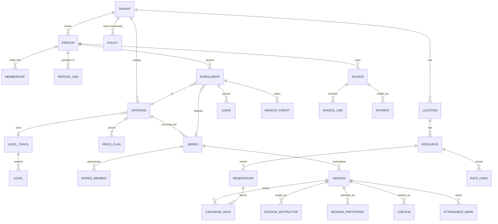
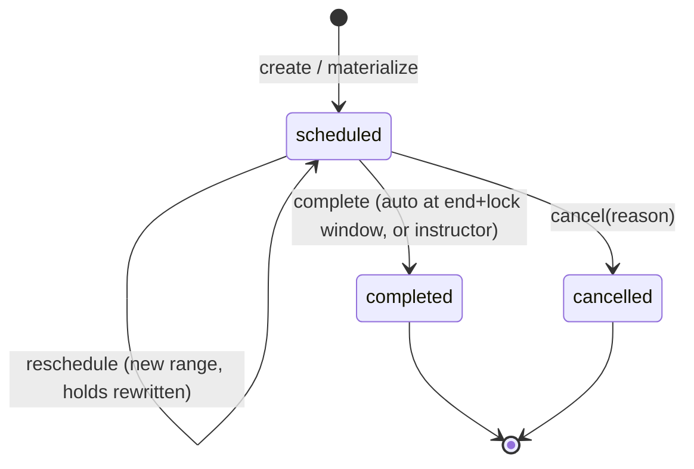
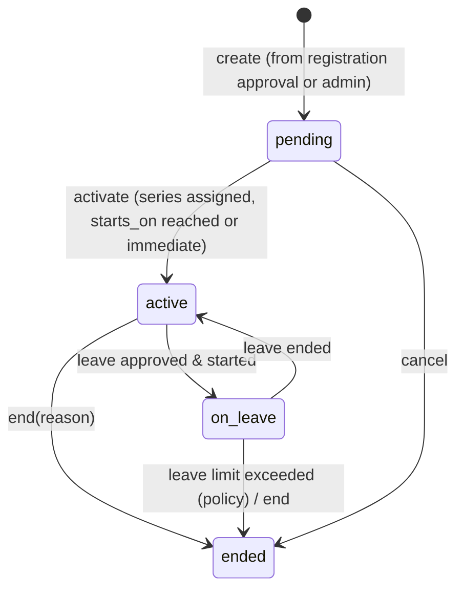
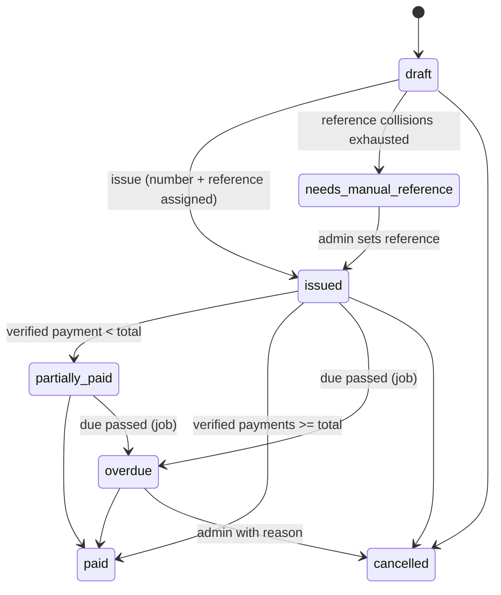
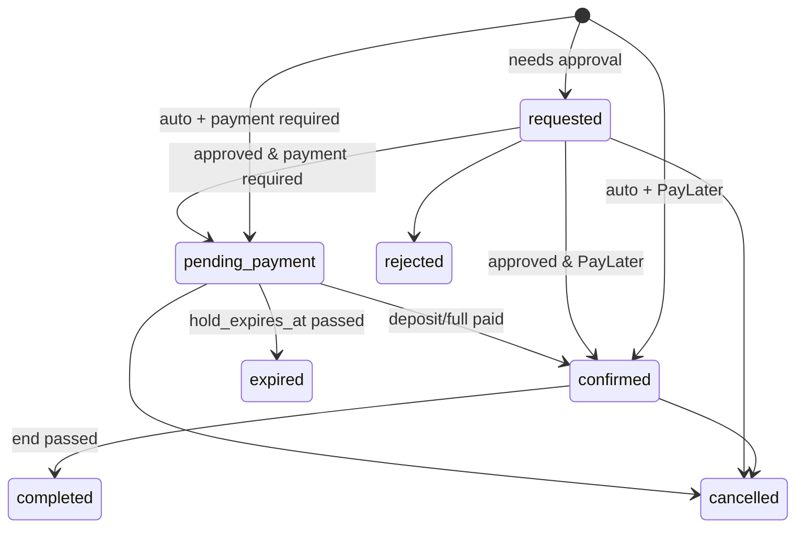

# 06 — Domain Model & Database

## 1. Conventions

**DOM-01.** These conventions apply to every table:
- Primary keys are `uuid`, generated in Rust as **UUIDv7** (time-ordered). There are no serial keys except `audit.entries.seq`.
- Every tenant-owned table has `tenant_id uuid NOT NULL`, RLS enabled and forced, and the policy `tenant_isolation` (SEC-05). Composite FKs include `tenant_id` where cheap.
- Timestamps are `timestamptz`. Local calendar dates (birth date, leave ranges, closures) are `date` / `daterange`.
- Money is `bigint` minor units plus a `currency char(3)` column on the aggregate root (invoice, rate card, price plan).
- Enums are `text` columns with `CHECK (col IN (...))`, not PG enums, so migrations stay easy. Rust maps them with `#[derive(sqlx::Type)] #[sqlx(type_name="text", rename_all="snake_case")]`.
- I18n display text is `jsonb` `{ "en": "...", "id": "..." }` (type `I18nText`).
- Soft delete applies only to PII-bearing roots (`persons`, `files`), via `deleted_at`. Operational records are never deleted, only moved to terminal states.
- FKs from operational records to persons use `ON DELETE RESTRICT`.
- Optimistic concurrency: mutable aggregates have a `version int NOT NULL DEFAULT 1`. Updates use `WHERE id=$1 AND version=$2` and increment `version`. API writes require `If-Match` (API-07).

## 2. Entity map



## 3. The conflict ledger (the core guarantee)

**DOM-10.** Double booking is prevented by **one table and one constraint**. No application-level check can be the last line of defence.

```sql
CREATE EXTENSION IF NOT EXISTS btree_gist;

CREATE TABLE calendar_holds (
  id            uuid PRIMARY KEY,
  tenant_id     uuid NOT NULL REFERENCES tenants(id),
  subject_kind  text NOT NULL CHECK (subject_kind IN ('resource','person')),
  subject_id    uuid NOT NULL,                -- resources.id or persons.id
  hold_range    tstzrange NOT NULL CHECK (NOT isempty(hold_range) AND lower_inc(hold_range) AND NOT upper_inc(hold_range)),
  owner_kind    text NOT NULL CHECK (owner_kind IN ('session','reservation')),
  owner_id      uuid NOT NULL,
  created_at    timestamptz NOT NULL DEFAULT now(),
  CONSTRAINT calendar_holds_no_overlap
    EXCLUDE USING gist (tenant_id WITH =, subject_kind WITH =, subject_id WITH =, hold_range WITH &&)
);
CREATE INDEX calendar_holds_owner ON calendar_holds (owner_kind, owner_id);
```

Hold rules (normative, implemented in `eq-core::calendar`):

| Owner | Holds written | `hold_range` |
|---|---|---|
| Session | 1 for the resource | `[starts_at, ends_at + buffer)` |
| | 1 per instructor | `[starts_at, ends_at + buffer)` |
| | 1 per participant | `[starts_at, ends_at)` (no buffer for students) |
| Reservation (requested / pending_payment / confirmed) | 1 for the resource | `[starts_at, ends_at + buffer)` |
| | 1 for the booker person | `[starts_at, ends_at)` |

- `buffer` = `scheduling.buffer_minutes` in force at `starts_at`, **snapshotted** on the session/reservation row (`buffer_minutes`).
- Cancelling, expiring or rejecting deletes the owner's holds in the same tx. Completed sessions keep their holds (history).
- Rescheduling deletes and rewrites the holds in one tx.
- A participant marked `blocked` (freeze) keeps the hold, so the slot is retained.
- The insert error SQLSTATE `23P01` (exclusion_violation) maps to `AppError::Conflict { code: "slot_taken", ... }`. The conflicting subject is identified by re-querying overlaps, so the message can say "Room 2 is taken" or "Teacher Ayu is busy".

**DOM-11.** Pre-checks such as alternative suggestions and the live "is this free?" UI are **advisory** and read the same table. The exclusion constraint is the authority (PRD-12).

**DOM-12.** Opening hours and closures are validated in the service, because they are policy, not structural. Staff with the permission `scheduling.session.override_hours` may book outside opening hours, but never through a conflict.

## 4. Full DDL

The DDL below is normative. Migrations MUST produce exactly this schema; column order may differ. Each migration file is named `NNNN_<module>_<desc>.sql` (ADR-0012). RLS boilerplate for every tenant table, shown once:

```sql
ALTER TABLE <t> ENABLE ROW LEVEL SECURITY;
ALTER TABLE <t> FORCE ROW LEVEL SECURITY;
CREATE POLICY tenant_isolation ON <t>
  USING (tenant_id = current_setting('app.tenant_id', true)::uuid)
  WITH CHECK (tenant_id = current_setting('app.tenant_id', true)::uuid);
```

### 4.1 core

```sql
CREATE TABLE tenants (
  id                  uuid PRIMARY KEY,
  slug                text NOT NULL UNIQUE CHECK (slug ~ '^[a-z0-9](-?[a-z0-9])*$' AND length(slug) BETWEEN 3 AND 40),
  name                text NOT NULL CHECK (length(name) BETWEEN 2 AND 80),
  country             char(2) NOT NULL,
  preset_id           text NOT NULL,
  preset_version      int  NOT NULL,
  setup_step          int  NOT NULL DEFAULT 1 CHECK (setup_step BETWEEN 1 AND 4),  -- 4 = done
  setup_completed_at  timestamptz,
  status              text NOT NULL DEFAULT 'active' CHECK (status IN ('active','suspended','closed')),
  locale              text NOT NULL DEFAULT 'en',      -- denormalised from CorePolicy (kept in sync on policy save)
  currency            char(3) NOT NULL DEFAULT 'USD',  -- denormalised from CorePolicy
  timezone            text NOT NULL DEFAULT 'UTC',     -- denormalised from CorePolicy
  created_at          timestamptz NOT NULL DEFAULT now()
);
-- tenants has NO RLS (read by tenant resolver as eq_app via SECURITY DEFINER fn resolve_tenant(slug))

CREATE TABLE locations (
  id          uuid PRIMARY KEY,
  tenant_id   uuid NOT NULL REFERENCES tenants(id),
  name        text NOT NULL,
  address     text,
  timezone    text,                               -- NULL = tenant timezone
  geo_lat     double precision CHECK (geo_lat BETWEEN -90 AND 90),
  geo_lng     double precision CHECK (geo_lng BETWEEN -180 AND 180),
  archived_at timestamptz,
  created_at  timestamptz NOT NULL DEFAULT now(),
  CHECK ((geo_lat IS NULL) = (geo_lng IS NULL))
);

CREATE TABLE resources (
  id                  uuid PRIMARY KEY,
  tenant_id           uuid NOT NULL REFERENCES tenants(id),
  location_id         uuid NOT NULL REFERENCES locations(id),
  name                text NOT NULL,
  kind                text NOT NULL DEFAULT 'room' CHECK (kind IN ('room','equipment','other')),
  capacity            int  NOT NULL DEFAULT 1 CHECK (capacity BETWEEN 1 AND 500),
  rentable            boolean NOT NULL DEFAULT false,
  color               text,
  sort                int NOT NULL DEFAULT 0,
  archived_at         timestamptz,
  created_at          timestamptz NOT NULL DEFAULT now(),
  UNIQUE (tenant_id, name)
);

CREATE TABLE persons (
  id              uuid PRIMARY KEY,
  tenant_id       uuid NOT NULL REFERENCES tenants(id),
  display_name    text NOT NULL CHECK (length(display_name) BETWEEN 1 AND 80),  -- plaintext by design (SEC-04)
  legal_name_enc  bytea,                           -- AES-256-GCM envelope (SEC-03)
  email_enc       bytea,
  email_bidx      bytea,                           -- HMAC-SHA256 blind index of normalized email
  phone_enc       bytea,
  phone_bidx      bytea,                           -- of E.164 phone
  birth_date_enc  bytea,
  address_enc     bytea,
  locale          text,                            -- NULL = tenant locale
  avatar_file_id  uuid,
  anonymized_at   timestamptz,
  deleted_at      timestamptz,
  created_at      timestamptz NOT NULL DEFAULT now(),
  updated_at      timestamptz NOT NULL DEFAULT now(),
  version         int NOT NULL DEFAULT 1
);
CREATE UNIQUE INDEX persons_email_unique ON persons (tenant_id, email_bidx) WHERE email_bidx IS NOT NULL AND deleted_at IS NULL;
CREATE INDEX persons_phone ON persons (tenant_id, phone_bidx);
CREATE INDEX persons_name_trgm ON persons USING gin (display_name gin_trgm_ops);   -- needs pg_trgm

CREATE TABLE memberships (
  tenant_id   uuid NOT NULL REFERENCES tenants(id),
  person_id   uuid NOT NULL REFERENCES persons(id),
  role        text NOT NULL CHECK (role IN ('owner','admin','instructor','guardian','student')),
  status      text NOT NULL DEFAULT 'active' CHECK (status IN ('invited','active','deactivated')),
  created_at  timestamptz NOT NULL DEFAULT now(),
  PRIMARY KEY (tenant_id, person_id, role)
);

CREATE TABLE person_links (                       -- guardian ↔ student (1:N, plus secondary guardians)
  tenant_id     uuid NOT NULL REFERENCES tenants(id),
  guardian_id   uuid NOT NULL REFERENCES persons(id),
  student_id    uuid NOT NULL REFERENCES persons(id),
  relationship  text,
  is_primary    boolean NOT NULL DEFAULT true,
  created_at    timestamptz NOT NULL DEFAULT now(),
  PRIMARY KEY (tenant_id, guardian_id, student_id),
  CHECK (guardian_id <> student_id)
);
CREATE UNIQUE INDEX person_links_one_primary ON person_links (tenant_id, student_id) WHERE is_primary;

CREATE TABLE tenant_modules (
  tenant_id   uuid NOT NULL REFERENCES tenants(id),
  module_id   text NOT NULL,
  enabled     boolean NOT NULL,
  changed_at  timestamptz NOT NULL DEFAULT now(),
  changed_by  uuid REFERENCES persons(id),
  PRIMARY KEY (tenant_id, module_id)
);

-- policies: see 04 §2

CREATE TABLE closures (
  id              uuid PRIMARY KEY,
  tenant_id       uuid NOT NULL REFERENCES tenants(id),
  location_id     uuid REFERENCES locations(id),    -- NULL = all locations
  dates           daterange NOT NULL CHECK (NOT isempty(dates)),
  name            jsonb NOT NULL,                   -- I18nText
  kind            text NOT NULL DEFAULT 'holiday' CHECK (kind IN ('holiday','closure')),
  created_at      timestamptz NOT NULL DEFAULT now()
);
CREATE INDEX closures_dates ON closures USING gist (tenant_id, dates);

-- calendar_holds: see §3

CREATE TABLE files (
  id            uuid PRIMARY KEY,
  tenant_id     uuid NOT NULL REFERENCES tenants(id),
  purpose       text NOT NULL CHECK (purpose IN ('avatar','checkin_photo','payment_proof','registration_doc','export','import','logo')),
  content_type  text NOT NULL,
  size_bytes    bigint NOT NULL,
  sha256        bytea NOT NULL,
  storage_key   text NOT NULL,                      -- path under EQ_DATA_DIR/files or S3 key
  encrypted     boolean NOT NULL,
  created_by    uuid REFERENCES persons(id),
  created_at    timestamptz NOT NULL DEFAULT now(),
  deleted_at    timestamptz
);

CREATE TABLE drafts (
  id          uuid PRIMARY KEY,
  tenant_id   uuid NOT NULL REFERENCES tenants(id),
  person_id   uuid NOT NULL REFERENCES persons(id),
  form_key    text NOT NULL,                        -- e.g. "scheduling.session.new"
  payload     jsonb NOT NULL,
  updated_at  timestamptz NOT NULL DEFAULT now(),
  UNIQUE (tenant_id, person_id, form_key)
);

CREATE TABLE outbox (
  id             uuid PRIMARY KEY,
  tenant_id      uuid NOT NULL,
  event_type     text NOT NULL,
  aggregate_id   uuid,
  payload        jsonb NOT NULL,
  occurred_at    timestamptz NOT NULL,
  dispatched_at  timestamptz,
  attempts       int NOT NULL DEFAULT 0,
  last_error     text
);
CREATE INDEX outbox_pending ON outbox (id) WHERE dispatched_at IS NULL;

CREATE TABLE event_receipts (handler_id text NOT NULL, event_id uuid NOT NULL, processed_at timestamptz NOT NULL DEFAULT now(), PRIMARY KEY (handler_id, event_id));

CREATE TABLE jobs (
  id             uuid PRIMARY KEY,
  tenant_id      uuid,                              -- NULL = platform job
  kind           text NOT NULL,
  payload        jsonb NOT NULL DEFAULT '{}',
  run_at         timestamptz NOT NULL,
  status         text NOT NULL DEFAULT 'queued' CHECK (status IN ('queued','running','done','failed','dead')),
  attempts       int NOT NULL DEFAULT 0,
  max_attempts   int NOT NULL DEFAULT 5,
  locked_until   timestamptz,
  last_error     text,
  dedupe_key     text UNIQUE,
  created_at     timestamptz NOT NULL DEFAULT now(),
  finished_at    timestamptz
);
CREATE INDEX jobs_ready ON jobs (run_at) WHERE status = 'queued';
```

Note: `outbox`, `event_receipts` and `jobs` are system tables, **without RLS**, accessed only by the dispatcher/runner. They set `app.tenant_id` per job before running handler code.

### 4.2 identity

```sql
CREATE TABLE credentials (
  person_id            uuid PRIMARY KEY REFERENCES persons(id),
  tenant_id            uuid NOT NULL REFERENCES tenants(id),
  password_hash        text,                      -- argon2id PHC string; NULL until invite accepted
  password_changed_at  timestamptz,
  totp_secret_enc      bytea,
  totp_enabled         boolean NOT NULL DEFAULT false,
  failed_count         int NOT NULL DEFAULT 0,
  failed_window_start  timestamptz,
  locked_until         timestamptz
);

CREATE TABLE refresh_sessions (
  id            uuid PRIMARY KEY,
  tenant_id     uuid NOT NULL REFERENCES tenants(id),
  person_id     uuid NOT NULL REFERENCES persons(id),
  family_id     uuid NOT NULL,                    -- rotation family (reuse detection, IDN-04)
  token_hash    bytea NOT NULL UNIQUE,            -- sha256 of opaque token
  active_role   text NOT NULL,
  created_at    timestamptz NOT NULL DEFAULT now(),
  last_used_at  timestamptz NOT NULL DEFAULT now(),
  idle_expires_at     timestamptz NOT NULL,
  absolute_expires_at timestamptz NOT NULL,
  revoked_at    timestamptz,
  user_agent    text,
  ip            inet
);

CREATE TABLE invites (
  id           uuid PRIMARY KEY,
  tenant_id    uuid NOT NULL REFERENCES tenants(id),
  person_id    uuid NOT NULL REFERENCES persons(id),
  role         text NOT NULL,
  token_hash   bytea NOT NULL UNIQUE,
  expires_at   timestamptz NOT NULL,
  accepted_at  timestamptz,
  created_by   uuid REFERENCES persons(id),
  created_at   timestamptz NOT NULL DEFAULT now()
);

CREATE TABLE password_resets (
  id          uuid PRIMARY KEY,
  tenant_id   uuid NOT NULL REFERENCES tenants(id),
  person_id   uuid NOT NULL REFERENCES persons(id),
  token_hash  bytea NOT NULL UNIQUE,
  expires_at  timestamptz NOT NULL,
  used_at     timestamptz,
  created_at  timestamptz NOT NULL DEFAULT now()
);
```

### 4.3 scheduling (catalog + sessions)

```sql
CREATE TABLE level_tracks (id uuid PRIMARY KEY, tenant_id uuid NOT NULL REFERENCES tenants(id), key text NOT NULL, name jsonb NOT NULL, UNIQUE (tenant_id, key));
CREATE TABLE levels (
  id uuid PRIMARY KEY, tenant_id uuid NOT NULL REFERENCES tenants(id),
  track_id uuid NOT NULL REFERENCES level_tracks(id), key text NOT NULL, name jsonb NOT NULL, ordinal int NOT NULL,
  UNIQUE (track_id, key), UNIQUE (track_id, ordinal)
);

CREATE TABLE offerings (
  id                  uuid PRIMARY KEY,
  tenant_id           uuid NOT NULL REFERENCES tenants(id),
  key                 text NOT NULL CHECK (key ~ '^[a-z0-9_]{2,40}$'),
  name                jsonb NOT NULL,
  description         jsonb,
  level_track_id      uuid REFERENCES level_tracks(id),
  durations_minutes   int[] NOT NULL CHECK (cardinality(durations_minutes) BETWEEN 1 AND 8),
  capacity_min        int NOT NULL DEFAULT 1 CHECK (capacity_min >= 1),
  capacity_max        int NOT NULL DEFAULT 1 CHECK (capacity_max >= capacity_min),
  min_age_months      int CHECK (min_age_months >= 0),
  max_age_months      int CHECK (max_age_months >= 0),
  internal            boolean NOT NULL DEFAULT false,
  price_needs_review  boolean NOT NULL DEFAULT false,
  color               text,
  archived_at         timestamptz,
  created_at          timestamptz NOT NULL DEFAULT now(),
  version             int NOT NULL DEFAULT 1,
  UNIQUE (tenant_id, key)
);

CREATE TABLE price_plans (
  id                 uuid PRIMARY KEY,
  tenant_id          uuid NOT NULL REFERENCES tenants(id),
  offering_id        uuid NOT NULL REFERENCES offerings(id),
  level_id           uuid REFERENCES levels(id),          -- NULL = all levels; specific level overrides
  key                text NOT NULL,
  kind               text NOT NULL CHECK (kind IN ('monthly','per_session','registration_fee','package')),
  amount_minor       bigint NOT NULL CHECK (amount_minor >= 0),
  currency           char(3) NOT NULL,
  sessions_included  int,                                 -- for 'package'
  effective_from     date NOT NULL,
  archived_at        timestamptz,
  created_at         timestamptz NOT NULL DEFAULT now(),
  UNIQUE (offering_id, level_id, key, effective_from)
);

CREATE TABLE series (                                     -- a recurring weekly slot ("Voice group, Tue 15:00, Room 2, Ayu")
  id                uuid PRIMARY KEY,
  tenant_id         uuid NOT NULL REFERENCES tenants(id),
  offering_id       uuid NOT NULL REFERENCES offerings(id),
  location_id       uuid NOT NULL REFERENCES locations(id),
  resource_id       uuid NOT NULL REFERENCES resources(id),
  instructor_id     uuid NOT NULL REFERENCES persons(id),
  weekday           text NOT NULL CHECK (weekday IN ('mon','tue','wed','thu','fri','sat','sun')),
  start_local       time NOT NULL,
  duration_minutes  int NOT NULL CHECK (duration_minutes BETWEEN 10 AND 480),
  capacity          int NOT NULL CHECK (capacity >= 1),
  valid_from        date NOT NULL,
  valid_to          date,                                  -- NULL = open-ended
  materialized_until date,                                 -- last date sessions were generated for
  status            text NOT NULL DEFAULT 'active' CHECK (status IN ('active','ended')),
  created_at        timestamptz NOT NULL DEFAULT now(),
  version           int NOT NULL DEFAULT 1
);

CREATE TABLE series_members (
  tenant_id      uuid NOT NULL REFERENCES tenants(id),
  series_id      uuid NOT NULL REFERENCES series(id),
  person_id      uuid NOT NULL REFERENCES persons(id),
  enrollment_id  uuid,                                     -- set by enrollment module
  active_from    date NOT NULL,
  active_to      date,
  PRIMARY KEY (series_id, person_id, active_from)
);

CREATE TABLE sessions (
  id                 uuid PRIMARY KEY,
  tenant_id          uuid NOT NULL REFERENCES tenants(id),
  offering_id        uuid NOT NULL REFERENCES offerings(id),
  series_id          uuid REFERENCES series(id),
  occurrence_date    date,                                 -- local date of the series occurrence (dedupe)
  location_id        uuid NOT NULL REFERENCES locations(id),
  resource_id        uuid NOT NULL REFERENCES resources(id),
  time_range         tstzrange NOT NULL CHECK (lower_inc(time_range) AND NOT upper_inc(time_range)),
  buffer_minutes     int NOT NULL,                         -- snapshot of policy (DOM-10)
  kind               text NOT NULL DEFAULT 'regular' CHECK (kind IN ('regular','substitute','makeup','trial','one_off')),
  consumes_credit    boolean NOT NULL DEFAULT true,
  status             text NOT NULL DEFAULT 'scheduled' CHECK (status IN ('scheduled','completed','cancelled')),
  cancelled_reason   text,
  cancelled_by       uuid REFERENCES persons(id),
  cancelled_by_role  text,
  cancelled_at       timestamptz,
  rescheduled_from   uuid REFERENCES sessions(id),
  notes              text,
  created_by         uuid REFERENCES persons(id),
  created_at         timestamptz NOT NULL DEFAULT now(),
  updated_at         timestamptz NOT NULL DEFAULT now(),
  version            int NOT NULL DEFAULT 1
);
CREATE UNIQUE INDEX sessions_series_occurrence ON sessions (series_id, occurrence_date) WHERE series_id IS NOT NULL AND status <> 'cancelled';
CREATE INDEX sessions_time ON sessions USING gist (tenant_id, time_range);

CREATE TABLE session_instructors (
  tenant_id   uuid NOT NULL REFERENCES tenants(id),
  session_id  uuid NOT NULL REFERENCES sessions(id),
  person_id   uuid NOT NULL REFERENCES persons(id),
  role        text NOT NULL DEFAULT 'primary' CHECK (role IN ('primary','assistant','substitute')),
  PRIMARY KEY (session_id, person_id)
);

CREATE TABLE session_participants (
  tenant_id      uuid NOT NULL REFERENCES tenants(id),
  session_id     uuid NOT NULL REFERENCES sessions(id),
  person_id      uuid NOT NULL REFERENCES persons(id),
  enrollment_id  uuid,
  status         text NOT NULL DEFAULT 'expected' CHECK (status IN ('expected','blocked','cancelled')),
  cancelled_at   timestamptz,
  credit_bps     int,                                     -- make-up credit granted on cancellation (0..10000)
  PRIMARY KEY (session_id, person_id)
);
```

### 4.4 enrollment

```sql
CREATE TABLE registrations (
  id                     uuid PRIMARY KEY,
  tenant_id              uuid NOT NULL REFERENCES tenants(id),
  status                 text NOT NULL DEFAULT 'pending' CHECK (status IN ('pending','approved','rejected','withdrawn')),
  applicant_enc          bytea NOT NULL,                  -- encrypted JSON: contact + students[] (ENR-03)
  applicant_display      text NOT NULL,                   -- display name for lists
  offering_ids           uuid[] NOT NULL,
  preferred_slots        jsonb,                           -- [{weekday, from, to}]
  payment_proof_file_id  uuid REFERENCES files(id),
  consent_at             timestamptz NOT NULL,
  source                 text NOT NULL DEFAULT 'public_form' CHECK (source IN ('public_form','admin','import')),
  reviewed_by            uuid REFERENCES persons(id),
  reviewed_at            timestamptz,
  review_note            text,
  created_at             timestamptz NOT NULL DEFAULT now()
);

CREATE TABLE enrollments (
  id              uuid PRIMARY KEY,
  tenant_id       uuid NOT NULL REFERENCES tenants(id),
  student_id      uuid NOT NULL REFERENCES persons(id),
  payer_id        uuid NOT NULL REFERENCES persons(id),
  offering_id     uuid NOT NULL REFERENCES offerings(id),
  level_id        uuid REFERENCES levels(id),
  price_plan_id   uuid REFERENCES price_plans(id),
  series_id       uuid REFERENCES series(id),
  status          text NOT NULL DEFAULT 'pending' CHECK (status IN ('pending','active','on_leave','ended')),
  starts_on       date NOT NULL,
  ended_on        date,
  ended_reason    text CHECK (ended_reason IN ('student_left','leave_limit','admin','reregistered','deceased_or_other')),
  leave_terms     jsonb NOT NULL,                         -- snapshot of LeaveRules (POL-05)
  registration_id uuid REFERENCES registrations(id),
  created_at      timestamptz NOT NULL DEFAULT now(),
  version         int NOT NULL DEFAULT 1
);
CREATE INDEX enrollments_payer ON enrollments (tenant_id, payer_id) WHERE status IN ('active','on_leave');

CREATE TABLE leaves (
  id             uuid PRIMARY KEY,
  tenant_id      uuid NOT NULL REFERENCES tenants(id),
  enrollment_id  uuid NOT NULL REFERENCES enrollments(id),
  dates          daterange NOT NULL,
  status         text NOT NULL DEFAULT 'requested' CHECK (status IN ('requested','approved','rejected','cancelled')),
  fee_minor      bigint NOT NULL DEFAULT 0,
  reason         text,
  requested_by   uuid NOT NULL REFERENCES persons(id),
  decided_by     uuid REFERENCES persons(id),
  decided_at     timestamptz,
  created_at     timestamptz NOT NULL DEFAULT now(),
  EXCLUDE USING gist (enrollment_id WITH =, dates WITH &&) WHERE (status IN ('requested','approved'))
);

CREATE TABLE makeup_credits (
  id                 uuid PRIMARY KEY,
  tenant_id          uuid NOT NULL REFERENCES tenants(id),
  enrollment_id      uuid NOT NULL REFERENCES enrollments(id),
  source_session_id  uuid NOT NULL REFERENCES sessions(id),
  credit_bps         int NOT NULL CHECK (credit_bps BETWEEN 1 AND 10000),
  status             text NOT NULL DEFAULT 'available' CHECK (status IN ('available','used','expired','void')),
  expires_on         date NOT NULL,
  used_session_id    uuid REFERENCES sessions(id),
  created_at         timestamptz NOT NULL DEFAULT now(),
  UNIQUE (enrollment_id, source_session_id)
);
```

### 4.5 billing

```sql
CREATE TABLE invoices (
  id                   uuid PRIMARY KEY,
  tenant_id            uuid NOT NULL REFERENCES tenants(id),
  number               text NOT NULL,
  payer_id             uuid NOT NULL REFERENCES persons(id),
  source               text NOT NULL CHECK (source IN ('cycle','rental','manual','enrollment')),
  period_key           text,                               -- e.g. "2026-11" for cycle invoices
  currency             char(3) NOT NULL,
  subtotal_minor       bigint NOT NULL,
  tax_minor            bigint NOT NULL DEFAULT 0,
  late_fee_minor       bigint NOT NULL DEFAULT 0,
  unique_amount_minor  bigint NOT NULL DEFAULT 0,          -- PaymentReference::UniqueAmount
  total_minor          bigint NOT NULL,
  paid_minor           bigint NOT NULL DEFAULT 0,
  status               text NOT NULL CHECK (status IN ('draft','issued','partially_paid','paid','overdue','cancelled','needs_manual_reference')),
  reference_code       text,                               -- PaymentReference::UniqueCode
  issued_at            timestamptz,
  due_at               timestamptz,
  terms                jsonb NOT NULL,                     -- snapshot {late_fee, overdue, partial_payment, payment_reference}
  late_fee_applied_at  timestamptz,
  cancelled_reason     text,
  created_at           timestamptz NOT NULL DEFAULT now(),
  version              int NOT NULL DEFAULT 1,
  UNIQUE (tenant_id, number),
  CHECK (total_minor = subtotal_minor + tax_minor + late_fee_minor + unique_amount_minor)
);
CREATE UNIQUE INDEX invoices_cycle_once ON invoices (tenant_id, payer_id, period_key) WHERE source = 'cycle' AND status <> 'cancelled';
CREATE UNIQUE INDEX invoices_open_reference ON invoices (tenant_id, reference_code) WHERE reference_code IS NOT NULL AND status IN ('issued','partially_paid','overdue');
CREATE UNIQUE INDEX invoices_open_unique_amount ON invoices (tenant_id, total_minor) WHERE unique_amount_minor > 0 AND status IN ('issued','partially_paid','overdue');

CREATE TABLE invoice_lines (
  id              uuid PRIMARY KEY,
  tenant_id       uuid NOT NULL REFERENCES tenants(id),
  invoice_id      uuid NOT NULL REFERENCES invoices(id),
  kind            text NOT NULL CHECK (kind IN ('tuition','registration_fee','rental','deposit','late_fee','leave_fee','adjustment','credit')),
  description     jsonb NOT NULL,                          -- I18nText rendered at issue time
  student_id      uuid REFERENCES persons(id),
  enrollment_id   uuid REFERENCES enrollments(id),
  reservation_id  uuid,
  quantity        int NOT NULL DEFAULT 1,
  unit_minor      bigint NOT NULL,
  amount_minor    bigint NOT NULL,                         -- quantity*unit, negative for credit
  sort            int NOT NULL DEFAULT 0
);

CREATE TABLE payments (
  id                 uuid PRIMARY KEY,
  tenant_id          uuid NOT NULL REFERENCES tenants(id),
  invoice_id         uuid NOT NULL REFERENCES invoices(id),
  amount_minor       bigint NOT NULL CHECK (amount_minor > 0),
  method             text NOT NULL CHECK (method IN ('bank_transfer','cash','qris','e_wallet','other','gateway')),
  status             text NOT NULL DEFAULT 'submitted' CHECK (status IN ('submitted','verified','rejected')),
  received_on        date,
  reference_entered  text,
  proof_file_id      uuid REFERENCES files(id),
  submitted_by       uuid REFERENCES persons(id),
  verified_by        uuid REFERENCES persons(id),
  verified_at        timestamptz,
  rejection_reason   text,
  idempotency_key    text NOT NULL,
  created_at         timestamptz NOT NULL DEFAULT now(),
  UNIQUE (tenant_id, idempotency_key)
);

CREATE TABLE payer_states (
  tenant_id    uuid NOT NULL REFERENCES tenants(id),
  payer_id     uuid NOT NULL REFERENCES persons(id),
  state        text NOT NULL CHECK (state IN ('normal','restricted','frozen')),
  since        timestamptz NOT NULL,
  reason       text NOT NULL,
  invoice_ids  uuid[] NOT NULL DEFAULT '{}',
  PRIMARY KEY (tenant_id, payer_id)
);

CREATE TABLE invoice_sequences (tenant_id uuid NOT NULL, scope_key text NOT NULL, next_value int NOT NULL, PRIMARY KEY (tenant_id, scope_key));
```

### 4.6 attendance

```sql
CREATE TABLE checkins (
  id                uuid PRIMARY KEY,
  tenant_id         uuid NOT NULL REFERENCES tenants(id),
  session_id        uuid NOT NULL REFERENCES sessions(id),
  instructor_id     uuid NOT NULL REFERENCES persons(id),
  server_at         timestamptz NOT NULL,
  client_at         timestamptz,
  offline           boolean NOT NULL DEFAULT false,
  gps_lat           double precision,
  gps_lng           double precision,
  gps_accuracy_m    real,
  gps_distance_m    real,
  photo_file_id     uuid REFERENCES files(id),
  face_ratio_bps    int,
  checks            jsonb NOT NULL,      -- {"gps":"pass|fail|not_configured|unavailable|disabled","time":"pass|early|late","photo":"pass|missing|invalid|disabled","face":"pass|fail|not_run|disabled"}
  status            text NOT NULL CHECK (status IN ('verified','pending_review','rejected')),
  reviewed_by       uuid REFERENCES persons(id),
  reviewed_at       timestamptz,
  review_note       text,
  UNIQUE (session_id, instructor_id)
);

CREATE TABLE attendance_marks (
  tenant_id   uuid NOT NULL REFERENCES tenants(id),
  session_id  uuid NOT NULL REFERENCES sessions(id),
  person_id   uuid NOT NULL REFERENCES persons(id),
  status      text NOT NULL CHECK (status IN ('present','late','absent','excused')),
  note        text,
  marked_by   uuid NOT NULL REFERENCES persons(id),
  marked_at   timestamptz NOT NULL,
  PRIMARY KEY (session_id, person_id)
);
```

### 4.7 rental

```sql
CREATE TABLE rate_cards (
  id                uuid PRIMARY KEY,
  tenant_id         uuid NOT NULL REFERENCES tenants(id),
  resource_id       uuid NOT NULL REFERENCES resources(id),
  booking_type_key  text NOT NULL,
  hourly_minor      bigint NOT NULL CHECK (hourly_minor >= 0),
  currency          char(3) NOT NULL,
  peak              jsonb,                     -- optional [{weekdays:[...], start:"HH:MM", end:"HH:MM", hourly_minor}]
  effective_from    date NOT NULL,
  created_at        timestamptz NOT NULL DEFAULT now(),
  UNIQUE (resource_id, booking_type_key, effective_from)
);

CREATE TABLE reservations (
  id                uuid PRIMARY KEY,
  tenant_id         uuid NOT NULL REFERENCES tenants(id),
  resource_id       uuid NOT NULL REFERENCES resources(id),
  booker_id         uuid NOT NULL REFERENCES persons(id),
  booking_type_key  text NOT NULL,
  time_range        tstzrange NOT NULL,
  buffer_minutes    int NOT NULL,
  status            text NOT NULL CHECK (status IN ('requested','pending_payment','confirmed','completed','cancelled','expired','rejected')),
  price_minor       bigint NOT NULL,
  deposit_minor     bigint NOT NULL DEFAULT 0,
  currency          char(3) NOT NULL,
  terms             jsonb NOT NULL,            -- snapshot of BookingType + RentalPayment
  hold_expires_at   timestamptz,
  purpose           text,
  decided_by        uuid REFERENCES persons(id),
  cancelled_by      uuid REFERENCES persons(id),
  reason            text,
  invoice_id        uuid,
  created_at        timestamptz NOT NULL DEFAULT now(),
  version           int NOT NULL DEFAULT 1
);
```

### 4.8 notify

```sql
CREATE TABLE channel_configs (
  tenant_id   uuid NOT NULL REFERENCES tenants(id),
  channel     text NOT NULL CHECK (channel IN ('email','whatsapp')),
  enabled     boolean NOT NULL DEFAULT false,
  provider    text NOT NULL,                     -- 'smtp' | 'whatsapp_cloud' | 'whatsapp_http'
  config_enc  bytea NOT NULL,                    -- encrypted JSON (host, user, password, token...)
  verified_at timestamptz,
  updated_at  timestamptz NOT NULL DEFAULT now(),
  PRIMARY KEY (tenant_id, channel)
);

CREATE TABLE notifications (
  id            uuid PRIMARY KEY,
  tenant_id     uuid NOT NULL REFERENCES tenants(id),
  recipient_id  uuid NOT NULL REFERENCES persons(id),
  category      text NOT NULL CHECK (category IN ('critical','standard')),
  template_key  text NOT NULL,
  params        jsonb NOT NULL,
  locale        text NOT NULL,
  dedupe_key    text,
  status        text NOT NULL DEFAULT 'pending' CHECK (status IN ('pending','deferred','sent','failed','suppressed','critical_failure')),
  send_after    timestamptz NOT NULL DEFAULT now(),
  read_at       timestamptz,                    -- in-app
  created_at    timestamptz NOT NULL DEFAULT now(),
  UNIQUE (tenant_id, dedupe_key)
);
CREATE INDEX notifications_inbox ON notifications (tenant_id, recipient_id, created_at DESC);

CREATE TABLE deliveries (
  id                   uuid PRIMARY KEY,
  tenant_id            uuid NOT NULL REFERENCES tenants(id),
  notification_id      uuid NOT NULL REFERENCES notifications(id),
  channel              text NOT NULL,
  attempt              int NOT NULL,
  status               text NOT NULL CHECK (status IN ('sent','failed','skipped_breaker','skipped_no_address','skipped_disabled')),
  provider_message_id  text,
  error                text,
  at                   timestamptz NOT NULL DEFAULT now()
);

CREATE TABLE breaker_states (
  tenant_id  uuid NOT NULL REFERENCES tenants(id),
  channel    text NOT NULL,
  state      text NOT NULL CHECK (state IN ('closed','open','half_open')),
  failures   int NOT NULL DEFAULT 0,
  opened_at  timestamptz,
  PRIMARY KEY (tenant_id, channel)
);
```

### 4.9 audit & privacy

```sql
CREATE SCHEMA audit;
CREATE TABLE audit.entries (
  seq            bigserial PRIMARY KEY,
  id             uuid NOT NULL UNIQUE,
  tenant_id      uuid NOT NULL,
  at             timestamptz NOT NULL,
  actor_id       uuid,                          -- NULL = system
  actor_role     text NOT NULL,                 -- owner|admin|instructor|guardian|student|system|platform
  action         text NOT NULL,                 -- e.g. "billing.invoice.issued"
  entity_type    text NOT NULL,
  entity_id      uuid,
  category       text NOT NULL CHECK (category IN ('operational','security','compliance')),
  before         jsonb,
  after          jsonb,
  ip             inet,
  request_id     uuid,
  prev_hash      bytea,                         -- filled by sealer (AUD-04)
  hash           bytea,
  sealed_at      timestamptz,
  anonymized_at  timestamptz
);
CREATE INDEX audit_entries_tenant_at ON audit.entries (tenant_id, at DESC);
CREATE INDEX audit_entries_entity ON audit.entries (tenant_id, entity_type, entity_id);
CREATE INDEX audit_entries_unsealed ON audit.entries (tenant_id, seq) WHERE hash IS NULL;
-- grants: eq_app INSERT + SELECT only. UPDATE only via SECURITY DEFINER functions audit.seal(...) and audit.anonymize(...). No DELETE except audit.purge_expired(...) (AUD-06).

CREATE TABLE deletion_requests (
  id            uuid PRIMARY KEY,
  tenant_id     uuid NOT NULL REFERENCES tenants(id),
  subject_id    uuid NOT NULL REFERENCES persons(id),
  requested_by  uuid NOT NULL REFERENCES persons(id),
  status        text NOT NULL DEFAULT 'received' CHECK (status IN ('received','identity_verified','rejected','completed')),
  due_by        date NOT NULL,
  reason        text,
  decided_by    uuid REFERENCES persons(id),
  completed_at  timestamptz,
  created_at    timestamptz NOT NULL DEFAULT now()
);
```

### 4.10 feedback

```sql
CREATE TABLE progress_notes (
  id             uuid PRIMARY KEY,
  tenant_id      uuid NOT NULL REFERENCES tenants(id),
  student_id     uuid NOT NULL REFERENCES persons(id),
  instructor_id  uuid NOT NULL REFERENCES persons(id),
  session_id     uuid REFERENCES sessions(id),
  ratings        jsonb NOT NULL,              -- {"progress": 4, "behaviour": 5}
  comment        text,
  status         text NOT NULL CHECK (status IN ('draft','pending_review','published','withdrawn')),
  published_at   timestamptz,
  created_at     timestamptz NOT NULL DEFAULT now()
);

CREATE TABLE instructor_ratings (
  id             uuid PRIMARY KEY,
  tenant_id      uuid NOT NULL REFERENCES tenants(id),
  instructor_id  uuid NOT NULL REFERENCES persons(id),
  rater_id       uuid NOT NULL REFERENCES persons(id),
  student_id     uuid NOT NULL REFERENCES persons(id),
  period_key     text NOT NULL,                -- "2026-11": one rating per rater/instructor/student per month
  stars          int NOT NULL CHECK (stars BETWEEN 1 AND 5),
  comment        text,
  created_at     timestamptz NOT NULL DEFAULT now(),
  UNIQUE (tenant_id, rater_id, instructor_id, student_id, period_key)
);
```

### 4.11 Supporting tables referenced by module specs

```sql
-- core: admin "Needs attention" list (RPT-01 widget `attention`)
CREATE TABLE attention_items (
  id           uuid PRIMARY KEY,
  tenant_id    uuid NOT NULL REFERENCES tenants(id),
  module_id    text NOT NULL,
  kind         text NOT NULL,          -- e.g. 'materialize_conflict','needs_manual_reference','checkin_pending','refund_due','critical_notification_failure','deletion_due'
  ref_type     text, ref_id uuid,
  payload      jsonb NOT NULL DEFAULT '{}',
  severity     text NOT NULL DEFAULT 'normal' CHECK (severity IN ('low','normal','high')),
  dedupe_key   text,
  created_at   timestamptz NOT NULL DEFAULT now(),
  resolved_at  timestamptz,
  resolved_by  uuid REFERENCES persons(id),
  UNIQUE (tenant_id, dedupe_key)
);
CREATE INDEX attention_open ON attention_items (tenant_id, created_at DESC) WHERE resolved_at IS NULL;

-- core: consents (AUD-12)
CREATE TABLE consents (tenant_id uuid NOT NULL REFERENCES tenants(id), person_id uuid NOT NULL REFERENCES persons(id),
  kind text NOT NULL CHECK (kind IN ('registration','terms','privacy')), text_hash bytea NOT NULL, at timestamptz NOT NULL DEFAULT now(),
  PRIMARY KEY (tenant_id, person_id, kind, text_hash));

-- scheduling: instructor soft availability (SCH-15)
CREATE TABLE instructor_availability (
  tenant_id uuid NOT NULL REFERENCES tenants(id), person_id uuid NOT NULL REFERENCES persons(id),
  weekday text NOT NULL CHECK (weekday IN ('mon','tue','wed','thu','fri','sat','sun')),
  start_local time NOT NULL, end_local time NOT NULL CHECK (end_local > start_local),
  PRIMARY KEY (tenant_id, person_id, weekday, start_local));

-- billing: charges waiting for the next invoice (registration fee, leave fee, rental credit)
CREATE TABLE pending_charges (
  id             uuid PRIMARY KEY,
  tenant_id      uuid NOT NULL REFERENCES tenants(id),
  payer_id       uuid NOT NULL REFERENCES persons(id),
  kind           text NOT NULL CHECK (kind IN ('registration_fee','leave_fee','credit','adjustment')),
  description    jsonb NOT NULL,
  amount_minor   bigint NOT NULL,             -- negative for credit
  student_id     uuid REFERENCES persons(id),
  enrollment_id  uuid REFERENCES enrollments(id),
  source_ref     text NOT NULL,               -- idempotency, e.g. "enrollment_activated:{event_id}"
  invoiced_in    uuid REFERENCES invoices(id),
  created_at     timestamptz NOT NULL DEFAULT now(),
  UNIQUE (tenant_id, source_ref)
);

-- notify: opt-outs (NTF-10)
CREATE TABLE notification_prefs (tenant_id uuid NOT NULL REFERENCES tenants(id), person_id uuid NOT NULL REFERENCES persons(id),
  channel text NOT NULL CHECK (channel IN ('email','whatsapp')), standard_opt_out boolean NOT NULL DEFAULT false,
  PRIMARY KEY (tenant_id, person_id, channel));

-- audit additions (AUD-04, AUD-06)
ALTER TABLE audit.entries ADD COLUMN redaction_proof bytea;
CREATE TABLE audit.checkpoints (tenant_id uuid NOT NULL, seq bigint NOT NULL, hash bytea NOT NULL, at timestamptz NOT NULL DEFAULT now(), PRIMARY KEY (tenant_id, seq));

-- core: per-tenant data-encryption keys (SEC-02) — NO RLS, accessed only by core::crypto
CREATE TABLE tenant_keys (tenant_id uuid NOT NULL REFERENCES tenants(id), key_version int NOT NULL, dek_enc bytea NOT NULL,
  created_at timestamptz NOT NULL DEFAULT now(), retired_at timestamptz, PRIMARY KEY (tenant_id, key_version));

-- core: API idempotency (API-08)
CREATE TABLE idempotency_keys (tenant_id uuid NOT NULL REFERENCES tenants(id), key text NOT NULL, route text NOT NULL,
  request_hash bytea NOT NULL, status int NOT NULL, body jsonb NOT NULL, created_at timestamptz NOT NULL DEFAULT now(),
  PRIMARY KEY (tenant_id, key));

-- feedback moderation (FBK-04)
ALTER TABLE instructor_ratings ADD COLUMN hidden_at timestamptz, ADD COLUMN hidden_reason text;
```

RLS applies to every table above except `audit.checkpoints`. `audit.entries` **does** get RLS for SELECT, plus a second policy restricting admins by category. That second policy is implemented in the query layer, because RLS can't see the role cheaply.

## 5. State machines (normative)

Transitions that aren't listed are rejected with `409 invalid_transition`. Every transition writes an audit entry.

### 5.1 Session



Auto-complete: the job `scheduling.autocomplete` runs every 15 min and marks sessions completed when `upper(time_range) < now()`.

### 5.2 Enrollment



### 5.3 Invoice



`overdue` with a partial payment keeps `paid_minor > 0`. The UI shows "Overdue (partially paid)".

### 5.4 Reservation



### 5.5 Check-in, registration, payer state, leave

- **Checkin:** created as `verified` or `pending_review` (or `rejected` if `on_failed_check = Reject`). `pending_review` moves to `verified` or `rejected` by admin review. Records are otherwise immutable.
- **Registration:** `pending` → `approved` (creates persons, enrollments) | `rejected` | `withdrawn`.
- **Payer state:**
  - `normal` → `restricted` | `frozen` (overdue job).
  - `restricted` / `frozen` → `normal`: auto on full payment, or admin unfreeze, according to the snapshotted terms.
- **Leave:** `requested` → `approved` | `rejected` | `cancelled`. `approved` → `cancelled` is allowed only before the start date.
