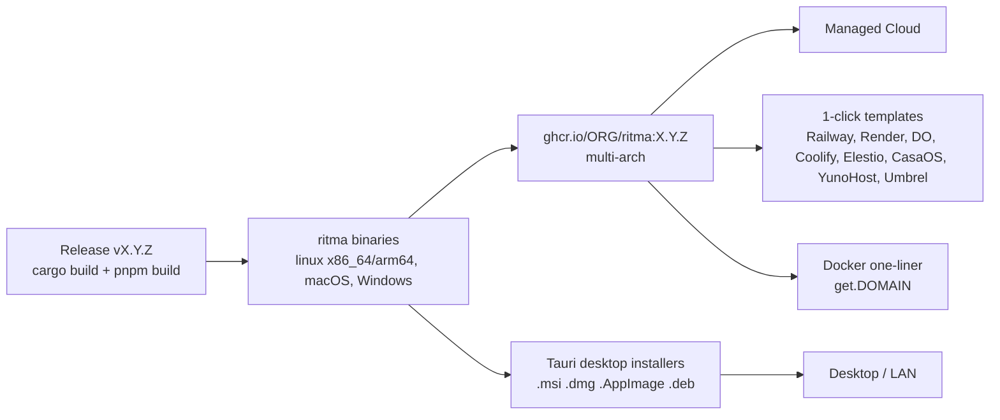

# 14 — Distribution: one artifact, four channels

## 1. Principle

**DST-01.** One versioned release produces **one binary per platform** (with the SPA, migrations, presets, templates and fonts embedded) and **one multi-arch container image** built from that binary. Every channel ships that same artifact, so there is no channel-specific fork of behaviour. Channels differ only in how Postgres, TLS and secrets are provided.

**DST-02. The first experience is identical everywhere.** Open the URL, enter the setup token (pre-filled when the channel can do it), then the 3-step wizard (05), then the dashboard with the checklist. No channel needs a terminal command after install.



## 2. Build and release pipeline

**DST-05.** `.github/workflows/release.yml` triggers on tag `vX.Y.Z`:
1. Build the web (`pnpm build`), then build the binaries with `cargo build --release --locked` for `x86_64-unknown-linux-musl`, `aarch64-unknown-linux-musl`, `x86_64-apple-darwin`, `aarch64-apple-darwin` and `x86_64-pc-windows-msvc`. musl is used for static Linux builds; `rustls` everywhere, no OpenSSL.
2. Build the container `FROM gcr.io/distroless/static` plus `pg_dump` (copied from `postgres:16-alpine` as a static build, or use `alpine` + `postgresql16-client` if static is impractical; the image size target is ≤ 60 MB). The image runs as non-root uid 10001 with `RITMA_DATA_DIR=/data` as a volume.
3. Build the Tauri desktop bundles (DST-20), signed with an Apple Developer ID plus notarisation and a Windows Authenticode certificate. Until certificates are available, ship unsigned builds with documented SmartScreen and Gatekeeper steps.
4. Create the SBOM (CycloneDX), checksums (`SHA256SUMS`) and cosign signatures (keyless).
5. Create the GitHub Release with the changelog from release-please, and publish `releases.<domain>/latest.json` with `{version, notes_url, assets: {...}}`.
6. Update the 1-click templates' image tag through a PR bot.

## 3. Channel 1 — Managed Cloud

See `15-cloud.md`. Summary: sign up at `app.<domain>` with email (magic link) or Google. Choose a subdomain. The wizard follows (no setup token, already authenticated). It is the same image with `RITMA_MODE=multi`.

## 4. Channel 2 — 1-click deploy templates

**DST-10.** Templates live in `deploy/`. Each one provisions the **app plus a managed Postgres 16**, generates `RITMA_SECRET_KEY` and `RITMA_SETUP_TOKEN` automatically, sets `RITMA_PUBLIC_URL` from the platform domain, and mounts a volume at `/data` where the platform supports it. Otherwise it uses `RITMA_FILES_BACKEND=s3` with the platform's object storage, or warns that files are ephemeral.

| Platform | File | Notes |
|---|---|---|
| Railway | `deploy/railway/railway.json` + template listing | Postgres plugin; volume `/data` |
| Render | `deploy/render/render.yaml` (Blueprint) | `fromDatabase` for DATABASE_URL; `generateValue: true` for secrets; disk `/data` 1 GB |
| DigitalOcean App Platform | `deploy/digitalocean/.do/deploy.template.yaml` | Dev DB or managed PG; Spaces for files (s3 backend) |
| Coolify | `deploy/coolify/docker-compose.yaml` (Coolify magic vars `SERVICE_FQDN_APP`, `SERVICE_PASSWORD_*`) | |
| Elestio | Submission doc `deploy/elestio/README.md` | Managed by Elestio |
| CasaOS | `deploy/casaos/docker-compose.yml` with `x-casaos` metadata, icon, screenshots | Local home-server users |
| YunoHost | Separate repo `ritma_ynh` (manifest.toml v2, install/upgrade/backup/restore scripts) | Linked from `deploy/yunohost/README.md` |
| Umbrel | `deploy/umbrel/umbrel-app.yml` + compose | |

**DST-11.** The README shows **Deploy buttons** (Railway, Render, DigitalOcean) under a single "Self-host in 2 minutes" heading. Each template's post-deploy message says: "Open <url>/setup. Your setup token is in the environment variable RITMA_SETUP_TOKEN (Settings → Variables)." Where the platform supports post-deploy output, the token is printed in the deploy logs too.

## 5. Channel 3 — Desktop / LAN

**DST-20. App.** `apps/desktop` is a Tauri 2 app (Rust). It:
- Embeds and runs the `ritma` server **in-process** as a library: `eq_server::run(config)` on a tokio runtime, so there's no sidecar binary.
- Runs **PostgreSQL** through `postgresql_embedded`. It downloads the PG 16 binaries on first run into the app-data dir, or bundles them in the installer for offline install (the default; about 30 MB compressed). PG runs on `127.0.0.1:<random free port>` with a generated password stored in the OS keychain.
- Generates `RITMA_SECRET_KEY` on first run, stored in the OS keychain (`keyring` crate). It offers the "Recovery kit" export (SEC-31).
- Opens a native window pointing at `http://127.0.0.1:<port>`, with the setup token passed in automatically (`/setup?token=`).
- Lives in the **system tray**, with: Open, "Phones & tablets…" (QR code), Back up now, Open backups folder, Start at login (toggle), Check for updates, Quit. Closing the window keeps the server running in the tray (a notice on first close).

**DST-21. LAN access.** By default the server binds `0.0.0.0` on a fixed default port 8080, with a fallback to a free port. "Phones & tablets…" shows a QR code of `http://<lan-ip>:<port>` and an explanation.

**DST-22. HTTPS for phones (required for camera, GPS and PWA install).** Browsers only allow camera and geolocation in secure contexts, and `http://192.168.x.x` is not one. The desktop app offers two modes, chosen in a first-run dialog that is also available in settings:

| Mode | How | Pros/cons |
|---|---|---|
| **Secure link (default, recommended)** | The app opens an outbound tunnel. **Primary:** Cloudflare Tunnel using an embedded `cloudflared`-compatible client (the `cloudflared` binary as a Tauri sidecar), registered via our **tunnel broker** API, which issues a `https://<school-slug>.<tunnel-domain>` hostname per install (free, rate-limited, abuse policy). **Fallback:** the user pastes their own tunnel token | Works anywhere, including from phones on mobile data; valid TLS; needs internet |
| **Local only (advanced)** | The app creates a local CA (`rcgen`), issues a cert for `<lan-ip>` and `ritma.local` (mDNS via `mdns-sd`), and serves HTTPS on 8443. It guides installing the CA on phones with a QR code to download the `.crt` and per-OS screenshots | No internet needed; CA install is fiddly on iOS/Android |

`RITMA_PUBLIC_URL` is set to the tunnel URL when the tunnel is active, so links in emails and WhatsApp work outside the LAN.

**DST-23. Backups (desktop).**
- Daily at 03:00, or at the next app start if the PC was off, into `Documents/Ritma Backups/`. The folder can be changed, e.g. to a USB drive or a synced folder (Google Drive or OneDrive desktop folder).
- The last 14 are kept.
- The tray shows a warning if the last successful backup is older than 3 days.
- Restore: Settings → Backups → "Restore from file…".

**DST-24. Updates.** The Tauri updater checks `releases.<domain>/desktop/latest.json` (signed with the Tauri updater key). The update is downloaded in the background, and the app restarts on "Restart to update" or at the next launch. The DB is backed up automatically before each update.

**DST-25. Move to cloud.** Settings → "Move to the cloud" exports a backup and opens the cloud signup with an import step (CLD-10) that accepts the `.eqbak` (encrypted with the user's key, which is entered in the browser and never sent to us in plaintext; import runs server-side with the provided key, then the key is discarded).

## 6. Channel 4 — Docker one-liner

**DST-30. Installer script.** `curl -fsSL https://get.<domain> | sh`, which is the same file as `deploy/install.sh` in the repo. The docs show "inspect first: `curl -fsSL https://get.<domain> -o install.sh && less install.sh && sh install.sh`".

The script:
1. Detects the OS (Linux x86_64/arm64; on macOS it suggests the desktop app instead). Checks for Docker plus Compose v2 and offers to install Docker via the official convenience script with a confirmation prompt.
2. Asks for 2 things (or takes flags or env for non-interactive installs): the **domain** (blank → `http://<server-ip>`, no TLS, with a warning) and an **email for TLS certificates**.
3. Creates `/opt/ritma/` with:
   - `docker-compose.yml`: app, postgres:16-alpine and caddy:2. Caddy does automatic HTTPS for the domain. Postgres has a volume and a health check. The app has `restart: unless-stopped`, a `depends_on` health condition, and the `/data` volume.
   - `.env`: generated `RITMA_SECRET_KEY`, `POSTGRES_PASSWORD`, `RITMA_SETUP_TOKEN`, `RITMA_PUBLIC_URL`, mode 600.
   - `Caddyfile`.
4. Runs `docker compose up -d`, waits for `/readyz`, and prints:

   ```
   ✅ Ritma is running.
   Open:  https://school.example.com/setup?token=XXXX
   Backups: /opt/ritma/data/backups (daily)
   Update:  cd /opt/ritma && docker compose pull && docker compose up -d
   ```
5. It is idempotent: re-running detects an existing install and offers update or reconfigure. It never overwrites `.env` secrets.

**DST-31.** A `deploy/docker/docker-compose.yml` is also provided for people who prefer to edit it themselves, with every variable documented inline.

## 7. Cross-channel adoption features

**DST-40. Telemetry (opt-in, anonymous).**
- Off by default. The owner can turn it on in Settings → System with a plain-language explanation.
- Payload, weekly: `{install_id (random uuid), version, channel, mode, preset_id, enabled_modules, counts bucketed (students: 0-25|26-100|101-500|500+), country}`.
- No PII, no tenant name, no IP stored by our endpoint (the receiver drops it).
- Documented in `docs/telemetry.md`.

**DST-41. Import from spreadsheets** (ENR-11) is reachable from the setup checklist. A downloadable template CSV/XLSX is localised.

**DST-42. Export everything** (`/settings/export`, owner): a ZIP of CSV files per entity plus `manifest.json` plus the files. It is the same code path as backup but in an open format, readable without our software. This makes the "no lock-in" USP true.

**DST-43. Owner docs** (`docs/` site, Starlight):
- Bahasa Indonesia first, English second.
- Screenshot-led guides per channel ("Install on Windows", "Install with Railway").
- Per module ("How late fees work"), with each policy field explained once and linked from the in-app help (`?` icon → `docs/<lang>/rules/<module>#<field>`).
- Developer docs are a separate section.

**DST-44. Demo instance.** `demo.<domain>` runs `RITMA_DEMO=1` with `seed-demo`: the music preset with 3 instructors, 40 students and 2 months of history. It resets nightly. Login buttons "Try as owner / admin / teacher / parent" skip passwords (demo mode only). It is linked from the README and the landing page.
