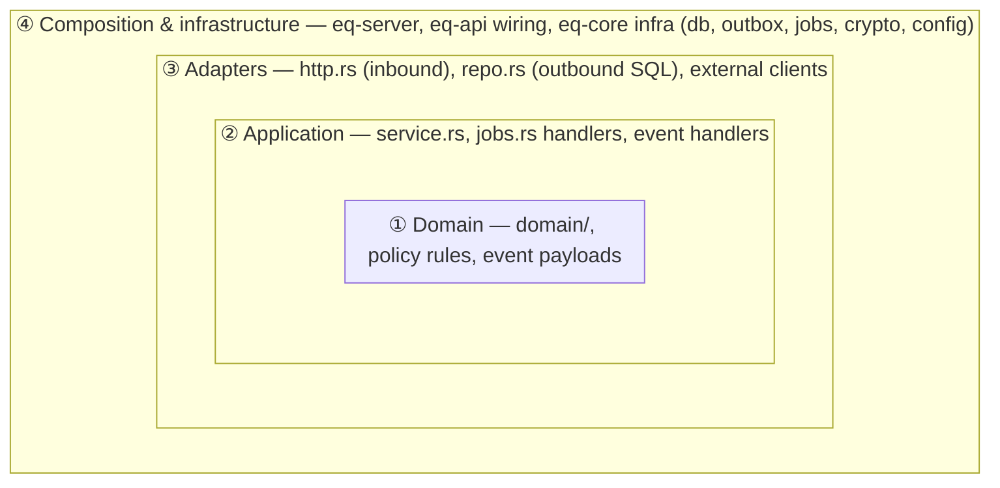

# 17 — Clean & Modular Architecture

`02-architecture.md` says **what** the system is made of. `03-module-system.md` says how modules plug in and toggle. This document gives the **rules that keep it clean as it grows**:
- which code may depend on which;
- what goes in each file;
- how modules stay independent.

Every task follows it, whether or not the task cites it. The decision behind the pragmatic choices is ADR-0013.

**Goals**, the reasons each rule exists:
1. **Toggle safety.** A school can switch any optional module off, and nothing else breaks (MOD-01).
2. **Business rules testable without infrastructure.** Fees, credits and booking rules run as pure functions in milliseconds (TST-01/02).
3. **Local reasoning.** A contributor can understand and change one module by reading only that module and `eq-core`.
4. **Replaceable edges.** Channels (email, WhatsApp), payment gateways, file storage and the clock change without touching business rules.

## 1. Layers and the dependency rule



**CA-01. The dependency rule.** Source code dependencies point **inward only**. An inner layer never names a type, function or crate from an outer layer.

| Layer | Files (per module crate, 02 §3) | May use | Must NOT use |
|---|---|---|---|
| **① Domain** | `domain/**`, the pure parts of `policy.rs` (struct, defaults, `validate`, `summarize`), `events.rs` payload structs | `std`, `eq_core` **primitives** (`Money`, `Bps`, ids, `Timestamp`, policy value types, `DomainError`), `chrono`/`chrono-tz` (pure calendar maths), `serde`, `schemars`, `thiserror` | `sqlx`, `axum`, `reqwest`, `tokio`, `tracing`, `std::env`, `std::fs`, `Clock`, `Tx`, anything async, any other module's crate |
| **② Application** | `service.rs`, `jobs.rs`, event handlers | Domain, its own `repo`, `eq_core` infra APIs (`db::begin`, `audit::record`, `outbox::emit`, `Clock`, ports), the always-on crates' public API | `axum`/HTTP types, DTOs, raw SQL strings, other optional modules |
| **③ Adapters** | `http.rs` (inbound: extractors, DTOs, `utoipa`), `repo.rs` (outbound: `sqlx::query!`), clients that implement a port (e.g. `eq-notify` channels) | Application and Domain of the **same** module | Business decisions. An adapter translates; it never decides |
| **④ Composition** | `lib.rs` (`impl Module`, wiring), `eq-api` (router, middleware, registry), `eq-server` (main, CLI, config) | Everything | Business logic |

**CA-02. Functional core, imperative shell.** All decisions live in ① as pure functions over plain values: *given this policy, these facts and `now`, what happens?* Layer ② gathers the inputs (repo reads, clock, policy version), calls ①, then carries out the result: repo writes, `audit::record`, `outbox::emit`, commit (ARC-04).

A service function reads like a short recipe, with **no `if` on business rules**. If you find yourself writing `if invoice.days_overdue > policy.grace_days` in `service.rs`, move it into `domain/`.

**CA-03. Errors flow outward.**
- ① returns `DomainError`-style enums: what rule was broken, plus the policy key.
- ② adds context and maps them to `AppError`.
- ③ (`http.rs`) renders problem+json.
- No layer reaches past its neighbour (ARC-12, CQ-22).

**CA-04. Data shapes per layer.** Each layer owns its types and converts at the boundary with `From`/`TryFrom`:
- **DTO** in `http.rs`: the API contract, `utoipa::ToSchema`.
- **Domain type** in `domain/`: invariants, behaviour.
- **Row** in `repo.rs`: the `query_as!` target, mirrors SQL.

A row type never leaks into the domain, and a domain type is never returned as JSON directly. This lets the DB, the API and the rules evolve separately (CQ-24).

## 2. Ports and adapters (where we abstract, and where we deliberately don't)

**CA-10. Introduce a trait (port) only at a real seam.** That means one of:
- (a) a **cross-module** synchronous query (ARC-08, traits in `eq_core::ports`);
- (b) **external IO** with more than one implementation or a test double: notification channels, payment gateways, file storage, the tunnel broker, the update check;
- (c) **time and randomness**: `Clock`, plus an RNG where outcomes depend on it.

No speculative interfaces "in case we switch later".

**CA-11. Repositories are concrete, not traits** (ADR-0013).
- `repo.rs` holds plain `async fn`s over `&mut Tx` that use compile-checked SQL.
- Reasons:
  - Postgres is the only database (ADR-0002).
  - Several invariants **are** database constraints (`EXCLUDE` for double booking, RLS for tenancy), so a fake repository would test a different system.
  - Services are tested against real Postgres (TST-03), and the domain is tested without any repository at all (CA-02).
- This keeps the code smaller with no loss of testability.

**CA-12. Port design.**
- A port is named for the consumer's need, not the provider's tables: `BillableSource::billable_lines`, not `EnrollmentRepo::list`.
- It returns `eq_core` types or types defined next to the trait in `eq_core::ports`.
- It's read-only unless the spec says otherwise.
- When the owning module is disabled, it returns an **empty** result (ARC-08).

## 3. Module anatomy

**CA-20. One module = one crate = one bounded context.**
- A module owns its domain language, its policy, its tables, its events, its permissions and its SPA folder.
- Its name is its `ModuleId` (03 §2).

**CA-21. Public surface.**
- Everything is `pub(crate)` unless another crate needs it (CQ-23).
- `lib.rs` is the module's front door. It re-exports exactly:
  - the `Module` impl;
  - event payload types;
  - for always-on crates only, the functions that optional modules are allowed to call (e.g. `eq_scheduling::series::add_member`).
- Adding to the public surface is an API change. Say so in the PR, and get a code owner's review.

**CA-22. Growing a module.** When a file passes about 600 lines (CQ-11), split it **by use-case or concept**, never by technical kind. Use Rust 2018-style modules (`service.rs` + `service/…`, no `mod.rs`).

```
crates/eq-billing/src/
├── lib.rs
├── policy.rs
├── domain/
│   ├── invoice.rs        # Invoice aggregate + state machine
│   ├── late_fee.rs       # pure: compute late fee from terms + facts
│   └── proration.rs
├── service.rs            # re-exports the use-cases below
├── service/
│   ├── issue_cycle.rs    # one use-case per file once service.rs grows
│   └── record_payment.rs
├── repo.rs
├── http.rs
├── events.rs
├── jobs.rs
└── perms.rs
```

Don't create `utils.rs`, `helpers.rs` or `common.rs`. A helper either belongs to a concept (put it there) or is a genuine primitive (propose it for `eq-core` under CA-31).

**CA-23. Aggregates.**
- A state change goes through its aggregate's method in `domain/`: `invoice.void(reason, now) -> Result<InvoiceVoided, DomainError>`. The method returns the facts that happened.
- The service persists the new state and turns those facts into audit entries and events.
- Nothing outside `domain/` sets a status field directly.

## 4. Module boundaries

**CA-30. Table ownership.**
- Each table belongs to exactly one module: the module tag in the migration file name that creates it (ADR-0012).
- **Only the owning module's `repo.rs` reads or writes its tables.**
- Other modules get data through:
  1. an **event** (the facts they need are in the payload);
  2. a **port** (a synchronous query);
  3. a **read view** for reporting. That's a SQL view named `rv_<owner>_<name>`, created by the owner's migration and documented in the owner's module spec as a public contract. Only `eq-reports` reads `rv_*` views.
- Foreign keys across modules are allowed, because the schema is always complete (MOD-02). Joining across modules in queries isn't.
- This covers the always-on modules too. An optional module that needs session details, people's names or memberships calls the public API of `eq_scheduling`, `eq_identity` or `eq_core` (CA-21, CA-32). It never runs SQL on `sessions`, `persons` or `memberships`.
- To avoid N+1 queries (CQ-42), those APIs offer **batch** reads that take a slice of ids and return a map, for example `display_names(tx, &[PersonId]) -> HashMap<PersonId, String>` or `sessions_by_ids(tx, &[SessionId])`. They run inside the caller's `Tx`.

**CA-31. `eq-core` stays thin.**
- It holds primitives (money, ids, time, policy value types), infrastructure (db, outbox, jobs, crypto, config, errors), the `Module` trait, and port traits.
- **No business feature lives in `eq-core`.** If two modules need the same rule, it belongs to the always-on module that owns the concept (usually scheduling), or it's a port.
- Adding to `eq-core` needs a code owner's review.

**CA-32. Choosing a communication style.**

| Need | Use | Example |
|---|---|---|
| React to something that happened, possibly later | **Event** (ARC-07) | billing frees a payer → `billing.payer_unfrozen.v1` → scheduling lifts the block |
| Ask a question now, inside my transaction | **Port** (ARC-08) | billing asks `BillableSource` for active enrollments when issuing invoices |
| Do something an always-on module owns | **Direct call** to its public API | enrollment calls `eq_scheduling::series::add_member` |
| Show combined numbers on a dashboard | **Read view** `rv_*` (CA-30) | reports sums `rv_billing_receivables` |
| Optional module → optional module, synchronously | **Not allowed** | Use an event or a port in `eq_core::ports` |

Events state facts in the past tense (`invoice_overdue`), never commands (`send_reminder`). The receiver decides what to do.

**CA-33. Toggle safety rules.**
- Code must behave correctly when any **other** optional module is off: ports return empty, events simply have no handler, and SPA widgets are hidden (MOD-01).
- A module never assumes another optional module is present. When a feature needs both, the dependency is declared in `MOD-03`'s `requires_*` table, not hidden in code.
- Event handlers and jobs check that their own module is enabled for the tenant and skip if not (MOD-01).

## 5. Frontend mirror

**CA-40.** The SPA has the same shape as the backend (08 §2). Its layers, from inner to outer:
- `lib/`: framework-free helpers. Formatting, the API client and auth.
- `components/ui` and `components/domain`: reusable, no module knowledge.
- `modules/<id>/`:
  - `api.ts` holds the TanStack Query hooks, the only data access;
  - `pages/` and `components/` hold the module UI.
- `routes/`: thin. Compose module pages, check guards.
- `app/`: shell and router.

**Dependency rule:** an import goes only to the same layer or an inner one. `modules/<a>` never imports from `modules/<b>` (CQ-64), and `components/` never imports from `modules/`. Shared UI moves down into `components/domain`.

**CA-41.** Pure UI logic (slot alternatives display, summary rendering, form-to-policy mapping) lives in plain `.ts` functions with unit tests. Components stay thin: data in, events out.

## 6. Worked example: "apply late fees" through the layers

The names are illustrative. The real signatures are defined in the billing tasks (M4).

```rust
// ① domain/late_fee.rs — pure, no IO, exhaustively unit/property tested
pub fn late_fee(terms: &LateFeeTerms, invoice: &InvoiceFacts, today: NaiveDate) -> Option<Money> {
    let overdue_days = (today - invoice.due_on).num_days();
    if overdue_days < i64::from(terms.apply_after_days) {
        return None;
    }
    Some(match terms.kind {
        LateFeeKind::Flat(amount) => amount,
        LateFeeKind::Percent(bps) => invoice.outstanding.apply_bps(bps),
    })
}

// ② service.rs — the recipe: load, decide (domain), persist, audit, emit, commit
pub async fn apply_late_fees(ctx: &ServiceCtx, tenant: &TenantCtx) -> Result<u32, BillingError> {
    let mut tx = db::begin(&ctx.pool, tenant, &Actor::system()).await?;
    let today = tenant.local_date(ctx.clock.now());
    let mut applied = 0;
    for invoice in repo::overdue_without_fee(&mut tx, today).await? {
        let Some(fee) = late_fee(&invoice.terms.late_fee, &invoice.facts(), today) else { continue };
        repo::insert_late_fee_line(&mut tx, invoice.id, fee).await?;
        audit::record(&mut tx, AuditEntry::late_fee_applied(invoice.id, fee)).await?;
        outbox::emit(&mut tx, &InvoiceOverdue { invoice_id: invoice.id, payer_id: invoice.payer_id, late_fee_minor: fee.amount_minor }).await?;
        applied += 1;
    }
    tx.commit().await?;
    Ok(applied)
}

// ③ repo.rs — SQL only, rows → domain via TryFrom
// ③ jobs.rs — cron kind "billing.apply_late_fees" → service::apply_late_fees
// ④ lib.rs — registers the job kind in Module::jobs()
```

Notice:
- the terms come from the **invoice snapshot** (POL-05), not the current policy;
- `today` comes from the tenant's local calendar (ARC-10);
- the domain function can be property-tested without a database.

## 7. Anti-patterns (each one fails review)

| Smell | Why it hurts | Instead |
|---|---|---|
| Business `if`s in `service.rs` or `http.rs` | Untestable without the DB; rules scatter | Move them to `domain/` (CA-02) |
| `sqlx::Row`, `PgPool` or `axum::Json` in a domain signature | Couples rules to infrastructure | Convert at the boundary (CA-04) |
| A module querying another module's tables | Breaks toggling and ownership; hidden coupling | Event, port or `rv_*` view (CA-30/32) |
| `utils.rs` / `helpers.rs` / `common` grab-bags | A dumping ground with no owner | Put the code in the concept that owns it (CA-22) |
| Business logic in `eq-core` "because two modules need it" | The core becomes a monolith inside the monolith | Use the owning always-on module, or a port (CA-31) |
| Interfaces with one implementation and no external IO | Indirection with no benefit | A concrete function (CA-10/11) |
| Commands disguised as events (`notify.send_sms_requested`) | The sender knows the receiver | Emit the fact; the receiver decides (CA-32) |
| Reusing a domain struct as the API DTO | API changes break rules and vice versa | Separate DTO + `From` (CA-04) |
| Setting `status = 'paid'` from a service | Bypasses the state machine | An aggregate method that returns the facts (CA-23) |
| A disabled-module check sprinkled in other modules | The gate leaks everywhere | `ModuleGate` + ports return empty (CA-33) |

## 8. Enforcement

- **CA-01, crate edges** [tool]: `scripts/check-deps.sh` (ARC-02).
- **CA-01, file layers** [tool]: `scripts/check-layers.sh`. It prints file:line for each violation:
  - files under `crates/*/src/domain/**` that use `sqlx`, `axum`, `reqwest`, `tokio`, `tracing`, `std::env`, `std::fs`, `Clock` or `Tx`;
  - an `http.rs` that uses `sqlx::`;
  - a `repo.rs` that uses `axum`.
- **CA-02, CA-10, CA-11** [tool + review]: the `clippy.toml` disallowed methods (`Utc::now`, `std::env::var`; CQ-21), plus review.
- **CA-30, table ownership** [review]: every table named in a `repo.rs` must have been created by a migration tagged with that module. The only exception is `rv_*` views read by `eq-reports`.
- **CA-40** [tool]: `scripts/check-web-boundaries.sh` (CQ-64).
- **Everything else** [review]: the review checklist (`16-code-quality.md` §9) and the anti-patterns in §7.
