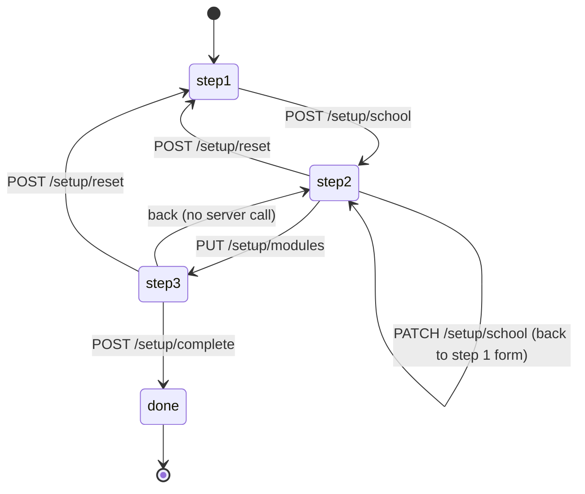
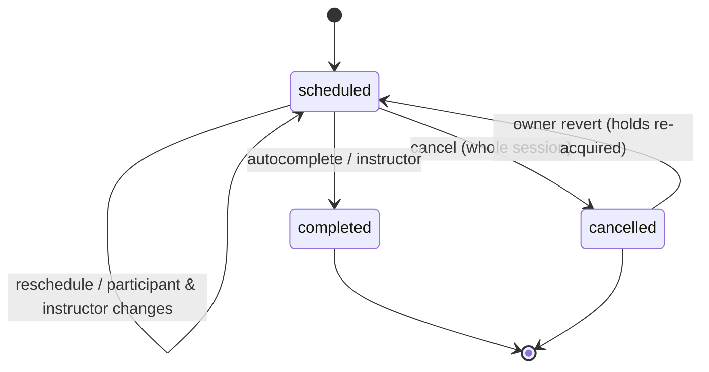
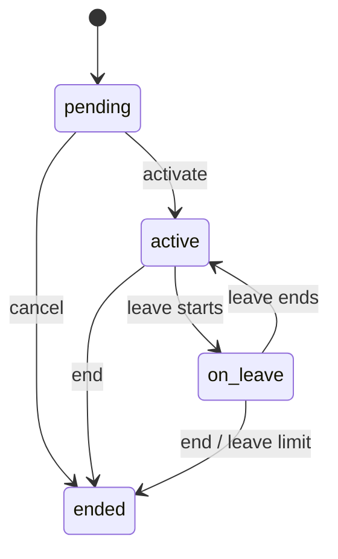
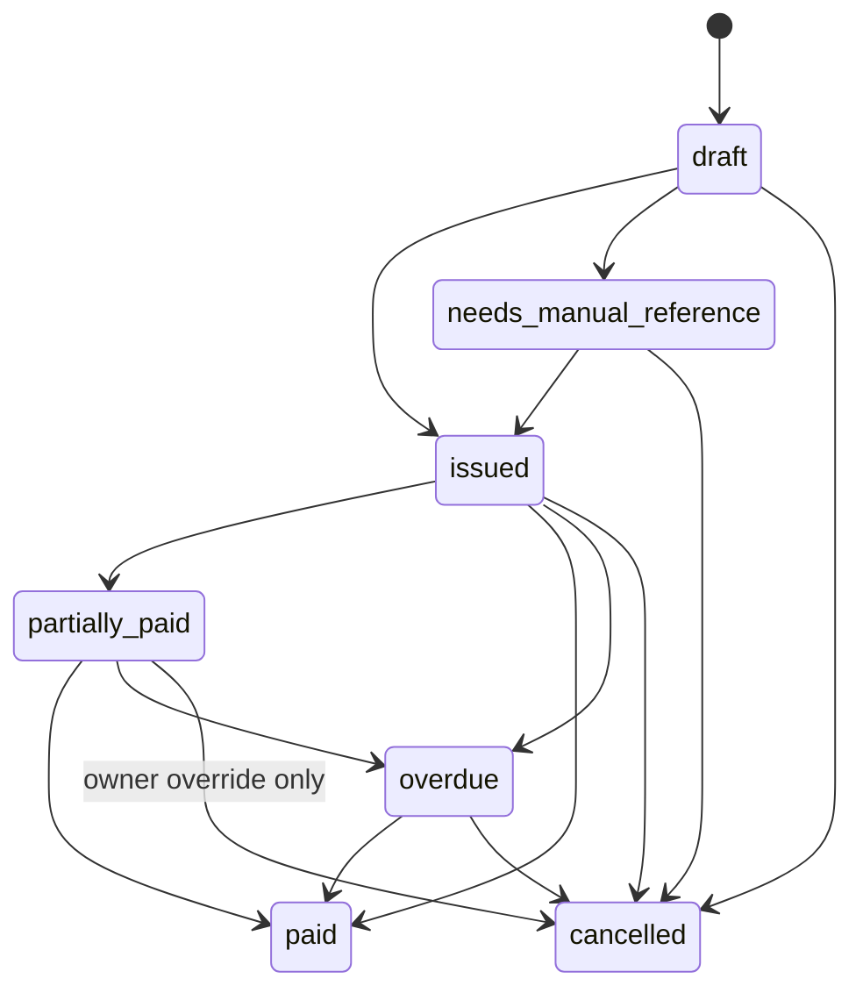
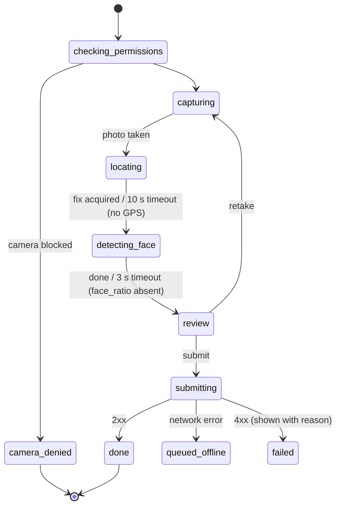

# 20 — States & Behaviour (canonical catalog)

This document lists **every stateful thing in Ritma**: server aggregates, derived states (tokens, locks, policy versions), infrastructure rows (outbox, jobs, breakers) and client-side UI flows. For each one it gives the states, every allowed transition with its trigger, actor, guards and effects, and the invariants that must always hold.

- It consolidates the diagrams in `06-domain-model.md` §5 and the rules scattered across `modules/*.md`. The diagrams in 06 §5 stay as the overview; **the transition tables here are the normative detail**. If they disagree, this file wins and 06 §5 is fixed in the same PR.
- Business rules (the *why* and the policy keys) stay in the module specs; this file cites them by ID.
- How data moves through these transitions is `21-data-flows.md`. How inputs are checked before a guard runs is `22-validation-and-sanitization.md`.

Tags: **[D-nn]** a decision taken here (listed in §9).

## 1. Conventions (apply to every server machine)

- **STM-01. Closed transitions.** A transition that isn't listed is rejected with **409 `invalid_transition`** and `{from, to}` in the problem extension, without side effects (06 §5). Self-transitions are listed explicitly when allowed.
- **STM-02. Transitions are aggregate methods.** A transition is a pure function in the module's `domain/`: `fn cancel(self, cmd, policy, now) -> Result<(Self, Vec<Effect>), XError>` (CA-23). The service applies the returned state and effects in **one transaction** in this order: domain → repo writes (incl. holds) → `audit::record` → `outbox::emit` → notification requests → commit (ARC-04 step 9). Any failure rolls back everything (ARC-05).
- **STM-03. Concurrency.** Transitions of a versioned aggregate (`version` column) triggered by a user require `If-Match` (API-07) and update `WHERE id = $1 AND version = $2`; zero rows → 409 `version_conflict` with `current`. Transitions triggered by jobs or events lock the row with `SELECT … FOR UPDATE` instead, and re-check the guard after locking (VAL-08).
- **STM-04. Audit and events.** Every transition writes one audit entry `"<module>.<entity>.<verb_past>"` (AUD-02) with redacted `before`/`after` of the state fields. The "Event" column names the outbox event (03 §6); "—" means none.
- **STM-05. Idempotent triggers.** A job or event that would move an aggregate into the state it is already in does nothing and returns `Ok` (no audit, no event). This makes at-least-once delivery safe (ARC-07).
- **STM-06. Time.** "now" is `Clock::now()` passed into the domain (ARC-03). Local-date guards use the tenant/location timezone (ARC-10).
- **STM-07. Terminal states** are never left, except through an explicitly listed owner override, which is audited with category `compliance`.
- **STM-08. Status badges.** Every state below has a UI tone from the design system and an icon (FE-36: never colour alone). Tones: `neutral`, `info`, `success`, `warning`, `danger`. The label is `t('status.<entity>.<state>')`.

Columns used in transition tables: **#** (stable id, used in test names: `stm_session_t3_cancel`), **From → To**, **Trigger** (route, job or event), **Who** (permission or `system`), **Guards** (all must hold; the code if one fails), **Effects** (writes, holds, audit verb, event, notification).

## 2. Core and setup

### STM-10. Tenant status (`tenants.status`)

| State | Meaning | Terminal | Badge |
|---|---|---|---|
| `active` | Normal operation | no | success |
| `suspended` | Cloud only: read-only access for owner/admin, everyone else gets 403 `tenant_suspended` [D-31] | no | warning |
| `closed` | Cloud only: no access; data kept until the retention job removes it (CLD) | yes | neutral |

| # | From → To | Trigger | Who | Guards | Effects |
|---|---|---|---|---|---|
| t1 | — → active | setup step 1 (STM-11 t1) | setup token / signup | — | tenant row |
| t2 | active → suspended | platform action (M9) | `eq_platform` | cloud mode | audit `platform.tenant.suspended` (compliance) |
| t3 | suspended → active | platform action | `eq_platform` | — | audit |
| t4 | active/suspended → closed | platform action / owner "close account" (M9) | `eq_platform` | export offered first | audit, all refresh sessions revoked |

Self-hosted tenants are always `active`; t2–t4 don't exist in `RITMA_MODE=single`.

### STM-11. Setup progress (`tenants.setup_step`, `setup_completed_at`)

| # | From → To | Trigger | Who | Guards | Effects |
|---|---|---|---|---|---|
| t1 | (no tenant) → step 2 | `POST /setup/school` | setup token (self-host) / signed-up owner (cloud) | token valid (constant-time compare); no tenant exists (single mode) → else 409 `invalid_transition` | One tx: tenant, owner person + membership, location, N resources, catalog, `tenant_modules`, policies v1, audit `setup.school_created`, setup token consumed (file deleted) (SET-11/12) |
| t2 | step 2/3 → same | `PATCH /setup/school` | owner | not `done` | updates name, country-derived fields, room count (adds/archives resources), audit `setup.school_updated` |
| t3 | step 2 → step 3 | `PUT /setup/modules` | owner | MOD-03 closure → else 422 `module_dependency`/`module_required_by` | STM-12 per changed module, `setup_step = 3` |
| t4 | step 3 → done | `POST /setup/complete` | owner | every submitted document validates (POL-10) → else 422 | policies v2 for changed modules, `setup_step = 4`, `setup_completed_at = now`, audit `setup.completed` |
| t5 | step 2/3 → step 1 | `POST /setup/reset` | owner | no sessions, enrollments or invoices exist → else 409 `setup_has_data` [D-32] | deletes the tenant's seeded rows in one tx (catalog, resources, modules, policies); keeps the owner; audit `setup.reset` |

- **Invariant:** `setup_step = 4 ⇔ setup_completed_at IS NOT NULL`.
- The SPA's setup gate (FE-10) reads `GET /setup/status`; every non-setup, non-auth route returns 409 `setup_required` [D-33] while `setup_step < 4`, so no business data can be written before setup completes.

### STM-12. Module enablement (`tenant_modules`)

| State | Meaning | Badge |
|---|---|---|
| `always_on` | core, identity, audit, scheduling (no row) | neutral + lock icon |
| `enabled` | row `enabled = true` | success |
| `disabled` | row `enabled = false` or no row for an optional module | neutral |
| `not_compiled` | `/meta/modules.compiled = false` | neutral, hidden in Settings → Features |

| # | From → To | Trigger | Who | Guards | Effects |
|---|---|---|---|---|---|
| t1 | disabled → enabled | `PUT /settings/modules` (or setup step 2) | `core.modules.write` (owner) | compiled; `requires_all` enabled and one of `requires_any` enabled (MOD-03) → else 422 `module_dependency` + `missing` | `on_enable` (idempotent); policy v1 inserted if none (MOD-06.4); audit `core.module.enabled`; event `core.module_toggled.v1`; `NOTIFY eq_modules_changed` (cache invalidation, MOD-05) |
| t2 | enabled → disabled | same | same | no enabled module requires it → else 422 `module_required_by` + `missing` | `on_disable` (MOD-08 effects, e.g. billing unfreezes payers); data kept (MOD-02); audit `core.module.disabled`; event |

- **Invariant:** the enabled set is always closed under MOD-03 (the request is all-or-nothing).
- Requests to a disabled module's routes get 404 `module_disabled` (ARC-04 step 6). Jobs and event handlers for it return `Ok` and skip (ERR-52).

### STM-13. Policy versions (`policies`, derived)

Policies are append-only (POL-03); the state is derived from `effective_from` and later versions.

| State | Condition | Badge |
|---|---|---|
| `scheduled` | `effective_from > now` | info ("Applies from …") |
| `in_force` | latest version with `effective_from ≤ now` | success |
| `superseded` | a newer version has `effective_from ≤ now` | neutral |

| # | Transition | Trigger | Who | Guards | Effects |
|---|---|---|---|---|---|
| t1 | (none) → scheduled/in_force | `PUT /settings/policies/{module}`, setup t1/t4, module enable | `core.policy.write` (owner) / system | POL-10 layers; `effective_from ≥ now − 5 min` (D-24); module enabled | insert version `max+1`, audit `core.policy.changed` with before/after documents, event `core.policy_changed.v1`, `NOTIFY eq_policy_changed` |
| t2 | scheduled → in_force | time passes | — | — | none (derived); the cache picks it on read (POL-04) |
| t3 | in_force → superseded | t2 of a newer version | — | — | none |

- A scheduled version can't be edited or deleted; publishing another version with an earlier `effective_from` effectively replaces it [D-34]. The Settings UI lists scheduled versions and offers "Replace".
- Snapshots (POL-05) mean superseded versions keep governing the records that copied them (invoices, reservations, enrollments).

### STM-14. Attention items (`attention_items`)

| State | Condition | Badge |
|---|---|---|
| `open` | `resolved_at IS NULL` | tone from `severity`: low → neutral, normal → warning, high → danger |
| `resolved` | `resolved_at` set | success (hidden by default) |

| # | From → To | Trigger | Who | Guards | Effects |
|---|---|---|---|---|---|
| t1 | — → open | any module (`attention::raise`) | system | `dedupe_key` unique → an existing open item is **updated** (`payload`, `created_at` kept) instead of duplicated | row |
| t2 | open → resolved | the cause is fixed (the raising module calls `attention::resolve(dedupe_key)`), or `POST /attention/{id}/resolve` | system / staff | — | `resolved_at`, `resolved_by`; audit `core.attention.resolved` (manual only) |
| t3 | resolved → open | the same `dedupe_key` is raised again | system | — | `resolved_at = NULL` |

### STM-15. Files (`files`)

| State | Condition | Badge |
|---|---|---|
| `stored` | `deleted_at IS NULL` | — |
| `deleted` | `deleted_at` set, bytes removed from storage | — |

Transitions: `stored → deleted` by retention jobs (ATT-08 photos, exports after 24 h, imports after 24 h), privacy erasure (AUD-11), avatar/logo replacement. The physical delete happens **after** commit via a job `core.files.delete` with the storage key, so a rolled-back tx never loses bytes [D-35]. Rows are never hard-deleted (DOM-01).

### STM-16. Drafts (`drafts`) and idempotency keys (`idempotency_keys`)

- **Draft:** `absent → saved` (`PUT /me/drafts/{form_key}`, upsert), `saved → saved` (newer payload), `saved → absent` (`DELETE`, form submitted, or the daily cleanup after 7 days, FE-30). Only the owning person can read or write it.
- **Idempotency key** (API-08, implemented by T-115): `absent → recorded → expired`.
  - A request with a key takes `pg_advisory_xact_lock(hashtext(tenant || key))` inside the request tx, so a concurrent duplicate waits for the first one to finish.
  - `recorded`: the handler stores `(route, request_hash, status, body)` **in the same tx as the business change**, so the record exists exactly when the change committed. Same route and same hash (CAN-70) → replay the stored status and body with `Idempotent-Replayed: true`. Different hash → 422 `idempotency_mismatch`.
  - A request that fails (4xx or 5xx) rolls back and records nothing; a retry with the same key runs again and normally gets the same error [D-36].
  - `expired`: older than 24 h, deleted by the daily cleanup.

## 3. Identity

### STM-20. Membership (`memberships.status`, per person × role)

| State | Meaning | Badge |
|---|---|---|
| `invited` | Created with an invite, password not set yet | info |
| `active` | Can log in with this role | success |
| `deactivated` | Kept for history, can't log in with this role | neutral |

| # | From → To | Trigger | Who | Guards | Effects |
|---|---|---|---|---|---|
| t1 | — → active | `POST /people` (no invite), approval, import | `identity.people.write` / system | role grantable by actor (IDN admin rules) | row; audit `identity.role.granted` |
| t2 | — → invited | `POST /people` with `invite`, `POST /people/{id}/invite` | `identity.people.write` | person has email or phone (for email/WhatsApp channels) | STM-21 t1 |
| t3 | invited → active | invite accepted (STM-21 t2) | invitee | — | password set (credentials), audit `identity.invite.accepted` |
| t4 | active/invited → deactivated | `POST /people/{id}/deactivate` or `DELETE /people/{id}/roles/{role}` | `identity.people.write` / `identity.roles.write` | not the last active owner → else 409 `last_owner` | all refresh sessions of the person in the tenant revoked (IDN-13); open invites for that role expired; audit `identity.role.revoked` / `identity.person.deactivated` |
| t5 | deactivated → active | `POST /people/{id}/reactivate` | `identity.people.write` | — | audit |

**Invariants:** at least one `active` owner per tenant at all times (checked inside the tx with `FOR UPDATE` on the owner memberships); a person with no `active` membership can't obtain tokens.

### STM-21. Invite (`invites`, derived)

| State | Condition | Badge |
|---|---|---|
| `pending` | `accepted_at IS NULL AND expires_at > now` | info |
| `accepted` | `accepted_at` set | success |
| `expired` | `accepted_at IS NULL AND expires_at ≤ now` (includes revoked: revoking sets `expires_at = now`, T-111) | neutral |

| # | From → To | Trigger | Who | Guards | Effects |
|---|---|---|---|---|---|
| t1 | — → pending | create/resend | `identity.people.write` | — | earlier pending invites for (person, role) → expired; token hash stored; event `identity.user_invited.v1`; audit `identity.invite.created` |
| t2 | pending → accepted | `POST /auth/invites/{token}/accept` | holder of the token | token hash matches (constant time), pending → else 410 `invite_expired` / 404 | single use, same tx: `accepted_at`, credentials password, membership t3, login (refresh family created) |
| t3 | pending → expired | time / resend / deactivate | — | — | — |

### STM-22. Refresh session (`refresh_sessions`)

| State | Condition |
|---|---|
| `active` | `revoked_at IS NULL AND idle_expires_at > now AND absolute_expires_at > now` |
| `rotated` | revoked because a successor in the same `family_id` was issued (`revoked_reason = 'rotated'`) [D-37] |
| `revoked` | revoked for logout, logout-all, password change/reset, deactivation, reuse detection (`revoked_reason` set) |
| `expired` | idle or absolute expiry passed |

| # | From → To | Trigger | Guards | Effects |
|---|---|---|---|---|
| t1 | — → active | login, invite accept, reset login | credentials valid, membership active | new `family_id`, cookie `eq_rt` |
| t2 | active → rotated (+ new active) | `POST /auth/refresh` | CSRF header + Origin (IDN-05); membership still active (IDN-13) else revoke + 401; `ver` matches | successor row in the same family; `idle_expires_at` slides; new access token |
| t3 | rotated → (family) revoked | a **rotated** token is presented | — | every row of the family revoked (`reuse`), audit `security.refresh_reuse` (security), 401 `session_expired` |
| t4 | active → revoked | logout / `DELETE /me/sessions/{id}` / logout-all / password change (others) / reset (all) / deactivation (all) | — | audit `security.logout` / `security.sessions_revoked` |
| t5 | active → expired | time | — | none; the next refresh gets 401 `session_expired`; cleanup job deletes rows 30 days later |

The access token (JWT, 10 min) has no server state; it dies by `exp`, by `ver` mismatch after a password change, or at the next refresh if the session was revoked.

### STM-23. Credentials lock (`credentials.failed_count`, `failed_window_start`, `locked_until`)

| State | Condition |
|---|---|
| `clear` | `failed_count = 0` |
| `counting` | `0 < failed_count < lockout.max_failed` and `now < failed_window_start + window_minutes` |
| `locked` | `locked_until > now` |

| # | From → To | Trigger | Effects |
|---|---|---|---|
| t1 | clear/counting → counting | wrong password | `failed_count += 1` (window restarts if expired); audit `security.login.failed` |
| t2 | counting → locked | the failure that reaches `max_failed` within the window | `locked_until = now + lock_minutes`; event `identity.account_locked.v1`; audit `security.account.locked` |
| t3 | locked → clear | time passes, then a correct password | counters reset |
| t4 | counting → clear | correct password (and TOTP if required) | counters reset; audit `security.login.success` |

While `locked`, a wrong password returns the generic 401 and does not extend the lock; a correct password returns 423 with `until` (IDN-06). The update uses `FOR UPDATE` on the credentials row so parallel guesses can't exceed `max_failed`.

### STM-24. Password reset token (`password_resets`)

`issued` (`used_at IS NULL AND expires_at > now`) → `used` (`POST /auth/reset`, single use in the same tx as the password change, all refresh sessions revoked) | `expired` (time). A new request doesn't invalidate older unused tokens; each expires on its own TTL (`reset_token_ttl_minutes`), and requests are capped by `reset_max_per_hour` [D-38].

### STM-25. TOTP enrolment (`credentials.totp_secret_enc`, `totp_enabled`)

| # | From → To | Trigger | Guards | Effects |
|---|---|---|---|---|
| t1 | off → pending | `POST /me/totp/setup` | `totp` policy ≠ `Off` | secret stored encrypted, `totp_enabled = false`; returns otpauth URI + QR |
| t2 | pending → on | `POST /me/totp/confirm {code}` | code valid ±1 step | `totp_enabled = true`, 10 recovery codes (argon2 hashes) shown once; audit `security.totp.enabled` |
| t3 | pending → pending | `POST /me/totp/setup` again | — | secret replaced |
| t4 | on → off | `DELETE /me/totp` with current password + code | policy isn't `RequiredForOwnerAdmin` while the person holds owner/admin → else 422 `policy_violation` `rule=identity.totp` (T-111) [D-39] | secret and recovery codes cleared; audit `security.totp.disabled`; other sessions revoked |

### STM-26. Person lifecycle (`persons`)

| State | Condition | Badge |
|---|---|---|
| `active` | `anonymized_at IS NULL AND deleted_at IS NULL` | — |
| `anonymized` | erased by AUD-11: PII null, display name "Deleted user …" | neutral |
| `deleted` | `deleted_at` set (only for persons with no operational records, e.g. a mistaken entry) [D-40] | hidden |

`active → anonymized` only through the privacy erasure job (STM-71 t4). `active → deleted` through `DELETE /people/{id}` with `identity.people.write` **only if** the person has no memberships other than `invited`, no sessions, enrollments, invoices, payments or check-ins (FK `RESTRICT` is the backstop → 409 `resource_in_use`). Both are terminal.

### STM-27. Guardian link (`person_links`)

`absent → linked(primary | secondary)`. Changing the primary guardian is one tx: old primary → secondary, new → primary (partial unique index `person_links_one_primary`); a second primary without the swap → 409 `primary_exists`. Unlinking the last guardian of a student under `guardians.required_under_age_years` is refused while the student has an active enrollment → 409 `guardian_required` [D-41].

## 4. Scheduling

### STM-30. Series (`series.status`)

| State | Meaning | Badge |
|---|---|---|
| `active` | Generates sessions up to `materialized_until` | success |
| `ended` | `valid_to` reached or ended manually; generates nothing | neutral |

| # | From → To | Trigger | Who | Guards | Effects |
|---|---|---|---|---|---|
| t1 | — → active | `POST /series` | `scheduling.series.write` | first `materialize_weeks_ahead` occurrences free (SCH-07) → else 409 `slot_taken` + `first_conflict_date` | series row, sessions materialised in the same tx, audit `scheduling.series.created` |
| t2 | active → active | `PATCH /series/{id}` (`effective_date`) | same, `If-Match` | future occurrences from `effective_date` can be regenerated without conflict → else 409 | future `scheduled` sessions from `effective_date` that have no marks/check-ins are cancelled (reason `series_changed`, credit 0) and regenerated; audit |
| t3 | active → ended | `POST /series/{id}/end {on}` or materialisation passes `valid_to` | same / system | — | future sessions after `on` cancelled (reason `series_ended`, credit 0); members' `active_to` set |
| t4 | active → active | `scheduling.materialize` job | system | — | STM-31 t1 for new dates; `materialized_until` advanced |

### STM-31. Session (`sessions.status`)

| State | Meaning | Holds | Badge |
|---|---|---|---|
| `scheduled` | Will happen (or is happening) | resource + instructors (with buffer) + participants | info; "In progress" (info, pulse) when `now ∈ time_range` (derived) |
| `completed` | Took place | kept (history, DOM-10) | success |
| `cancelled` | Won't happen | deleted | neutral, strikethrough |

| # | From → To | Trigger | Who | Guards | Effects |
|---|---|---|---|---|---|
| t1 | — → scheduled | `POST /sessions`, series materialisation, make-up/trial/substitute booking | `scheduling.session.write` / system | V6–V7 of VAL-25 §5.3 (duration, step, opening hours, closure, capacity, frozen participants); V8 holds → else 409 `slot_taken` | session, instructors, participants, holds; audit `scheduling.session.created`; event `scheduling.session_scheduled.v1` |
| t2 | scheduled → scheduled | `POST /sessions/{id}/reschedule` | `scheduling.session.write`, `If-Match` | not started yet (`now < starts_at`) [D-42]; same V6–V8 for the new range | holds deleted and rewritten; `version += 1`; audit `scheduling.session.rescheduled`; event `session_rescheduled.v1` |
| t3 | scheduled → cancelled | `POST /sessions/{id}/cancel {scope: session}` | `scheduling.session.cancel` | `reason` if `reason_required`; session still `scheduled` (a session in progress can be cancelled until it is completed) | all holds deleted; every participant `cancelled` with `credit_bps` from SCH-10; `cancelled_*` set; audit; event `session_cancelled.v1` (with participants' credits) |
| t4 | scheduled → completed | `scheduling.autocomplete` (every 15 min) when `upper(time_range) < now`, or instructor action after start | system / instructor of the session | `now ≥ starts_at` | audit `scheduling.session.completed`; event `session_completed.v1` (participants with status `expected`/`blocked`) |
| t5 | cancelled → scheduled | `POST /sessions/{id}/revert` | `scheduling.override.revert` (owner) | not ended yet (`now < ends_at`); **all** holds re-acquired → else 409 `slot_taken` | participants back to their pre-cancel status, credits granted by the cancellation voided (event `session_reverted.v1`); audit category `compliance` |

**Invariants:** a `scheduled` session has exactly one resource hold and one per instructor and per non-cancelled participant, all with the session's range; `sessions_series_occurrence` uniqueness holds for non-cancelled series sessions; at least one `primary` or `substitute` instructor.

### STM-32. Session participant (`session_participants.status`)

| State | Meaning | Hold | Badge |
|---|---|---|---|
| `expected` | Will attend | yes | — |
| `blocked` | Payer frozen (SCH-13): slot kept, check-in/marking still possible, guardian sees the frozen banner | yes | danger "Payment hold" |
| `cancelled` | Won't attend; `credit_bps` recorded | no | neutral |

| # | From → To | Trigger | Who | Guards | Effects |
|---|---|---|---|---|---|
| t1 | — → expected | session t1, `POST /sessions/{id}/participants`, materialisation | staff / system | capacity; hold free → 409 `slot_taken`; payer frozen → added as `blocked` | hold |
| t2 | expected → blocked | `billing.payer_frozen.v1` (state `frozen`) | system | session in the future | — (hold kept) |
| t3 | blocked → expected | `billing.payer_unfrozen.v1` | system | — | — |
| t4 | expected/blocked → cancelled | `POST /sessions/{id}/cancel {scope: participant}` | staff, or payer/guardian of that student if `payer_can_cancel` | session `scheduled` and not started; payer: own student only (404 otherwise) | hold deleted; `credit_bps` per SCH-10 tiers (`hours_before` floored); event `session_cancelled.v1` (scope participant) |
| t5 | expected/blocked → cancelled | `enrollment.enrollment_on_leave.v1` / `enrollment_ended.v1` | system | session date in the leave range / after `ended_on` | hold deleted, credit 0, reason `on_leave` / `enrollment_ended` |
| t6 | cancelled → expected/blocked | session t5 revert | owner | hold re-acquired | credit voided |

### STM-33. Calendar holds (`calendar_holds`)

Holds have no status: a row **exists** while its owner needs the slot (DOM-10). The owner's transition table above says when holds are written or deleted. Invariant (DB): no two holds for the same `(tenant, subject_kind, subject_id)` overlap; a `requested`/`pending_payment`/`confirmed` reservation and a `scheduled` (or `completed`) session always have their holds; cancelled/expired/rejected owners have none. TST-05 proves the race.

## 5. Enrollment

### STM-40. Registration (`registrations.status`)

| State | Meaning | Badge |
|---|---|---|
| `pending` | Waiting for review (trial possible) | warning |
| `approved` | Persons and enrollments created | success |
| `rejected` | Refused with a reason | neutral |
| `withdrawn` | The applicant withdrew (link in the confirmation message) or staff marked it | neutral |

| # | From → To | Trigger | Who | Guards | Effects |
|---|---|---|---|---|---|
| t1 | — → pending | `POST /public/registrations`, admin entry, import | public / staff | VAL-25 §5.4; `public_form` on (else 404) | encrypted `applicant_enc`, consent record, event `registration_submitted.v1`, notifications to applicant and admins |
| t2 | pending → approved | `POST /registrations/{id}/approve`, or automatically when `approval=Auto` and every student passes age/capacity checks with `placement=None` (ENR-04) | `enrollment.registration.write` / system | ENR-01/02 per student; series capacity; **all students in one tx** | persons, links, memberships, enrollments (STM-41 t1), series members, optional invites; audit `enrollment.registration.approved`; notification `registration_approved` |
| t3 | pending → rejected | `POST /registrations/{id}/reject` | same | reason | notification if `notify`; audit |
| t4 | pending → withdrawn | withdraw link / staff | applicant token / staff | — | audit |

Approved/rejected/withdrawn are terminal. The encrypted applicant data is kept per retention, then erased with the person if approved (AUD-11), or purged after `privacy` retention if rejected/withdrawn [D-43].

### STM-41. Enrollment (`enrollments.status`)

| State | Billing | Scheduling | Badge |
|---|---|---|---|
| `pending` | nothing | series member from `starts_on` | info |
| `active` | tuition per cycle (BIL-02) | participant in materialised sessions | success |
| `on_leave` | per `leave_terms.billing_during_leave` | not a participant on leave dates | warning |
| `ended` | none from `ended_on` | removed from `ended_on` | neutral |

| # | From → To | Trigger | Who | Guards | Effects |
|---|---|---|---|---|---|
| t1 | — → pending/active | approval, `POST /enrollments`, import | `enrollment.write` / system | payer resolution ENR-01, age ENR-02; `active` iff `starts_on ≤ today` | `leave_terms` snapshot; series member; if active: event `enrollment_activated.v1` (billing registration fee) |
| t2 | pending → active | `POST /enrollments/{id}/activate` or the daily `enrollment.leave_transitions` job on `starts_on` | `enrollment.write` / system | series assigned | event `enrollment_activated.v1`; audit |
| t3 | active → on_leave | `enrollment.leave_transitions` on the approved leave's `from` | system | leave `approved` | event `enrollment_on_leave.v1` (sent at approval time for future cancellation, see STM-42 t2) |
| t4 | on_leave → active | same job on `until + 1` | system | no other approved leave starts that day | audit |
| t5 | active/on_leave → ended | `POST /enrollments/{id}/end {reason, on}`; leave over-limit with `EndAndRequireReregistration` (ENR-07); privacy erasure | `enrollment.write` / system | `on ≥ starts_on` | `ended_on`, `ended_reason`; series member `active_to`; event `enrollment_ended.v1` (scheduling cancels future participations, billing stops) |
| t6 | pending → ended | cancel before start | `enrollment.write` | — | `ended_reason = admin` |
| t7 | active → active | `POST /enrollments/{id}/change` | `enrollment.write`, `If-Match` | `effective_on ≥ today` | ENR-06 series/level/price changes effective-dated |

### STM-42. Leave (`leaves.status`)

| # | From → To | Trigger | Who | Guards | Effects |
|---|---|---|---|---|---|
| t1 | — → requested | `POST /enrollments/{id}/leaves` | payer of the enrollment / staff | ENR-07 on **snapshotted** terms: enabled, notice (staff may override with `override_notice: true`), limit, no overlap (exclusion) | row; notification to admins |
| t2 | requested → approved | `POST /leaves/{id}/approve`, or immediately when requested by staff | `enrollment.leave.decide` | enrollment `active` or `on_leave`; limit re-checked inside the tx | `decided_*`; event `enrollment_on_leave.v1 {from, until}`; fee > 0 → event `leave_fee_charged.v1`; notification `leave_decided` |
| t3 | requested → rejected | `POST /leaves/{id}/reject` | same | — | notification |
| t4 | requested → cancelled | `POST /leaves/{id}/cancel` | requester / staff | — | — |
| t5 | approved → cancelled | same | staff, or requester | `today < from` → else 409 `invalid_transition` | sessions already cancelled for the leave are **not** restored automatically; the admin gets an attention item `leave_cancelled_review` [D-44] |

### STM-43. Make-up credit (`makeup_credits.status`)

| State | Badge |
|---|---|
| `available` | success, shows `expires_on` |
| `used` | neutral |
| `expired` | neutral |
| `void` | neutral, strikethrough |

| # | From → To | Trigger | Guards | Effects |
|---|---|---|---|---|
| t1 | — → available | `session_cancelled.v1` (credit > 0), `occurrence_skipped.v1` (credit > 0), `no_show_recorded.v1` with `student_no_show = MakeupCredit` | `makeup_credits.enabled`; outstanding < `max_outstanding` (else not created, `info` audit); unique `(enrollment, source_session)` | `expires_on = source date + expires_after_days`; event `makeup_credit_granted.v1` |
| t2 | available → used | booking a `makeup` session with this participant and credits ≥ 10000 bps in total (ENR-08) | not expired; same enrollment | `used_session_id` |
| t3 | available → expired | `enrollment.expire_credits` daily | `expires_on < today` | — |
| t4 | available/used → void | `session_reverted.v1`, `no_show_reverted.v1` for its source | — | if `used`, the make-up session keeps its participant; an attention item `credit_voided_after_use` is raised [D-45] |
| t5 | used → available | the make-up session it paid for is **cancelled by staff** | `today ≤ expires_on` | `used_session_id = NULL` [D-46] |

## 6. Billing

### STM-50. Invoice (`invoices.status`)

| State | Open? | Counts for payer state | Badge |
|---|---|---|---|
| `draft` | no | no | neutral |
| `needs_manual_reference` | no (not sent) | no | warning |
| `issued` | yes | no | info |
| `partially_paid` | yes | no | info "Partially paid" |
| `overdue` | yes | **yes** | danger ("Overdue (partially paid)" when `paid_minor > 0`) |
| `paid` | no | no | success |
| `cancelled` | no | no | neutral |

| # | From → To | Trigger | Who | Guards | Effects |
|---|---|---|---|---|---|
| t1 | — → draft | `POST /invoices` (manual), cycle job, rental/enrollment events | `billing.invoice.write` / system | lines ≥ 1; cycle: unique `(payer, period_key)` | lines from `pending_charges` attached (`invoiced_in`) |
| t2 | draft → issued | `POST /invoices/{id}/issue`, cycle/rental flow | same | reference allocated within 3 attempts (BIL-04) | number (gap-free sequence), reference, `issued_at`, `due_at`, `terms` snapshot; event `invoice_issued.v1`; critical notification |
| t3 | draft → needs_manual_reference | reference allocation fails 3× | system | — | attention item `needs_manual_reference` |
| t4 | needs_manual_reference → issued | `PATCH /invoices/{id}/reference` | `billing.invoice.write` | reference unique among open | as t2 |
| t5 | issued → partially_paid | payment verified (STM-51 t2) | — | `0 < paid_minor < total_minor` | event `payment_recorded.v1` |
| t6 | issued/partially_paid/overdue → paid | payment verified | — | `paid_minor ≥ total_minor` | event `invoice_paid.v1`; overpayment > 0 → attention `overpayment` |
| t7 | issued/partially_paid → overdue | `billing.overdue` job | system | `now > due_at` | late fee per snapshotted terms (BIL-06); event `invoice_overdue.v1`; payer state re-evaluated (STM-52) |
| t8 | overdue → overdue | same job, later day | system | `late_fee_applied_at IS NULL` and day ≥ due + `days_after_due` | late fee line (once); freeze evaluation |
| t9 | draft/issued/needs_manual_reference → cancelled | `POST /invoices/{id}/cancel` | `billing.invoice.write` | `paid_minor = 0` → else 409 `has_payments` | `cancelled_reason`; pending charges released (`invoiced_in = NULL`) [D-47]; linked rental reservation unaffected unless STM-60 says so |
| t10 | overdue → cancelled | same | admin with reason | `paid_minor = 0` | payer state re-evaluated |
| t11 | partially_paid/overdue (paid > 0) → cancelled | owner override | `billing.override.cancel` | reason | category `compliance`; payments stay recorded (refund handled outside the system, v1) |

**Invariants:** `total_minor = subtotal + tax + late_fee + unique_amount` (DB CHECK); `paid_minor = Σ verified payments`; lines and totals are immutable after issue except late-fee and adjustment/credit lines (BIL-09), each of which recomputes totals in the same tx.

### STM-51. Payment (`payments.status`)

| State | Counts in `paid_minor` | Badge |
|---|---|---|
| `submitted` | no | warning "Waiting for verification" |
| `verified` | yes | success |
| `rejected` | no | danger, with reason |

| # | From → To | Trigger | Who | Guards | Effects |
|---|---|---|---|---|---|
| t1 | — → submitted | `POST /invoices/{id}/payments` by the payer | payer (own invoice) | BIL-07 partial/min-first rules; invoice open; `Idempotency-Key` unique | proof file; attention `payment_to_verify` |
| t2 | — → verified | same route by staff | `billing.payment.record` | invoice open | applied to the invoice in the same tx (STM-50 t5/t6) |
| t3 | submitted → verified | `POST /payments/{id}/verify` | `billing.payment.verify` | invoice still open (if paid meanwhile → verified as overpayment + attention) | applied; notification `payment_verified` |
| t4 | submitted → rejected | `POST /payments/{id}/reject` | same | reason | notification `payment_rejected` |

Verified and rejected are terminal (SEC-07: only the status/verify columns change, through a DB function). Correcting a wrong verified payment is an `adjustment` line, never an edit.

### STM-52. Payer state (`payer_states.state`)

| State | Effect on the payer | Badge |
|---|---|---|
| `normal` | — (no row, or `state = normal`) | — |
| `restricted` | New rental bookings blocked; banner | warning |
| `frozen` | Restricted + their students' future participations `blocked` (STM-32 t2) | danger |

| # | From → To | Trigger | Guards | Effects |
|---|---|---|---|---|
| t1 | normal → restricted/frozen | `billing.overdue` job | any overdue invoice whose snapshotted `overdue.action` applies at local date ≥ due + `overdue.days_after_due`; the **strictest** action wins (BIL-08) | upsert with `invoice_ids`; event `payer_frozen.v1 {state}`; critical notification |
| t2 | restricted → frozen | same job | a stricter invoice reaches its threshold | same |
| t3 | restricted/frozen → normal | last overdue invoice paid, and every snapshotted `exit` is `AutoOnFullPayment` | — | event `payer_unfrozen.v1 {by: system}` |
| t4 | restricted/frozen → normal | `POST /payers/{id}/unfreeze` | `billing.payer.unfreeze`; all overdue invoices paid → else 409 `unpaid_overdue` | event `payer_unfrozen.v1 {by}` |
| t5 | restricted/frozen → normal | owner override (`override: true`) | `billing.override.unfreeze`, reason | category `compliance` |
| t6 | restricted/frozen → normal | billing module disabled (MOD-08) | — | audit reason `module-disabled` |

The state is **recomputed** from the overdue invoices on every trigger rather than incremented, so replays converge (STM-05).

### STM-53. Pending charge (`pending_charges`)

`pending` (`invoiced_in IS NULL`) → `invoiced` (attached to a draft at t1) → `pending` again if that draft is cancelled (STM-50 t9). Unique `source_ref` makes event replays harmless.

## 7. Attendance

### STM-55. Check-in (`checkins.status`)

| # | From → To | Trigger | Who | Guards | Effects |
|---|---|---|---|---|---|
| t1 | — → verified / pending_review / rejected | `POST /sessions/{id}/checkin` | instructor of the session | ATT-01 (session `scheduled`, policy enabled, unique per instructor → 409 `already_checked_in`) | ATT-02 checks → ATT-03 outcome; photo stored encrypted; event `checkin_recorded.v1`; pending → admin notification |
| t2 | pending_review → verified | `POST /checkins/{id}/review {approve}` | `attendance.review` | — | event `checkin_reviewed.v1`; notification to instructor |
| t3 | pending_review → rejected | same `{reject, note}` | same | note required (D-27) | same |

Immutable otherwise (ATT-04). The review SLA job (ATT-05) raises reminders and the `review_overdue` event while `pending_review`. Badges: verified success, pending_review warning, rejected danger; each check result shows its own icon (pass/fail/not_configured/…).

### STM-56. Attendance mark (`attendance_marks`, per session × person)

| Phase | Condition | Who can write |
|---|---|---|
| `not_open` | `now < starts_at` | nobody (403 `marks_not_open`) [D-48] |
| `open` | `starts_at ≤ now < ends_at + lock_after_hours` | instructor (if `marked_by ∈ {Instructor, Either}`) / admin |
| `locked` | after the lock window | admins with `attendance.marks.override` (audited) → else 403 `marks_locked` |

Mark values `present | late | absent | excused`; `unmarked` is the absence of a row. Any value ↔ any value inside `open`. Entering `absent` emits `no_show_recorded.v1`; leaving `absent` emits `no_show_reverted.v1` (ATT-11). `PUT /sessions/{id}/marks` is a bulk upsert in one tx; the response is the full mark list.

## 8. Rental, notify, audit, feedback, infrastructure

### STM-60. Reservation (`reservations.status`)

| State | Holds | Badge |
|---|---|---|
| `requested` | yes | warning (countdown to `hold_expires_at`) |
| `pending_payment` | yes | warning (countdown) |
| `confirmed` | yes | success |
| `completed` | yes (history) | neutral |
| `cancelled` / `expired` / `rejected` | no | neutral |

| # | From → To | Trigger | Who | Guards | Effects |
|---|---|---|---|---|---|
| t1 | — → requested / pending_payment / confirmed | `POST /reservations`, guest flow after email verification | `rental.reserve` / guest | RNT-02, rate card, not restricted/frozen; holds → 409 `slot_taken` | price snapshot, terms snapshot, holds, `hold_expires_at` per RNT-04; event `reservation_requested.v1` or `reservation_confirmed.v1` |
| t2 | requested → pending_payment / confirmed | `POST /reservations/{id}/approve` | `rental.decide` | not expired | new `hold_expires_at` (payment) or NULL; events |
| t3 | requested → rejected | `POST /reservations/{id}/reject` | `rental.decide` | reason | holds deleted |
| t4 | pending_payment → confirmed | `billing.invoice_paid.v1` for `invoice_id` | system | still `pending_payment` (late payment after expiry → attention `paid_after_expiry`, no auto re-book) [D-49] | `hold_expires_at = NULL`; event `reservation_confirmed.v1` |
| t5 | requested/pending_payment → expired | `rental.expire_holds` (every minute) | system | `hold_expires_at ≤ now` | holds deleted; linked unpaid invoice cancelled; event `reservation_expired.v1` |
| t6 | requested/pending_payment/confirmed → cancelled | `POST /reservations/{id}/cancel` | booker until `start − cancel_until_hours_before` (snapshot) → else 403 `cancel_window_passed`; staff any time with `refund_bps` | — | holds deleted; event `reservation_cancelled.v1 {refund_bps}` |
| t7 | confirmed → completed | `rental.autocomplete` | system | `ends_at < now` | — |

### STM-61. Notification (`notifications.status`) and delivery

| State | Meaning | Badge (delivery log) |
|---|---|---|
| `pending` | Waiting for `send_after` / dispatch | neutral |
| `deferred` | Moved past quiet hours (standard only) | info |
| `sent` | ≥ 1 routed channel delivered (in-app always written) | success |
| `failed` | Standard: all routed channels failed | warning |
| `critical_failure` | Critical: all routed channels failed | danger |
| `suppressed` | Notify disabled, recipient opted out of every channel, or no address anywhere | neutral |

| # | From → To | Trigger | Effects |
|---|---|---|---|
| t1 | — → pending | `Notifier::request` in the caller's tx | `ON CONFLICT (dedupe_key) DO NOTHING` |
| t2 | pending → deferred | dispatch inside quiet hours (standard) | `send_after = quiet end` |
| t3 | deferred → pending | time | — |
| t4 | pending → sent / failed / critical_failure | `notify.dispatch` per NTF-03 routing, retries scheduled via `run_at` | one `deliveries` row per attempt; critical_failure → event `delivery_failed.v1` + attention |
| t5 | failed/critical_failure → pending | `POST /notifications/{id}/resend` | new attempt cycle; audit `notify.notification.resent` |
| t6 | pending → suppressed | dispatch finds no deliverable channel and it isn't critical | in-app row kept |

`deliveries` rows are immutable facts (`sent`, `failed`, `skipped_*`). In-app read state: `unread → read` (`read_at`) via `POST /me/notifications/read`; optimistic in the UI (FE-33).

### STM-62. Circuit breaker (`breaker_states`, per tenant × channel)

`closed → open` after `failure_threshold` consecutive failures; `open → half_open` when `cooldown_minutes` passed (checked at dispatch); `half_open → closed` on the trial's success, `half_open → open` on its failure; `* → closed` by `POST /settings/channels/{c}/reset-breaker` (audited). Only one trial message is in flight in `half_open` (row lock) [D-50].

### STM-63. Channel config (`channel_configs`)

`unconfigured` (no row) → `configured` (`PUT`, `verified_at = NULL`) → `verified` (successful `POST …/test`, `verified_at = now`) → back to `configured` on any config change. `enabled` is independent: a channel can be `enabled` while unverified (it will simply fail and trip the breaker); the Settings page warns.

### STM-70. Audit entry (`audit.entries`)

`unsealed` (`hash IS NULL`) → `sealed` (sealer, every 10 s, in `seq` order under an advisory lock) → `anonymized` (`anonymized_at`, AUD-05, chain still verifiable via `redaction_proof`) → `purged` (deleted by `purge_expired` after a checkpoint, AUD-06). No other change is possible for `eq_app` (AUD-03).

### STM-71. Deletion request (`deletion_requests.status`)

| # | From → To | Trigger | Who | Guards | Effects |
|---|---|---|---|---|---|
| t1 | — → received | `POST /privacy/deletion-requests` | subject / guardian / staff | no open invoices when `block_deletion_with_open_invoices` → else 409 `open_invoices` | `due_by` (business days, closures excluded); attention item 3 business days before |
| t2 | received → identity_verified | `POST /{id}/verify` | admin | — | enqueue `privacy.erase` |
| t3 | received → rejected | `POST /{id}/reject` | admin | reason | message to requester |
| t4 | identity_verified → completed | `privacy.erase` job | system | AUD-11 steps 1–8 succeed in one tx (files after commit, STM-15) | person anonymised (STM-26); confirmation to the captured contact |

### STM-72. Data export (`files` purpose `export`)

`queued` (job) → `ready` (file stored encrypted, signed URL valid 24 h) → `deleted` (24 h). A failed export job ends `dead` (STM-80) and the requester sees "Export failed, try again".

### STM-73. Progress note (`progress_notes.status`)

| # | From → To | Trigger | Who | Guards |
|---|---|---|---|---|
| t1 | — → draft | `POST /students/{id}/notes {publish: false}` | instructor who taught the student in 90 days (else 403 `not_eligible`) | — |
| t2 | draft → published / pending_review | `POST /notes/{id}/publish` | author | `publish` policy: Immediate → published (notify guardians), AfterAdminReview → pending_review |
| t3 | pending_review → published | `POST /notes/{id}/publish` | admin | — |
| t4 | pending_review → withdrawn | `POST /notes/{id}/withdraw` | admin / author | — |
| t5 | published → withdrawn | same | author within 24 h of `published_at` (else 403 `withdraw_window_passed`), or admin any time | — |

Visibility per FBK-02 applies only to `published`. Ratings (FBK-03/04): `visible → hidden` (`POST /ratings/{id}/hide`, admin, reason) — stars still count; no un-hide in v1 [D-51].

### STM-80. Outbox row (`outbox`)

`pending` (`dispatched_at IS NULL AND dead_letter_at IS NULL`, `next_attempt_at` null or due) → `dispatched` (all handlers succeeded) | `retrying` (`attempts` < 5, `next_attempt_at` in the future, backoff 1 s/5 s/30 s/5 min/30 min) → `dead` (`dead_letter_at` set after the 5th failure; attention item + alert, OPS-08). Owner actions in Settings → System health: **Retry** (`dead → pending`, attempts reset) and **Discard** (`dead → dispatched` with `last_error = 'discarded by <actor>'`), both audited (T-107).

### STM-81. Job (`jobs.status`)

`queued → running` (claimed with `SKIP LOCKED`, `locked_until = now + lease`) → `done` | `queued` again with `run_at` backoff on `Retryable` | `dead` on `Permanent` or `attempts ≥ max_attempts` (ERR-51). A `running` job whose `locked_until` passed (crashed worker) is reclaimable as `queued` by the next claim [D-52]. `failed` is reserved for jobs cancelled by shutdown and retried on next start. Dead jobs: same Retry/Discard as STM-80.

### STM-82. Event receipt (`event_receipts`)

Exists or not: `(handler_id, event_id)` is inserted in the handler's own tx; presence means "already handled, skip" (ARC-07).

## 9. Client-side states (SPA)

These are UI state machines. They live in the SPA and have no server table, but they're normative for UX and tested in Vitest/Playwright. Simple ones are discriminated-union reducers (`useReducer` with an exhaustive `switch`); the two flows with timers, device APIs and retries (check-in capture, offline queue) use **XState v5**, lazy-loaded with the check-in route (FE-02) [D-53].

### STM-90. Auth session (`lib/auth.ts`)

| State | Meaning | Transitions |
|---|---|---|
| `booting` | App load, FE-10 sequence running | → `anonymous` (refresh 401), → `authenticated` (refresh ok), → `setup_required` (`/setup/status.completed = false`) |
| `anonymous` | No access token | → `authenticating` (login submit) |
| `authenticating` | Login request in flight | → `authenticated`, → `needs_totp` (401 `totp_required`), → `anonymous` (error shown inline, ERR-61) |
| `needs_totp` | Waiting for the 6-digit code | → `authenticating` |
| `authenticated` | Token in memory; refresh timer set to `exp − 60 s` | → `refreshing` (timer or a 401), → `anonymous` (logout / broadcast `logout`) |
| `refreshing` | Single-flight refresh; other requests wait on the same promise | → `authenticated`, → `anonymous` (failed refresh: clear Query cache, drafts, offline queue per SBD-58) |
| `setup_required` | Redirect to `/setup` | → `authenticated` after setup completes |

`BroadcastChannel('eq-auth')` messages `token`, `logout`, `role_switched` drive the same transitions in other tabs (FE-11).

### STM-91. Server data (every list, widget and detail; FE-34)

| State | Render |
|---|---|
| `pending` (no data yet) | `Skeleton` matching the final layout |
| `empty` (success, 0 items, no filters) | `EmptyState` with the primary action |
| `no_results` (success, 0 items, filters active) | "No results" with "Clear filters" [D-54] |
| `success` | data; background refetch shows a subtle top progress bar, never a skeleton |
| `error` | `ErrorState` per ERR-61, with retry and copyable `request_id` |
| `stale_offline` | cached data with an "Offline, showing data from {time}" banner (FE-35) |

TanStack Query states map onto these; the mapping is one helper `useViewState(query, {hasFilters})`.

### STM-92. Form submission

`editing → (submit) validating → submitting → succeeded | failed_validation | failed_conflict | failed_other`, and `failed_* → editing` on any edit. While `submitting`, the submit button shows a spinner and is disabled (VAL-34); fields stay editable but changes start a new submission only after the current one resolves. `failed_conflict` covers `version_conflict` (reload dialog, draft kept) and `slot_taken` (conflict panel, FE-31).

### STM-93. Draft indicator (FE-30)

`clean → dirty → saving_local → saved_local → syncing → synced`; `syncing → not_synced` on a failed `PUT /me/drafts` (retried every 30 s while dirty); `* → clean` on submit or discard. The indicator shows Saved / Saving / Not synced.

### STM-94. Setup wizard UI

Mirrors STM-11. Step components are `idle → submitting → committed | error`. "Next" is disabled until the step's required inputs are valid (template card selected, VAL-33). A refresh resumes at `GET /setup/status.current_step`.

### STM-95. Module toggle dialog (MOD-07)

`idle → confirm_enable_with_deps | confirm_disable_dependents | confirm_disable_with_data → saving → idle | error`. The dialog computes the closure client-side from `/meta/modules` for the message; the server re-checks (422 if the client was stale).

### STM-96. Check-in capture (ATT-02/06/07, XState)

GPS is requested with `enableHighAccuracy`, `maximumAge: 0`; `camera_denied` explains how to enable the camera and, if the policy doesn't require a photo, allows submitting without one.

### STM-97. Offline queue item (ATT-07, XState + IndexedDB)

`queued → sending → sent (deleted) | queued (retry on Background Sync / focus, exponential up to 5 min) | rejected (4xx: kept in "Couldn't send" with the error, user can discard)`. Items are encrypted with the device key (ATT-07) and cleared on logout (SBD-58).

## 10. Decisions taken in this document

| ID | Decision |
|---|---|
| D-31 | Suspended tenants are read-only for owner/admin (`tenant_suspended` 403 for others) |
| D-32 | `setup_has_data` (409) when reset is attempted after operational data exists |
| D-33 | `setup_required` (409) on business routes until setup completes |
| D-34 | Scheduled policy versions aren't editable; a newer version replaces them |
| D-35 | Physical file deletion happens after commit via `core.files.delete` |
| D-36 | Only committed (successful) requests are recorded under an idempotency key; failed requests record nothing (matches T-115) |
| D-37 | `refresh_sessions` gets a `revoked_reason` column (`rotated`, `logout`, `reuse`, `password`, `deactivated`, `admin`) so reuse can be told apart from logout |
| D-38 | A new reset request doesn't invalidate older unused tokens |
| D-39 | Disabling TOTP is refused with 422 `policy_violation rule=identity.totp` when policy requires it (T-111 said 403; ERR-10 maps policy violations to 422) |
| D-40 | Hard soft-delete (`deleted_at`) only for persons with no operational records |
| D-41 | Unlinking the last guardian of a minor with an active enrollment → 409 `guardian_required` |
| D-42 | Sessions can't be rescheduled after they start |
| D-43 | Rejected/withdrawn registration data is purged after the privacy retention period |
| D-44 | Cancelling an approved future leave doesn't auto-restore cancelled sessions; it raises `leave_cancelled_review` |
| D-45 | Voiding a credit that was already used raises `credit_voided_after_use` instead of touching the make-up session |
| D-46 | A used credit returns to `available` if staff cancel the make-up session it paid for |
| D-47 | Cancelling a draft releases its pending charges |
| D-48 | Marks can't be written before the session starts (`marks_not_open`) |
| D-49 | Payment arriving after a reservation expired raises `paid_after_expiry`; no automatic re-booking |
| D-50 | One trial message at a time in `half_open` |
| D-51 | Hidden rating comments can't be un-hidden in v1 |
| D-52 | Jobs with an expired lease are reclaimable |
| D-53 | XState v5 only for check-in capture and the offline queue; reducers elsewhere |
| D-54 | Lists distinguish `empty` from `no_results` |

New error codes introduced above (registered per ERR-21 by the owning task): `tenant_suspended`, `setup_has_data`, `setup_required`, `guardian_required`, `marks_not_open`, `withdraw_window_passed`, `resource_in_use` (already in ERR-43). New attention kinds: `leave_cancelled_review`, `credit_voided_after_use`, `paid_after_expiry`, `overpayment`, `payment_to_verify`.
