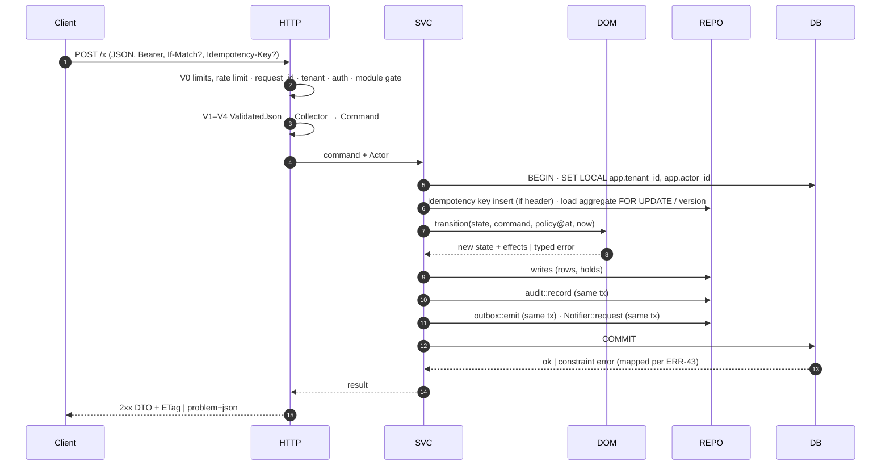
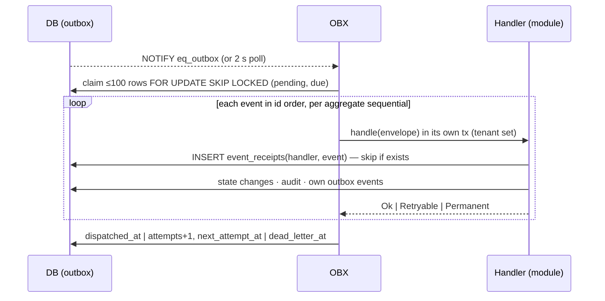
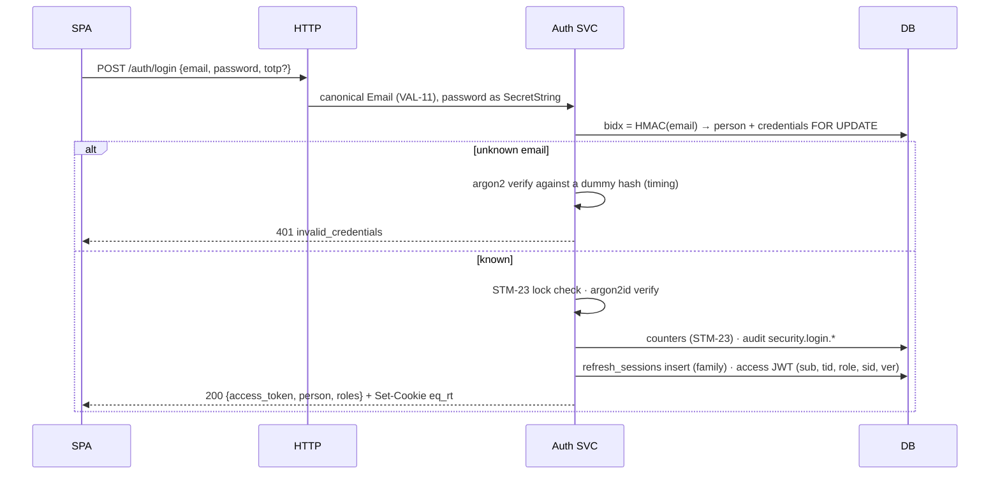
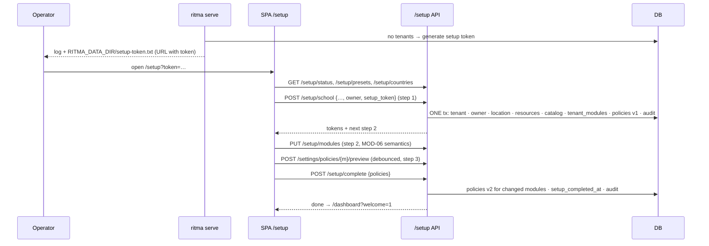
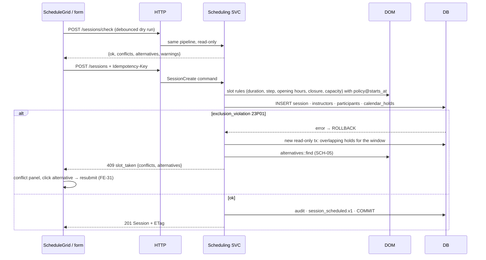
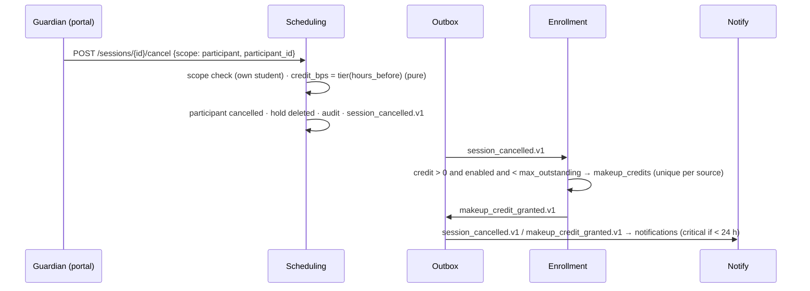
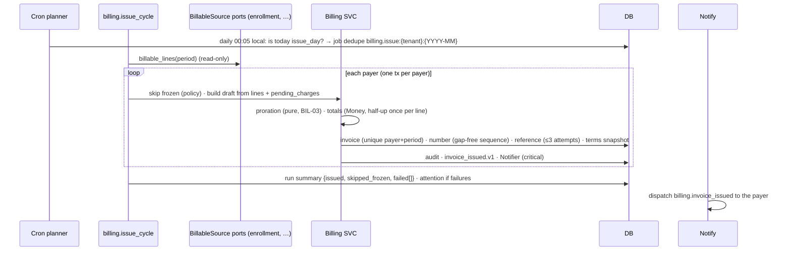
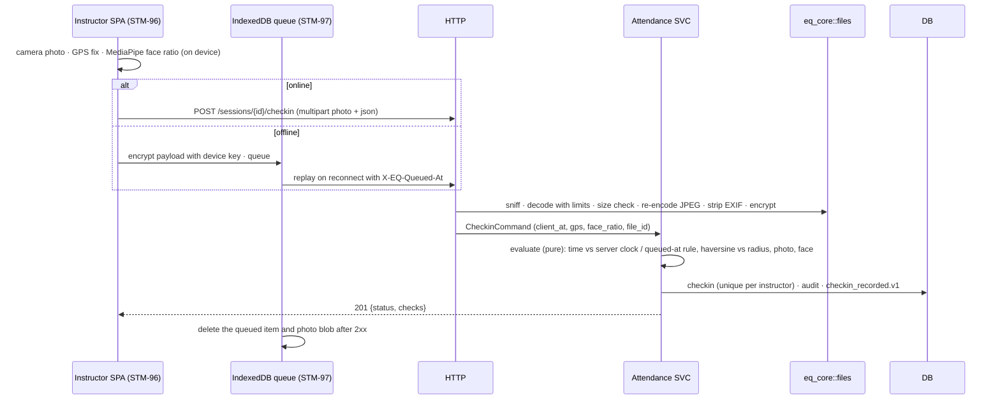
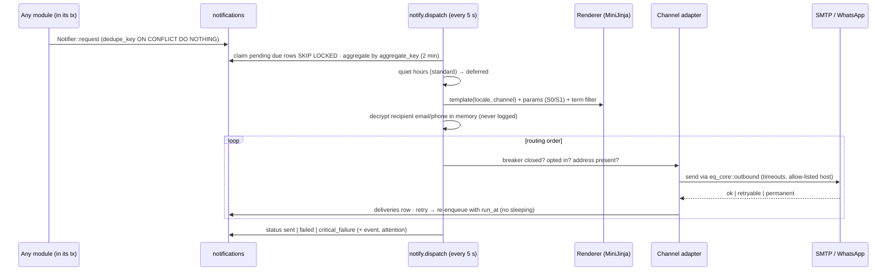

# 21 — Data Flows

This document shows **how data moves** through Ritma for every important use case: which layer touches it, in which transaction, what is written, what is emitted, and where sensitive data is encrypted, decrypted or dropped.

- The generic request lifecycle is ARC-04; the flows below are its concrete instances.
- States and guards are `20-state-machines.md` (STM-\*). Inputs are checked per `22-validation-and-sanitization.md` (VAL-07 stages V0–V8). Formats are `23-contracts-and-canonical-forms.md`.
- Diagrams use the layer names of `17-clean-architecture.md`: **HTTP** (`http.rs` adapter + `eq-api` middleware), **SVC** (service), **DOM** (pure domain), **REPO** (`repo.rs`), **DB** (PostgreSQL), **OBX** (outbox dispatcher), **JOB** (job runner), **NTF** (notify), **EXT** (external provider).

Tags: **[D-nn]** a decision, listed in §8.

## 1. Generic flows

### FLW-01. Write request (every mutation)

- Steps 6–13 are **one transaction**. A failure anywhere rolls back the business write, the audit entry, the events and the notifications together (ARC-05).
- Policy is read with `PolicyStore::get(at)` where `at` is the time of the thing checked (POL-05), or from the record's snapshot.
- The response is built from the committed state, not from the request.

### FLW-02. Read request (lists and details)

`HTTP` (V0–V2 query parsing, `Page` limits) → `SVC` (`Scope` from the `Actor`, IDN-10) → `REPO` (one SQL query with the scope predicate and keyset pagination on `(sort_key, id)`, SBD-41) → DTO mapping (S2 fields only with `read_pii`, decrypted in SVC through `eq_core::crypto`, each decryption of another person's PII audited per AUD-01, throttled per day) → `200 Page<T>`. Reads open a read-only transaction with the tenant set, so RLS applies.

### FLW-03. Event dispatch (outbox → handlers)

Handlers of disabled modules return `Ok` without work (ERR-52). A handler never calls another module directly; it re-reads through ports when it needs more than the payload (CAN-60).

### FLW-04. Jobs and cron

The cron planner (1/min) evaluates each `CronSpec` in the tenant TZ and inserts due jobs with a `dedupe_key` (`ON CONFLICT DO NOTHING`). Workers claim with `SKIP LOCKED`, set `app.tenant_id`, run the handler as `ActorCtx::system(kind)` through the **same services** as HTTP (so audit and events are identical), and record `done`/backoff/`dead` (STM-81). Policy-driven days ("issue on the 5th") are checked by a daily job against the policy in force, never hard-coded (ARC-09).

### FLW-05. Cache invalidation

Writes to policies and modules `NOTIFY eq_policy_changed` / `eq_modules_changed` with `{tenant_id, module}` **after commit** (a `NOTIFY` inside a tx is delivered at commit). Every process listens and evicts its `moka` entries; the 30 s TTL is the safety net (MOD-05, POL-04). Report widgets cache 60 s per tenant/range and are evicted by `core.module_toggled.v1` (RPT-03).

## 2. Identity flows

### FLW-10. Login

The access token stays in memory (STM-90). `ver` binds it to `password_changed_at`.

### FLW-11. Refresh and rotation

`POST /auth/refresh` (cookie + `X-EQ-CSRF: 1` + Origin check) → hash the cookie → load the row `FOR UPDATE` → STM-22: active → rotate (new row, same family, new cookie, new JWT); rotated → revoke the family, audit `security.refresh_reuse`, 401; expired/revoked → 401 `session_expired`. The SPA runs this single-flight and broadcasts the new token to other tabs (FE-11).

### FLW-12. Invite and password reset

- **Invite:** staff `POST /people/{id}/invite` → invite row (token hash) + `identity.user_invited.v1` → notify renders `identity.invite` with a URL built from `RITMA_PUBLIC_URL` + `/invite/{token}` (CAN-80) → recipient `GET /auth/invites/{token}` (shows tenant, role) → `POST …/accept {password}` → one tx: password hash, invite accepted, membership active, refresh family → logged in.
- **Reset:** `POST /auth/forgot {email}` → always 202 after constant work; if the person exists and is under `reset_max_per_hour`, a reset row + `password_reset_requested.v1` → notify sends the link → `POST /auth/reset` → one tx: password, token used, **all** refresh sessions revoked, audit.

## 3. Setup and settings

### FLW-20. Setup wizard (self-host first run)

### FLW-21. Policy change

Settings → Rules form (`PolicyForm`, ajv on change) → `POST /settings/policies/{m}/preview` (V0–V7, no write, returns errors + summary) → owner picks "Apply from" → `PUT /settings/policies/{m}` → insert version, audit before/after, `core.policy_changed.v1`, `NOTIFY` → caches evicted (FLW-05) → modules read the new version for future checks; **existing commitments keep their snapshot** (POL-05).

### FLW-22. Module toggle

Settings → Features (STM-95 dialog) → `PUT /settings/modules {enabled}` → closure checks → per change `on_enable`/`on_disable` + audit + `core.module_toggled.v1` in one tx → `NOTIFY eq_modules_changed` → `ModuleGate` cache evicted → the SPA refetches `/meta/modules` and rebuilds navigation (FE-15).

## 4. Scheduling flows

### FLW-30. Create a session (with conflict)

### FLW-31. Materialisation

Daily `scheduling.materialize` (and on demand after series/member changes) → per active series, per date up to `today + materialize_weeks_ahead`: skip if a session exists for `(series, date)`; apply closures (`on_closure`), the cycle cap (`sessions_per_cycle`, `extra_occurrence`), leave (EnrollmentStatus port) → insert session + holds in a **savepoint per occurrence**, so one conflict skips that date only and raises a `materialize_conflict` attention item with alternatives; `occurrence_skipped.v1` when a credit applies → `materialized_until` advanced.

### FLW-32. Cancellation → make-up credit

## 5. Enrollment and billing flows

### FLW-40. Public registration → approval

1. `/join` loads `GET /public/catalog` (S0) and the form rules.
2. `POST /public/registrations` (multipart): V0 (5/h per IP, captcha if configured) → honeypot → V3 kinds → payment proof via `files::accept` (sniff, re-encode, **encrypt**) → applicant JSON **encrypted** into `applicant_enc` (AAD = tenant|registrations|applicant_enc|id) → only `applicant_display` stays plaintext → `registration_submitted.v1` → confirmation message to the applicant's address (taken from the request, never logged).
3. Admin opens `/registrations/{id}`: SVC decrypts `applicant_enc` (permission `enrollment.registration.read`, audited) and looks up existing persons by blind index (email/phone) to suggest links.
4. `POST /registrations/{id}/approve`: **one tx** creates persons (PII encrypted per field, blind indexes), links, memberships, enrollments (with `leave_terms` snapshot), series members (capacity checked under lock), optional invites → `enrollment_activated.v1` per active enrollment → billing turns registration fees into `pending_charges` (unique `source_ref`) → scheduling materialises the new members on demand.

### FLW-41. Monthly cycle issuance

A failure for one payer rolls back only that payer's tx; re-running the job is safe because of the unique index (BIL-02).

### FLW-42. Payment → verification → paid → unfreeze

Payer `POST /invoices/{id}/payments` (proof upload encrypted, `Idempotency-Key`) → `submitted` + attention `payment_to_verify` → admin queue shows matches (`reference_entered = reference_code`, or amount = total for UniqueAmount) → `POST /payments/{id}/verify` → one tx: payment verified, `paid_minor += amount`, invoice status (STM-50), `payment_recorded.v1`, `invoice_paid.v1` → billing handler re-evaluates payer state (STM-52 t3) → `payer_unfrozen.v1` → scheduling sets `blocked` participants back to `expected` (STM-32 t3); rental lifts the restriction; notify sends `payment_verified` and `payer_unfrozen`.

### FLW-43. Overdue → late fee → freeze

Daily `billing.overdue` (00:10 local) → for each open invoice past `due_at`: lock it, `overdue`, late fee per **snapshotted** terms (once) → `invoice_overdue.v1` → recompute the payer state from all overdue invoices (strictest snapshotted action) → `payer_frozen.v1 {state}` → scheduling blocks future participations (frozen only) → rental blocks new bookings → notify critical message → every API response for that payer's session carries `X-EQ-Payer-State` and `/me.payer_state` drives the banner (FE-32).

## 6. Attendance, rental, notify, privacy

### FLW-50. Instructor check-in (online and offline)

Raw GPS coordinates are S1 for the instructor's own check-in and shown only to reviewers; the photo is S2 and only reachable through a 5-minute signed URL (SEC-15) until the retention job deletes it (ATT-08).

### FLW-51. Reservation with deposit

`POST /rental/quote` (dry run: price breakdown from the rate card in force, peak slices) → `POST /reservations` + `Idempotency-Key` → one tx: RNT-02 checks, PayerState port, price/terms snapshot, holds, `pending_payment` with `hold_expires_at` → `reservation_requested.v1 {needs_payment}` → billing issues a `rental` invoice (`deposit` line) due at `hold_expires_at` → payment verified → `invoice_paid.v1` → rental confirms (STM-60 t4) → or `rental.expire_holds` expires it, deletes holds and cancels the unpaid invoice.

### FLW-52. Notification pipeline

### FLW-53. Privacy export and erasure

- **Export:** `POST /privacy/export {subject_id}` (scope check) → job `privacy.export` → collect through ports (each module returns its rows for the subject) → ZIP (`person.json` with decrypted PII, CSVs with the formula guard) → file `export` **encrypted** → signed URL valid 24 h → audit `privacy.export.created` → the file is deleted after 24 h (STM-72).
- **Erasure:** STM-71 → job `privacy.erase` → one tx: end enrollments, delete future participations and holds, deactivate memberships, revoke sessions, anonymise the person (null `*_enc` and `*_bidx`), anonymise audit entries for the subject, keep invoices with the anonymised name → after commit: physical deletion of avatar, check-in photos and payment proofs (STM-15) → confirmation to the contact captured before erasure.

### FLW-54. File upload and download

Upload: multipart part → V0 body limit (route-specific) → stream to a temp file under `RITMA_DATA_DIR/tmp` with a size cap → `files::accept(purpose)` (VAL-15) → storage via `object_store` (local or S3) at `files/{tenant}/{yyyy}/{mm}/{file_id}` → `files` row with sha256 → `{file_id}`. Download: `GET /api/v1/files/{id}?exp&sig` → HMAC check (constant time) bound to the actor → RLS-scoped row lookup → stream (decrypting in 1 MiB STREAM chunks if encrypted) with `nosniff` and `Content-Disposition` (CAN-81).

### FLW-55. CSV/XLSX import

`POST /import/students/preview` (file) → VAL-17 limits → parse in `spawn_blocking` → per row: field kinds (VAL-21) + reference lookups by key/email → preview stored as a short-lived `upload_id` (the import file, 24 h) → UI shows row errors → fix and re-upload, or `POST /import/students/commit {upload_id}` → **one tx** for all rows (refused unless 0 errors) → the same services as manual creation (audit and events per entity) → error-report CSV if anything fails.

## 7. Data lineage (sensitive data)

**FLW-60.** Where S2/S3 data exists in plaintext. Everywhere else it is ciphertext, a hash, or absent.

| Data (class) | Enters | Plaintext exists only in | At rest | Leaves the server as | Never in |
|---|---|---|---|---|---|
| Password (S3) | login, accept, reset, change | request memory (`SecretString`, zeroized) | argon2id hash | — | logs, audit, events, responses, drafts |
| Refresh / invite / reset tokens (S3) | generated by the server | the response cookie or the outgoing message | SHA-256 | cookie / link once | logs, audit, events |
| TOTP secret (S3) | setup | setup response (QR) and verification memory | AES-GCM (`totp_secret_enc`) | QR once | logs, audit |
| Channel credentials (S3) | Settings → Channels | request memory, adapter memory at send time | AES-GCM (`config_enc`) | redacted `••••` | logs, audit (keys only), events |
| Email, phone (S2) | people forms, registration, guest booking | request memory, SVC memory for `read_pii` responses, notify job memory at send time | AES-GCM + HMAC blind index | `read_pii` responses, outgoing messages, privacy export | logs, audit (ids only), events, notification params, URLs |
| Legal name, birth date, address (S2) | people forms, registration | same as above | AES-GCM | `read_pii` responses, export | logs, audit, events |
| Registration applicant data (S2) | `/join` | request memory, review screen | AES-GCM (`applicant_enc`) | review screen (admin) | logs, events |
| Check-in photo, payment proof, registration docs (S2) | uploads | upload memory/temp file (deleted after encryption) | encrypted file (STREAM) | signed URL, 5 min | logs, static paths |
| Offline check-in payload (S2) | instructor device | device memory | IndexedDB, WebCrypto AES-GCM (non-extractable key) | replay request | localStorage, logs |
| Drafts (may contain S2 typed by the user) | forms | browser + `drafts` row | plaintext JSON in `drafts` (RLS, owner only), cleared on logout and after 7 days | the same person only | logs, audit [D-55] |
| Display name (S1) | everywhere | plaintext by design (SEC-04) | plaintext | role-scoped responses, messages, audit | logs (ids only) |

## 8. Decisions taken in this document

| ID | Decision |
|---|---|
| D-55 | Server-side drafts are stored as plaintext JSON under RLS, readable only by their author, and purged after 7 days; forms that collect S2 values (registration review, people PII fields) exclude those fields from drafts |
