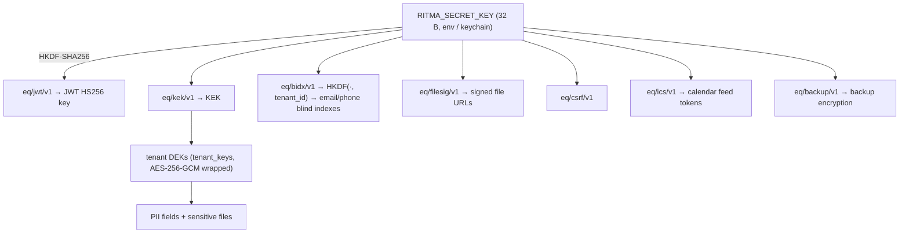

# 25 — Authentication and Access Control

This document is the **single consolidated view** of how Ritma authenticates people and decides what they may do. It doesn't add rules. It assembles IDN-\* (`modules/identity.md`), SEC-\* (spec 10), STM-20..27 and STM-90 (spec 20), FLW-10..12 (spec 21), SBD-40..43/49 (spec 18) and the permission tables of every module spec into one place. Where a source and this document disagree, the source wins and this document is a bug. Gaps found while consolidating are listed in §9 as open decisions, not filled in.

ID prefix: **AUTH-**. Decisions: `ADR-0016` (token model), `ADR-0017` (RBAC model).

## 1. Principles

- **AUTH-01. Deny by default.** Every route declares its auth mode (`bearer`, `cookie`, `signed`, `token`, `none`) in its `#[utoipa::path]` security block, and every non-`none` handler calls `actor.require(perm)` before touching data (SBD-40). A route without a declared mode fails the contract test (TST-04).
- **AUTH-02. No auth server.** Authentication is in-process (`eq-identity`), built from audited libraries: `argon2`, `jsonwebtoken`, `totp-rs`, `hkdf`/`hmac`/`sha2`, `subtle`, `secrecy` (OSS §2). Keycloak, Ory and similar were rejected because they add a stateful service (OSS-05, ADR-0016).
- **AUTH-03. Short-lived bearer, long-lived rotating cookie.** The access token lives 10 minutes in memory only. Continuity comes from an opaque refresh token in an `HttpOnly` cookie that rotates on every use, with reuse detection (IDN-03/04).
- **AUTH-04. Permission ≠ scope.** A permission says *which action* a role may take. A scope says *which rows* (IDN-10). Permissions are checked in the handler; scopes are applied in SQL (SBD-41). Out-of-scope rows return 404, not 403.
- **AUTH-05. Tenant from context only.** The tenant comes from the host (multi) or config (single), never from a body, query or header (SBD-42). The JWT's `tid` must equal the resolved tenant, otherwise 401.
- **AUTH-06. No enumeration.** Login, forgot-password and invite flows reveal nothing about whether an account exists (SBD-43, IDN-06/08): constant-time paths with a dummy hash, identical responses.

## 2. Keys and secrets



| Secret | Where it lives | Rotation | Source |
|---|---|---|---|
| Master key `RITMA_SECRET_KEY` | env (`.env` mode 600), OS keychain on desktop | `ritma rotate-keys` with `RITMA_SECRET_KEY_PREVIOUS` | SEC-01, T-705 |
| JWT key | derived, memory only | follows the master key; tokens die within 10 min | SEC-01 |
| Tenant DEKs | `tenant_keys` (wrapped) | new version for writes, `crypto.reencrypt` job | SEC-02 |
| Password hashes | `credentials.password_hash` (argon2id m=19456 KiB, t=2, p=1) | rehash on login when parameters change | IDN-02 |
| Refresh tokens | client cookie; server keeps SHA-256 only | every refresh | IDN-04 |
| Invite / reset tokens | link; server keeps SHA-256 only | single use, TTL from policy | IDN-07/08, SEC-12 |
| TOTP secret | `credentials.totp_secret_enc` (encrypted) | re-enrolment | IDN-12 |
| Recovery codes | argon2 hashes, 10, shown once | regenerated on re-enrolment | IDN-12 |
| Setup token | `RITMA_DATA_DIR/setup-token.txt` or `RITMA_SETUP_TOKEN` | single use, cleared at step 1 | SET-11 |

All secret values in Rust are `SecretString`/`SecretBox` (`secrecy`), compared with `subtle::ConstantTimeEq`, and never logged (SBD-49/50, SEC-21).

## 3. Credentials and tokens

### 3.1 Access token (JWT)

| Field | Value |
|---|---|
| Algorithm | HS256 only. The verifier pins the algorithm and rejects `none` and asymmetric algorithms |
| Lifetime | 600 s (`exp - iat`), technical constant |
| Claims | `sub` person id · `tid` tenant id · `role` active role · `sid` refresh session id · `iat` · `exp` · `ver` = `credentials.password_changed_at` epoch |
| Transport | Response body → SPA memory → `Authorization: Bearer …`. Never in `localStorage`, `sessionStorage`, cookies or URLs (FE-12) |
| Verification per request | signature, `exp` (30 s leeway), `tid` = resolved tenant, `ver` = current (cached 60 s, invalidated in-process on password change), membership for `role` still `active` with the permission set cached 30 s (T-110, CACHE-03) |
| Failure | 401 `unauthenticated`; the SPA refreshes once and retries (FE-11) |

### 3.2 Refresh token (cookie)

| Property | Value |
|---|---|
| Value | 32 random bytes from `OsRng`, base64url; server stores SHA-256 in `refresh_sessions.token_hash` |
| Cookie | `eq_rt`; `HttpOnly; Secure (when https); SameSite=Strict; Path=/api/v1/auth`; no `Domain` (host-only); `Max-Age` = absolute expiry |
| Family | `family_id` per login. Every refresh issues a successor and marks the predecessor `rotated` (STM-22 t2) |
| Reuse | Presenting a `rotated` token revokes the whole family, audits `security.refresh_reuse` and returns 401 `session_expired` (STM-22 t3) |
| Idle expiry | `idle_timeout_minutes[role]`, sliding on each refresh (defaults: owner 30, admin 30, instructor 60, guardian 120, student 120) |
| Absolute expiry | `absolute_session_days` (default 30) from login; never slides |
| Concurrency | The refresh row is locked `FOR UPDATE`; two tabs refreshing at once are serialised client-side by the single-flight refresh and `BroadcastChannel('eq-auth')` (STM-90) |

### 3.3 CSRF

Only the cookie-authenticated endpoints (`/auth/refresh`, `/auth/logout`, `/auth/switch-role`) can be forged cross-site. They require **both** `X-EQ-CSRF: 1` (a custom header a cross-site form can't send) **and** an `Origin` equal to `RITMA_PUBLIC_URL`'s origin. Bearer endpoints are immune because browsers never attach the bearer token automatically (IDN-05). `SameSite=Strict` is a third, independent layer.

### 3.4 Other credentials

| Credential | Use | Format and checks | Source |
|---|---|---|---|
| Signed file URL | Download a protected file | `?exp=<unix>&sig=base64url(HMAC(filesig, tenant\|id\|exp\|actor))`, 5 min, bound to the actor; avatars and logo are public within the tenant | SEC-15, CAN-81 |
| Calendar feed token | Read-only iCal feed | `base64url(person_id ‖ HMAC(ics key, tenant_id ‖ person_id ‖ ics_secret_version)[0..16])`; `DELETE /me/calendar-token` bumps `persons.ics_secret_version`; a bad or old token → 404 | SCH-16, CAN-83, T-211 |
| Unsubscribe token | Opt out of standard messages | signed token per person × channel, no login | NTF-10 |
| Guest magic link | Verify a rental guest's email | single-use, 15 min hold | RNT-10 |
| Setup token | Claim a fresh self-hosted install | compared in constant time; cleared when step 1 commits | SET-11 |
| Webhook signature | Payment providers (v1.x) | provider-specific HMAC, verified before parsing | BIL-12, SBD-63 |

## 4. Flows

### 4.1 Login (+ TOTP)

```mermaid
sequenceDiagram
  autonumber
  participant B as Browser (SPA)
  participant A as API (eq-identity)
  participant D as Postgres
  B->>A: POST /auth/login {email, password, totp?}
  A->>A: rate limit 10/min/IP (API-15); normalise email (NFC, trim, lowercase)
  A->>D: find credentials by email_bidx (FOR UPDATE)
  alt unknown email
    A->>A: verify against dummy hash (constant time)
    A-->>B: 401 invalid_credentials
  else locked (locked_until > now)
    A->>A: verify password
    A-->>B: wrong pw → 401 invalid_credentials · right pw → 423 locked {until}
  else wrong password
    A->>D: failed_count += 1 (may lock: STM-23 t2, event account_locked)
    A-->>B: 401 invalid_credentials
  else TOTP required and missing/invalid
    A-->>B: 401 totp_required (no counter reset yet)
  else success
    A->>D: reset counters; create refresh session (family); audit security.login.success
    A-->>B: 200 {access_token, expires_in, person, roles, active_role} + Set-Cookie eq_rt
  end
```

- The active role defaults to the most privileged active membership: owner > admin > instructor > guardian > student (IDN-09).
- TOTP is required when `totp = RequiredForOwnerAdmin` and the person holds owner or admin, or when the person enabled it. Codes accept ±1 step (30 s). A recovery code is accepted in place of the code and is consumed.
- Deactivated memberships can't log in. A person with no active membership gets the generic 401.

### 4.2 Refresh, rotation and reuse

`POST /auth/refresh` (cookie + CSRF) → lock the session row → if `rotated`: revoke the family, 401 → if expired or revoked: 401 `session_expired` → check membership active and `ver` → insert successor, mark predecessor `rotated`, slide idle expiry → new access token + new cookie. The SPA schedules this at `exp − 60 s` and on any 401 (single-flight). Full state machine: STM-22; client side: STM-90.

### 4.3 Logout, logout-all, device sessions

| Action | Effect |
|---|---|
| `POST /auth/logout` (cookie + CSRF) | Revoke this refresh session; clear the cookie; the SPA clears memory, Query cache, drafts and the offline queue and broadcasts `logout` (SBD-58) |
| `POST /auth/logout-all` (bearer) | Revoke every session of the person in this tenant |
| `DELETE /me/sessions/{id}` | Revoke one device; the device's access token dies within ≤ 10 min |

### 4.4 Role switch

`POST /auth/switch-role {role}` (cookie + CSRF): the role must be an active membership, else 403. It issues a new access token with the new `role`, keeps the refresh family, audits `security.role_switched`, and the SPA reloads `/me`, `/meta/modules` and the nav (permissions change with the role).

### 4.5 Invite and password reset

- **Invite (IDN-07):** admin creates a person with `invite: true` or calls `/people/{id}/invite` → token (hash stored, `invite_expires_days`) → link by email, WhatsApp or copy → `GET /auth/invites/{token}` shows tenant, name and role (404 unknown, 410 `invite_expired`) → `POST …/accept {password}` sets the password, activates the membership and logs in (STM-20 t3, STM-21). Resend revokes the previous invite.
- **Reset (IDN-08):** `POST /auth/forgot {email}` always returns 202 with identical latency; at most `reset_max_per_hour` per email → token TTL `reset_token_ttl_minutes` → `POST /auth/reset {token, new_password}` (400 `token_invalid`, 422 `password_weak`) → password changed, **all** refresh sessions revoked, `ver` bumped (STM-24).

### 4.6 Password change, deactivation, TOTP changes

| Event | Sessions | Access tokens |
|---|---|---|
| `POST /me/password` | other sessions revoked | all old tokens fail at once (`ver`) |
| Reset completed | all revoked | all fail (`ver`) |
| Membership deactivated (IDN-13) | all of the tenant revoked | fail within ≤ 30 s (permission-set cache, T-110) and at the latest at the next refresh |
| TOTP disabled | other sessions revoked | unchanged |
| Refresh reuse | family revoked | the family's tokens die within 10 min |

### 4.7 Passwords

- Length `password_min_length` (default 10, policy 8–64) to 128 characters, counted in Unicode scalar values after NFC, no trimming (VAL field kind `password`).
- Rejected if in the bundled top-10k common list; no composition rules (NIST 800-63B).
- The client shows a strength hint, but the server is authoritative (422 `password_weak`).

## 5. Roles

| Role | Who | Default density | Notes |
|---|---|---|---|
| `owner` | The school owner | compact | **Read-mostly** (IDN-11): reads everything, writes rules, modules, admins and overrides. Gets the admin set automatically when the tenant has no admin (computed, never stored) |
| `admin` | Front desk / office | compact | Day-to-day operations |
| `instructor` | Teacher, coach, tutor (label from terminology) | comfortable | Own sessions and own students |
| `guardian` | Parent or payer | comfortable | Self and linked students |
| `student` | Learner with an account (often adult) | comfortable | Self only |

A person can hold several roles and acts in **one active role at a time** (IDN-09). The effective permission set is the default grants of the active role only, never a union across roles (ADR-0017). Platform staff in cloud mode use `eq_platform` and the platform console, never a tenant role (SBD B8, spec 15).

## 6. Permission matrix (complete)

Legend: ✅ granted (scope `All`) · `own` / `linked` / `self` = granted with that scope (§7) · `read` = read part only · — = not granted. The **module spec is normative** for each grant; this table must match it, and the test `rbac_matrix_matches_spec` (T-113) fails if the registered `PermissionDef`s differ from it.

| Permission | owner | admin | instructor | guardian | student | Source |
|---|---|---|---|---|---|---|
| **core** | | | | | | |
| `core.policy.read` | ✅ | ✅ | — | — | — | T-113, 04 §7 |
| `core.policy.write` | ✅ | — | — | — | — | 04 §7, IDN-11 |
| `core.modules.read` | ✅ | ✅ | — | — | — | T-113 |
| `core.modules.write` | ✅ | — | — | — | — | MOD-06, IDN-11 |
| **identity** | | | | | | |
| `identity.people.read` | ✅ | ✅ | own students | self + linked | self | identity §3 |
| `identity.people.read_pii` | ✅ | ✅ | — | self + linked | self | identity §3 |
| `identity.people.write` | — | ✅ | — | — | — | identity §3 |
| `identity.roles.write` | ✅ (incl. admin/owner) | ✅ (instructor/guardian/student only) | — | — | — | identity §3 |
| `identity.admins.manage` | ✅ | — | — | — | — | identity §3 |
| **audit** | | | | | | |
| `audit.read` | ✅ all categories | ✅ `admin_categories` only | — | — | — | AUD-07, T-113 |
| `audit.verify` | ✅ | — | — | — | — | AUD-04, T-113 |
| **scheduling** | | | | | | |
| `scheduling.catalog.read` | ✅ | ✅ | ✅ | ✅ | ✅ | scheduling §3 |
| `scheduling.catalog.write` | — | ✅ | — | — | — | scheduling §3 |
| `scheduling.series.write` | — | ✅ | — | — | — | scheduling §3 |
| `scheduling.session.read` | ✅ | ✅ | own | linked | own | scheduling §3 |
| `scheduling.session.write` | — | ✅ | — | — | — | scheduling §3 |
| `scheduling.session.cancel` | — | ✅ | — | participant only (policy `payer_can_cancel`) | participant only, if payer | scheduling §3, SCH-10 |
| `scheduling.session.override_hours` | — | ✅ | — | — | — | scheduling §3 |
| `scheduling.session.custom_duration` | — | ✅ | — | — | — | scheduling §3 |
| `scheduling.override.revert` | ✅ | — | — | — | — | scheduling §3 |
| **enrollment** | | | | | | |
| `enrollment.registration.read` | read | ✅ | — | — | — | enrollment §3 |
| `enrollment.registration.write` | — | ✅ | — | — | — | enrollment §3 |
| `enrollment.registration.read_pii` | (open, §9 D-62) | ✅ | — | — | — | T-404 |
| `enrollment.read` | ✅ | ✅ | own students | linked | own | enrollment §3 |
| `enrollment.write` | — | ✅ | — | — | — | enrollment §3 |
| `enrollment.leave.request` | — | ✅ | — | linked | own, if payer | enrollment §3 |
| `enrollment.leave.decide` | — | ✅ | — | — | — | enrollment §3 |
| **billing** | | | | | | |
| `billing.invoice.read` | ✅ | ✅ | — | own (payer) | own (if payer) | billing §3 |
| `billing.invoice.write` | — | ✅ | — | — | — | billing §3 |
| `billing.payment.record` | — | ✅ (verified at once) | — | own (submitted) | own (submitted) | billing §3, BIL-07 |
| `billing.payment.verify` | — | ✅ | — | — | — | billing §3 |
| `billing.payer.unfreeze` | — | ✅ (only when no unpaid overdue, BIL-08) | — | — | — | billing §3 |
| `billing.override.unfreeze` | ✅ | — | — | — | — | billing §3 |
| `billing.override.cancel` | ✅ | — | — | — | — | billing §3 |
| **attendance** | | | | | | |
| `attendance.checkin.submit` | — | — | own sessions | — | — | attendance §4 |
| `attendance.review` | read | ✅ | — | — | — | attendance §4 |
| `attendance.marks.write` | — | ✅ | own sessions (policy `marked_by`) | — | — | attendance §4 |
| `attendance.marks.override` | — | ✅ | — | — | — | attendance §4 |
| `attendance.marks.read` | ✅ | ✅ | own sessions | linked | own | attendance §4 |
| **rental** | | | | | | |
| `rental.reserve` | — | ✅ (on behalf of anyone) | ✅ | ✅ | ✅ | rental §3 |
| `rental.read` | ✅ | ✅ | own | own | own | rental §3 |
| `rental.decide` | — | ✅ | — | — | — | rental §3 |
| `rental.rates.write` | — | ✅ | — | — | — | rental §3 |
| **notify** | | | | | | |
| `notify.channels.manage` | ✅ | ✅ | — | — | — | notify §3 |
| `notify.log.read` | ✅ | ✅ | — | — | — | notify §3 |
| **reports** | | | | | | |
| `reports.revenue.read` | ✅ | — (grantable) | — | — | — | RPT-06 |
| **feedback** | role rules in FBK §2; no permission keys declared yet (§9 D-63) | | | | | |

Rules the matrix can't show:
- **Owner override actions** (unfreeze, cancel a paid invoice, revert a session) require a reason and are audited in category `compliance` (IDN-11, BIL-08/09).
- **Policy-dependent grants** (`payer_can_cancel`, `marked_by`, `rental` "who can book") are read from the policy in force; turning the policy off removes the action even though the role has the permission.
- **Frozen or restricted payers** keep their permissions, but domain guards block bookings and cancellations (BIL-08, RNT-02); the SPA explains why (FE-32).
- **Module off** beats permission: a disabled module's routes return 404 `module_disabled` before the permission check (ARC-04 step 6).
- **Public routes** (`auth: none`): `/auth/login|forgot|reset|invites/*`, `/setup/status|presets|countries`, `/public/*` (catalog, registrations, rental, unsubscribe), `/meta/app`, `/healthz`, `/readyz`. Each has its own rate limit (API-15) and abuse controls (ENR-03, RNT-10).

## 7. Scopes

| Scope | Applies to | SQL rule (illustrative) |
|---|---|---|
| `All` | owner, admin | no row filter beyond RLS |
| `Instructor(p)` | instructor | sessions where `p ∈ session_instructors`; students = participants of those sessions in the last 90 days (FBK-01 uses the same window) |
| `Guardian(p)` | guardian | `p` itself plus students linked through `person_links(guardian_id = p)` |
| `Self_(p)` | student | rows about `p` only; payer-only actions also need `payer_id = p` |

- Scope is applied in the repository query (`WHERE` clause or join), never by filtering after load (SBD-41). List endpoints and detail endpoints use the same scope function.
- A detail request for a row outside the scope returns **404 `not_found`**; a request for an action the role lacks returns **403 `forbidden {perm}`** (ERR-10). This order hides existence from out-of-scope actors.
- RLS (`app.tenant_id`) is a separate, lower layer that isolates tenants; scopes never replace it (SEC-05).

## 8. Testing and enforcement

| Check | What it proves | Where |
|---|---|---|
| `rbac_matrix_matches_spec` | Registered `PermissionDef`s equal §6 | T-113 |
| TST-04 endpoint × role matrix | Every endpoint returns the right status and `code` for every role | each module task (`*_role_matrix`) |
| TST-06 isolation | Cross-tenant ids and unset tenant return 0 rows | T-116 |
| Identity ACs | Lockout, refresh reuse, `ver` invalidation, guardian scope, last owner, invite expiry, enumeration timing | T-110..T-112 |
| Auth mode contract test | Every route declares `security` and non-public routes reject anonymous calls | T-114/T-116a |
| ZAP baseline + fuzzing | No auth bypass, no verbose errors | T-711, T-116a |

## 9. Decisions and open points from this consolidation

| ID | Decision or open point | Status |
|---|---|---|
| D-62 | `enrollment.registration.read_pii` (T-404) has no row in `modules/enrollment.md` §3. Proposed grant: admin ✅, owner read. | **Open**, needs the enrollment spec updated before T-404 is promoted |
| D-63 | Feedback actions are defined by role in FBK §2 but have no permission keys. Proposed keys `feedback.notes.write`, `feedback.notes.publish`, `feedback.ratings.write`, `feedback.ratings.moderate` with the FBK grants. | **Open**, needs `modules/feedback.md` before T-608 is promoted |
| D-64 | Privacy endpoints (AUD-10/11) are defined by requester relationship (self, guardian, staff), not by keys. Kept as relationship rules; T-609/T-610 test them in the role matrix. | Recorded |
| D-65 | Token verification timings come from T-110: 30 s `exp` leeway, `ver` cache 60 s, permission-set cache 30 s. A deactivated person can act for at most 30 s; accepted as a technical constant. | Recorded |
