# 29 — Entity-Relationship Diagrams and Data Dictionary

**ERD-01. Source of truth.** The normative schema is the DDL in `06-domain-model.md` §3–§4 (and `policies` in `04-policy-engine.md` §2). This document is **generated from that DDL** by `scripts/erd.py`, so the diagrams, the column list and the DDL cannot disagree:
- Everything between `<!-- BEGIN GENERATED: … -->` and `<!-- END GENERATED: … -->` is written by `scripts/erd.py --write`. Never edit it by hand.
- The prose, the mapping in §7 and the rules are hand-written.
- To change the schema, the architect edits spec 06, then runs `scripts/erd.py --write` in the same commit. An implementer who needs a schema change blocks the task (AGENTS §0, DOM-02).

How to read the diagrams:
- Mermaid `erDiagram`. `||` = exactly one, `|o` = zero or one, `o{` = zero or many, `o|` = zero or one on the child side (unique FK).
- **Solid line** = a database foreign key. **Dotted line** labelled `(logical)` = a reference without an FK (ERD-02).
- The edge to `tenants` is **omitted**. Every table with a `tenant_id` column belongs to one tenant (DOM-01); the dictionary's RLS line says so per table.
- Keys: `PK` primary key (also every column of a composite PK), `FK` foreign key, `UK` single-column unique. Composite unique constraints are in the DDL only.
- The quoted comment on an attribute is its data class when it is not S1 (ERD-04).

## 1. Inventory

<!-- BEGIN GENERATED: inventory -->
| Module | Tables | Count |
|---|---|---|
| `core` | `calendar_holds`, `tenants`, `locations`, `resources`, `persons`, `memberships`, `person_links`, `tenant_modules`, `closures`, `files`, `drafts`, `outbox`, `event_receipts`, `jobs`, `attention_items`, `consents`, `tenant_keys`, `idempotency_keys`, `cron_state`, `policies` | 20 |
| `identity` | `credentials`, `refresh_sessions`, `invites`, `password_resets`, `totp_recovery_codes` | 5 |
| `scheduling` | `level_tracks`, `levels`, `offerings`, `price_plans`, `series`, `series_members`, `sessions`, `session_instructors`, `session_participants`, `instructor_availability` | 10 |
| `enrollment` | `registrations`, `enrollments`, `leaves`, `makeup_credits`, `enrollment_changes` | 5 |
| `billing` | `invoices`, `invoice_lines`, `payments`, `payer_states`, `invoice_sequences`, `pending_charges` | 6 |
| `attendance` | `checkins`, `attendance_marks` | 2 |
| `rental` | `rate_cards`, `reservations` | 2 |
| `notify` | `channel_configs`, `notifications`, `deliveries`, `breaker_states`, `notification_prefs` | 5 |
| `audit` | `audit.entries`, `deletion_requests`, `audit.checkpoints` | 3 |
| `feedback` | `progress_notes`, `instructor_ratings` | 2 |
| `platform` | `platform.accounts`, `platform.account_tenants`, `platform.plans`, `platform.subscriptions`, `platform.usage_snapshots` | 5 |
| **total** | | **65** |
<!-- END GENERATED: inventory -->

## 2. Overview (all tables, foreign keys and logical references)

The overview shows every table with its owner module only. The per-module diagrams in §3 show the columns.

<!-- BEGIN GENERATED: overview -->
```mermaid
erDiagram
  %% core
  calendar_holds {
    text module "core"
  }
  tenants {
    text module "core"
  }
  locations {
    text module "core"
  }
  resources {
    text module "core"
  }
  persons {
    text module "core"
  }
  memberships {
    text module "core"
  }
  person_links {
    text module "core"
  }
  tenant_modules {
    text module "core"
  }
  closures {
    text module "core"
  }
  files {
    text module "core"
  }
  drafts {
    text module "core"
  }
  outbox {
    text module "core"
  }
  event_receipts {
    text module "core"
  }
  jobs {
    text module "core"
  }
  attention_items {
    text module "core"
  }
  consents {
    text module "core"
  }
  tenant_keys {
    text module "core"
  }
  idempotency_keys {
    text module "core"
  }
  cron_state {
    text module "core"
  }
  policies {
    text module "core"
  }
  %% identity
  credentials {
    text module "identity"
  }
  refresh_sessions {
    text module "identity"
  }
  invites {
    text module "identity"
  }
  password_resets {
    text module "identity"
  }
  totp_recovery_codes {
    text module "identity"
  }
  %% scheduling
  level_tracks {
    text module "scheduling"
  }
  levels {
    text module "scheduling"
  }
  offerings {
    text module "scheduling"
  }
  price_plans {
    text module "scheduling"
  }
  series {
    text module "scheduling"
  }
  series_members {
    text module "scheduling"
  }
  sessions {
    text module "scheduling"
  }
  session_instructors {
    text module "scheduling"
  }
  session_participants {
    text module "scheduling"
  }
  instructor_availability {
    text module "scheduling"
  }
  %% enrollment
  registrations {
    text module "enrollment"
  }
  enrollments {
    text module "enrollment"
  }
  leaves {
    text module "enrollment"
  }
  makeup_credits {
    text module "enrollment"
  }
  enrollment_changes {
    text module "enrollment"
  }
  %% billing
  invoices {
    text module "billing"
  }
  invoice_lines {
    text module "billing"
  }
  payments {
    text module "billing"
  }
  payer_states {
    text module "billing"
  }
  invoice_sequences {
    text module "billing"
  }
  pending_charges {
    text module "billing"
  }
  %% attendance
  checkins {
    text module "attendance"
  }
  attendance_marks {
    text module "attendance"
  }
  %% rental
  rate_cards {
    text module "rental"
  }
  reservations {
    text module "rental"
  }
  %% notify
  channel_configs {
    text module "notify"
  }
  notifications {
    text module "notify"
  }
  deliveries {
    text module "notify"
  }
  breaker_states {
    text module "notify"
  }
  notification_prefs {
    text module "notify"
  }
  %% audit
  audit_entries {
    text module "audit"
  }
  deletion_requests {
    text module "audit"
  }
  audit_checkpoints {
    text module "audit"
  }
  %% feedback
  progress_notes {
    text module "feedback"
  }
  instructor_ratings {
    text module "feedback"
  }
  %% platform
  platform_accounts {
    text module "platform"
  }
  platform_account_tenants {
    text module "platform"
  }
  platform_plans {
    text module "platform"
  }
  platform_subscriptions {
    text module "platform"
  }
  platform_usage_snapshots {
    text module "platform"
  }
  resources |o..o{ calendar_holds : "subject_id (logical)"
  persons |o..o{ calendar_holds : "subject_id (logical)"
  sessions |o..o{ calendar_holds : "owner_id (logical)"
  reservations |o..o{ calendar_holds : "owner_id (logical)"
  locations ||--o{ resources : "location_id"
  files |o..o{ persons : "avatar_file_id (logical)"
  persons ||--o{ memberships : "person_id"
  persons ||--o{ person_links : "guardian_id"
  persons ||--o{ person_links : "student_id"
  persons |o--o{ tenant_modules : "changed_by"
  locations |o--o{ closures : "location_id"
  persons |o--o{ files : "created_by"
  persons ||--o{ drafts : "person_id"
  outbox |o..o{ event_receipts : "event_id (logical)"
  persons ||--o| credentials : "person_id"
  persons ||--o{ refresh_sessions : "person_id"
  persons ||--o{ invites : "person_id"
  persons |o--o{ invites : "created_by"
  persons ||--o{ password_resets : "person_id"
  level_tracks ||--o{ levels : "track_id"
  level_tracks |o--o{ offerings : "level_track_id"
  offerings ||--o{ price_plans : "offering_id"
  levels |o--o{ price_plans : "level_id"
  offerings ||--o{ series : "offering_id"
  locations ||--o{ series : "location_id"
  resources ||--o{ series : "resource_id"
  persons ||--o{ series : "instructor_id"
  series ||--o{ series_members : "series_id"
  persons ||--o{ series_members : "person_id"
  enrollments |o..o{ series_members : "enrollment_id (logical)"
  offerings ||--o{ sessions : "offering_id"
  series |o--o{ sessions : "series_id"
  locations ||--o{ sessions : "location_id"
  resources ||--o{ sessions : "resource_id"
  persons |o--o{ sessions : "cancelled_by"
  sessions |o--o{ sessions : "rescheduled_from"
  persons |o--o{ sessions : "created_by"
  sessions ||--o{ session_instructors : "session_id"
  persons ||--o{ session_instructors : "person_id"
  sessions ||--o{ session_participants : "session_id"
  persons ||--o{ session_participants : "person_id"
  enrollments |o..o{ session_participants : "enrollment_id (logical)"
  files |o--o{ registrations : "payment_proof_file_id"
  persons |o--o{ registrations : "reviewed_by"
  persons ||--o{ enrollments : "student_id"
  persons ||--o{ enrollments : "payer_id"
  offerings ||--o{ enrollments : "offering_id"
  levels |o--o{ enrollments : "level_id"
  price_plans |o--o{ enrollments : "price_plan_id"
  series |o--o{ enrollments : "series_id"
  registrations |o--o{ enrollments : "registration_id"
  enrollments ||--o{ leaves : "enrollment_id"
  persons ||--o{ leaves : "requested_by"
  persons |o--o{ leaves : "decided_by"
  enrollments ||--o{ makeup_credits : "enrollment_id"
  sessions ||--o{ makeup_credits : "source_session_id"
  sessions |o--o{ makeup_credits : "used_session_id"
  persons ||--o{ invoices : "payer_id"
  invoices ||--o{ invoice_lines : "invoice_id"
  persons |o--o{ invoice_lines : "student_id"
  enrollments |o--o{ invoice_lines : "enrollment_id"
  reservations |o..o{ invoice_lines : "reservation_id (logical)"
  invoices ||--o{ payments : "invoice_id"
  files |o--o{ payments : "proof_file_id"
  persons |o--o{ payments : "submitted_by"
  persons |o--o{ payments : "verified_by"
  persons ||--o{ payer_states : "payer_id"
  sessions ||--o{ checkins : "session_id"
  persons ||--o{ checkins : "instructor_id"
  files |o--o{ checkins : "photo_file_id"
  persons |o--o{ checkins : "reviewed_by"
  sessions ||--o{ attendance_marks : "session_id"
  persons ||--o{ attendance_marks : "person_id"
  persons ||--o{ attendance_marks : "marked_by"
  resources ||--o{ rate_cards : "resource_id"
  resources ||--o{ reservations : "resource_id"
  persons ||--o{ reservations : "booker_id"
  persons |o--o{ reservations : "decided_by"
  persons |o--o{ reservations : "cancelled_by"
  invoices |o..o{ reservations : "invoice_id (logical)"
  persons ||--o{ notifications : "recipient_id"
  notifications ||--o{ deliveries : "notification_id"
  persons |o..o{ audit_entries : "actor_id (logical)"
  persons ||--o{ deletion_requests : "subject_id"
  persons ||--o{ deletion_requests : "requested_by"
  persons |o--o{ deletion_requests : "decided_by"
  persons ||--o{ progress_notes : "student_id"
  persons ||--o{ progress_notes : "instructor_id"
  sessions |o--o{ progress_notes : "session_id"
  persons ||--o{ instructor_ratings : "instructor_id"
  persons ||--o{ instructor_ratings : "rater_id"
  persons ||--o{ instructor_ratings : "student_id"
  persons |o--o{ attention_items : "resolved_by"
  persons ||--o{ consents : "person_id"
  persons ||--o{ instructor_availability : "person_id"
  persons ||--o{ pending_charges : "payer_id"
  persons |o--o{ pending_charges : "student_id"
  enrollments |o--o{ pending_charges : "enrollment_id"
  invoices |o--o{ pending_charges : "invoiced_in"
  persons ||--o{ notification_prefs : "person_id"
  persons ||--o{ totp_recovery_codes : "person_id"
  enrollments ||--o{ enrollment_changes : "enrollment_id"
  levels |o--o{ enrollment_changes : "level_id"
  series |o--o{ enrollment_changes : "series_id"
  price_plans |o--o{ enrollment_changes : "price_plan_id"
  persons ||--o{ enrollment_changes : "created_by"
  platform_accounts ||--o{ platform_account_tenants : "account_id"
  platform_plans ||--o{ platform_subscriptions : "plan_id"
  persons |o--o{ policies : "created_by"
```
<!-- END GENERATED: overview -->

## 3. Modules

Each module section has a diagram of the module's own tables (tables of other modules appear by name only, through their relationships) and the data dictionary. A module owns its tables: only its `repo.rs` writes them (CA-30). The owner is the spec 06 section the DDL is in.

### 3.1 core

Tenancy, people, the conflict ledger, policies, files, the outbox and jobs. `persons` lives in core because every module refers to it; identity owns credentials, not people.

<!-- BEGIN GENERATED: diagram-core -->
```mermaid
erDiagram
  calendar_holds {
    uuid id PK
    uuid tenant_id FK
    text subject_kind
    uuid subject_id
    tstzrange hold_range
    text owner_kind
    uuid owner_id
    timestamptz created_at
  }
  tenants {
    uuid id PK
    text slug UK "S0"
    text name "S0"
    char(2) country
    text preset_id
    int preset_version
    int setup_step
    timestamptz setup_completed_at
    text status
    text locale
    char(3) currency
    text timezone
    timestamptz created_at
  }
  locations {
    uuid id PK
    uuid tenant_id FK
    text name
    text address
    text timezone
    float8 geo_lat
    float8 geo_lng
    timestamptz archived_at
    timestamptz created_at
  }
  resources {
    uuid id PK
    uuid tenant_id FK
    uuid location_id FK
    text name
    text kind
    int capacity
    boolean rentable
    text color
    int sort
    timestamptz archived_at
    timestamptz created_at
  }
  persons {
    uuid id PK
    uuid tenant_id FK
    text display_name
    bytea legal_name_enc "S2"
    bytea email_enc "S2"
    bytea email_bidx "S2"
    bytea phone_enc "S2"
    bytea phone_bidx "S2"
    bytea birth_date_enc "S2"
    bytea address_enc "S2"
    text locale
    uuid avatar_file_id
    timestamptz anonymized_at
    timestamptz deleted_at
    timestamptz created_at
    timestamptz updated_at
    int version
    int ics_secret_version
  }
  memberships {
    uuid tenant_id PK, FK
    uuid person_id PK, FK
    text role PK
    text status
    timestamptz created_at
  }
  person_links {
    uuid tenant_id PK, FK
    uuid guardian_id PK, FK
    uuid student_id PK, FK
    text relationship
    boolean is_primary
    timestamptz created_at
  }
  tenant_modules {
    uuid tenant_id PK, FK
    text module_id PK
    boolean enabled
    timestamptz changed_at
    uuid changed_by FK
  }
  closures {
    uuid id PK
    uuid tenant_id FK
    uuid location_id FK
    daterange dates
    jsonb name
    text kind
    timestamptz created_at
  }
  files {
    uuid id PK
    uuid tenant_id FK
    text purpose
    text content_type
    bigint size_bytes
    bytea sha256
    text storage_key
    boolean encrypted
    uuid created_by FK
    timestamptz created_at
    timestamptz deleted_at
  }
  drafts {
    uuid id PK
    uuid tenant_id FK
    uuid person_id FK
    text form_key
    jsonb payload
    timestamptz updated_at
  }
  outbox {
    uuid id PK
    uuid tenant_id
    text event_type
    uuid aggregate_id
    jsonb payload
    timestamptz occurred_at
    timestamptz dispatched_at
    int attempts
    text last_error
  }
  event_receipts {
    text handler_id PK
    uuid event_id PK
    timestamptz processed_at
  }
  jobs {
    uuid id PK
    uuid tenant_id
    text kind
    jsonb payload
    timestamptz run_at
    text status
    int attempts
    int max_attempts
    timestamptz locked_until
    text last_error
    text dedupe_key UK
    timestamptz created_at
    timestamptz finished_at
  }
  attention_items {
    uuid id PK
    uuid tenant_id FK
    text module_id
    text kind
    text ref_type
    uuid ref_id
    jsonb payload
    text severity
    text dedupe_key
    timestamptz created_at
    timestamptz resolved_at
    uuid resolved_by FK
  }
  consents {
    uuid tenant_id PK, FK
    uuid person_id PK, FK
    text kind PK
    bytea text_hash PK
    timestamptz at
  }
  tenant_keys {
    uuid tenant_id PK, FK
    int key_version PK
    bytea dek_enc "S3"
    timestamptz created_at
    timestamptz retired_at
  }
  idempotency_keys {
    uuid tenant_id PK, FK
    text key PK
    text route
    bytea request_hash
    int status
    jsonb body
    timestamptz created_at
  }
  cron_state {
    uuid tenant_id PK, FK
    text kind PK
    timestamptz last_fire_at
  }
  policies {
    uuid tenant_id PK, FK
    text module_id PK
    int version PK
    int schema_version
    timestamptz effective_from
    jsonb document
    text note
    uuid created_by FK
    timestamptz created_at
  }
  resources |o..o{ calendar_holds : "subject_id (logical)"
  persons |o..o{ calendar_holds : "subject_id (logical)"
  sessions |o..o{ calendar_holds : "owner_id (logical)"
  reservations |o..o{ calendar_holds : "owner_id (logical)"
  locations ||--o{ resources : "location_id"
  files |o..o{ persons : "avatar_file_id (logical)"
  persons ||--o{ memberships : "person_id"
  persons ||--o{ person_links : "guardian_id"
  persons ||--o{ person_links : "student_id"
  persons |o--o{ tenant_modules : "changed_by"
  locations |o--o{ closures : "location_id"
  persons |o--o{ files : "created_by"
  persons ||--o{ drafts : "person_id"
  outbox |o..o{ event_receipts : "event_id (logical)"
  persons |o--o{ attention_items : "resolved_by"
  persons ||--o{ consents : "person_id"
  persons |o--o{ policies : "created_by"
```
<!-- END GENERATED: diagram-core -->

<!-- BEGIN GENERATED: dictionary-core -->
#### `calendar_holds`

Owner: `core` · RLS: yes

| Column | Type | Null | Key | Class | References | Notes |
|---|---|---|---|---|---|---|
| `id` | `uuid` |  | PK | S1 |  |  |
| `tenant_id` | `uuid` |  | FK | S1 | `tenants` |  |
| `subject_kind` | `text` |  |  | S1 |  |  |
| `subject_id` | `uuid` |  |  | S1 | `resources | persons` (logical: polymorphic by subject_kind) | resources.id or persons.id |
| `hold_range` | `tstzrange` |  |  | S1 |  |  |
| `owner_kind` | `text` |  |  | S1 |  |  |
| `owner_id` | `uuid` |  |  | S1 | `sessions | reservations` (logical: polymorphic by owner_kind) |  |
| `created_at` | `timestamptz` |  |  | S1 |  |  |

#### `tenants`

Owner: `core` · RLS: no — read through SECURITY DEFINER resolve_tenant(slug)

| Column | Type | Null | Key | Class | References | Notes |
|---|---|---|---|---|---|---|
| `id` | `uuid` |  | PK | S1 |  |  |
| `slug` | `text` |  | UK | S0 |  |  |
| `name` | `text` |  |  | S0 |  |  |
| `country` | `char(2)` |  |  | S1 |  |  |
| `preset_id` | `text` |  |  | S1 |  |  |
| `preset_version` | `int` |  |  | S1 |  |  |
| `setup_step` | `int` |  |  | S1 |  | 4 = done |
| `setup_completed_at` | `timestamptz` | yes |  | S1 |  |  |
| `status` | `text` |  |  | S1 |  |  |
| `locale` | `text` |  |  | S1 |  | denormalised from CorePolicy (kept in sync on policy save) |
| `currency` | `char(3)` |  |  | S1 |  | denormalised from CorePolicy |
| `timezone` | `text` |  |  | S1 |  | denormalised from CorePolicy |
| `created_at` | `timestamptz` |  |  | S1 |  |  |

#### `locations`

Owner: `core` · RLS: yes

| Column | Type | Null | Key | Class | References | Notes |
|---|---|---|---|---|---|---|
| `id` | `uuid` |  | PK | S1 |  |  |
| `tenant_id` | `uuid` |  | FK | S1 | `tenants` |  |
| `name` | `text` |  |  | S1 |  |  |
| `address` | `text` | yes |  | S1 |  |  |
| `timezone` | `text` | yes |  | S1 |  | NULL = tenant timezone |
| `geo_lat` | `double precision` | yes |  | S1 |  |  |
| `geo_lng` | `double precision` | yes |  | S1 |  |  |
| `archived_at` | `timestamptz` | yes |  | S1 |  |  |
| `created_at` | `timestamptz` |  |  | S1 |  |  |

#### `resources`

Owner: `core` · RLS: yes

| Column | Type | Null | Key | Class | References | Notes |
|---|---|---|---|---|---|---|
| `id` | `uuid` |  | PK | S1 |  |  |
| `tenant_id` | `uuid` |  | FK | S1 | `tenants` |  |
| `location_id` | `uuid` |  | FK | S1 | `locations` |  |
| `name` | `text` |  |  | S1 |  |  |
| `kind` | `text` |  |  | S1 |  |  |
| `capacity` | `int` |  |  | S1 |  |  |
| `rentable` | `boolean` |  |  | S1 |  |  |
| `color` | `text` | yes |  | S1 |  |  |
| `sort` | `int` |  |  | S1 |  |  |
| `archived_at` | `timestamptz` | yes |  | S1 |  |  |
| `created_at` | `timestamptz` |  |  | S1 |  |  |

#### `persons`

Owner: `core` · RLS: yes

| Column | Type | Null | Key | Class | References | Notes |
|---|---|---|---|---|---|---|
| `id` | `uuid` |  | PK | S1 |  |  |
| `tenant_id` | `uuid` |  | FK | S1 | `tenants` |  |
| `display_name` | `text` |  |  | S1 |  | plaintext by design (SEC-04) |
| `legal_name_enc` | `bytea` | yes |  | S2 |  | AES-256-GCM envelope (SEC-03) |
| `email_enc` | `bytea` | yes |  | S2 |  |  |
| `email_bidx` | `bytea` | yes |  | S2 |  | HMAC-SHA256 blind index of normalized email |
| `phone_enc` | `bytea` | yes |  | S2 |  |  |
| `phone_bidx` | `bytea` | yes |  | S2 |  | of E.164 phone |
| `birth_date_enc` | `bytea` | yes |  | S2 |  |  |
| `address_enc` | `bytea` | yes |  | S2 |  |  |
| `locale` | `text` | yes |  | S1 |  | NULL = tenant locale |
| `avatar_file_id` | `uuid` | yes |  | S1 | `files` (logical: set after upload) |  |
| `anonymized_at` | `timestamptz` | yes |  | S1 |  |  |
| `deleted_at` | `timestamptz` | yes |  | S1 |  |  |
| `created_at` | `timestamptz` |  |  | S1 |  |  |
| `updated_at` | `timestamptz` |  |  | S1 |  |  |
| `version` | `int` |  |  | S1 |  |  |
| `ics_secret_version` | `int` |  |  | S1 |  | (added by ALTER, §4.11) |

#### `memberships`

Owner: `core` · RLS: yes

| Column | Type | Null | Key | Class | References | Notes |
|---|---|---|---|---|---|---|
| `tenant_id` | `uuid` |  | PK/FK | S1 | `tenants` |  |
| `person_id` | `uuid` |  | PK/FK | S1 | `persons` |  |
| `role` | `text` |  | PK | S1 |  |  |
| `status` | `text` |  |  | S1 |  |  |
| `created_at` | `timestamptz` |  |  | S1 |  |  |

#### `person_links`

Owner: `core` · RLS: yes · guardian ↔ student (1:N, plus secondary guardians)

| Column | Type | Null | Key | Class | References | Notes |
|---|---|---|---|---|---|---|
| `tenant_id` | `uuid` |  | PK/FK | S1 | `tenants` |  |
| `guardian_id` | `uuid` |  | PK/FK | S1 | `persons` |  |
| `student_id` | `uuid` |  | PK/FK | S1 | `persons` |  |
| `relationship` | `text` | yes |  | S1 |  |  |
| `is_primary` | `boolean` |  |  | S1 |  |  |
| `created_at` | `timestamptz` |  |  | S1 |  |  |

#### `tenant_modules`

Owner: `core` · RLS: yes

| Column | Type | Null | Key | Class | References | Notes |
|---|---|---|---|---|---|---|
| `tenant_id` | `uuid` |  | PK/FK | S1 | `tenants` |  |
| `module_id` | `text` |  | PK | S1 |  |  |
| `enabled` | `boolean` |  |  | S1 |  |  |
| `changed_at` | `timestamptz` |  |  | S1 |  |  |
| `changed_by` | `uuid` | yes | FK | S1 | `persons` |  |

#### `closures`

Owner: `core` · RLS: yes

| Column | Type | Null | Key | Class | References | Notes |
|---|---|---|---|---|---|---|
| `id` | `uuid` |  | PK | S1 |  |  |
| `tenant_id` | `uuid` |  | FK | S1 | `tenants` |  |
| `location_id` | `uuid` | yes | FK | S1 | `locations` | NULL = all locations |
| `dates` | `daterange` |  |  | S1 |  |  |
| `name` | `jsonb` |  |  | S1 |  | I18nText |
| `kind` | `text` |  |  | S1 |  |  |
| `created_at` | `timestamptz` |  |  | S1 |  |  |

#### `files`

Owner: `core` · RLS: yes

| Column | Type | Null | Key | Class | References | Notes |
|---|---|---|---|---|---|---|
| `id` | `uuid` |  | PK | S1 |  |  |
| `tenant_id` | `uuid` |  | FK | S1 | `tenants` |  |
| `purpose` | `text` |  |  | S1 |  |  |
| `content_type` | `text` |  |  | S1 |  |  |
| `size_bytes` | `bigint` |  |  | S1 |  |  |
| `sha256` | `bytea` |  |  | S1 |  |  |
| `storage_key` | `text` |  |  | S1 |  | path under RITMA_DATA_DIR/files or S3 key |
| `encrypted` | `boolean` |  |  | S1 |  |  |
| `created_by` | `uuid` | yes | FK | S1 | `persons` |  |
| `created_at` | `timestamptz` |  |  | S1 |  |  |
| `deleted_at` | `timestamptz` | yes |  | S1 |  |  |

#### `drafts`

Owner: `core` · RLS: yes

| Column | Type | Null | Key | Class | References | Notes |
|---|---|---|---|---|---|---|
| `id` | `uuid` |  | PK | S1 |  |  |
| `tenant_id` | `uuid` |  | FK | S1 | `tenants` |  |
| `person_id` | `uuid` |  | FK | S1 | `persons` |  |
| `form_key` | `text` |  |  | S1 |  | e.g. "scheduling.session.new" |
| `payload` | `jsonb` |  |  | S1 |  |  |
| `updated_at` | `timestamptz` |  |  | S1 |  |  |

#### `outbox`

Owner: `core` · RLS: no — system table, dispatcher only

| Column | Type | Null | Key | Class | References | Notes |
|---|---|---|---|---|---|---|
| `id` | `uuid` |  | PK | S1 |  |  |
| `tenant_id` | `uuid` |  |  | S1 |  |  |
| `event_type` | `text` |  |  | S1 |  |  |
| `aggregate_id` | `uuid` | yes |  | S1 | `any aggregate` (logical: event source) |  |
| `payload` | `jsonb` |  |  | S1 |  |  |
| `occurred_at` | `timestamptz` |  |  | S1 |  |  |
| `dispatched_at` | `timestamptz` | yes |  | S1 |  |  |
| `attempts` | `int` |  |  | S1 |  |  |
| `last_error` | `text` | yes |  | S1 |  |  |

#### `event_receipts`

Owner: `core` · RLS: no — system table, dispatcher only

| Column | Type | Null | Key | Class | References | Notes |
|---|---|---|---|---|---|---|
| `handler_id` | `text` |  | PK | S1 |  |  |
| `event_id` | `uuid` |  | PK | S1 | `outbox` (logical: dedupe of handled events) |  |
| `processed_at` | `timestamptz` |  |  | S1 |  |  |

#### `jobs`

Owner: `core` · RLS: no — system table, runner only

| Column | Type | Null | Key | Class | References | Notes |
|---|---|---|---|---|---|---|
| `id` | `uuid` |  | PK | S1 |  |  |
| `tenant_id` | `uuid` | yes |  | S1 |  | NULL = platform job |
| `kind` | `text` |  |  | S1 |  |  |
| `payload` | `jsonb` |  |  | S1 |  |  |
| `run_at` | `timestamptz` |  |  | S1 |  |  |
| `status` | `text` |  |  | S1 |  |  |
| `attempts` | `int` |  |  | S1 |  |  |
| `max_attempts` | `int` |  |  | S1 |  |  |
| `locked_until` | `timestamptz` | yes |  | S1 |  |  |
| `last_error` | `text` | yes |  | S1 |  |  |
| `dedupe_key` | `text` | yes | UK | S1 |  |  |
| `created_at` | `timestamptz` |  |  | S1 |  |  |
| `finished_at` | `timestamptz` | yes |  | S1 |  |  |

#### `attention_items`

Owner: `core` · RLS: yes

| Column | Type | Null | Key | Class | References | Notes |
|---|---|---|---|---|---|---|
| `id` | `uuid` |  | PK | S1 |  |  |
| `tenant_id` | `uuid` |  | FK | S1 | `tenants` |  |
| `module_id` | `text` |  |  | S1 |  |  |
| `kind` | `text` |  |  | S1 |  | e.g. 'materialize_conflict','needs_manual_reference','checkin_pending','refund_due','critical_notification_failure','deletion_due' |
| `ref_type` | `text` | yes |  | S1 |  |  |
| `ref_id` | `uuid` | yes |  | S1 | `any aggregate` (logical: by ref_type) |  |
| `payload` | `jsonb` |  |  | S1 |  |  |
| `severity` | `text` |  |  | S1 |  |  |
| `dedupe_key` | `text` | yes |  | S1 |  |  |
| `created_at` | `timestamptz` |  |  | S1 |  |  |
| `resolved_at` | `timestamptz` | yes |  | S1 |  |  |
| `resolved_by` | `uuid` | yes | FK | S1 | `persons` |  |

#### `consents`

Owner: `core` · RLS: yes

| Column | Type | Null | Key | Class | References | Notes |
|---|---|---|---|---|---|---|
| `tenant_id` | `uuid` |  | PK/FK | S1 | `tenants` |  |
| `person_id` | `uuid` |  | PK/FK | S1 | `persons` |  |
| `kind` | `text` |  | PK | S1 |  |  |
| `text_hash` | `bytea` |  | PK | S1 |  |  |
| `at` | `timestamptz` |  |  | S1 |  |  |

#### `tenant_keys`

Owner: `core` · RLS: no — accessed only by core::crypto

| Column | Type | Null | Key | Class | References | Notes |
|---|---|---|---|---|---|---|
| `tenant_id` | `uuid` |  | PK/FK | S1 | `tenants` |  |
| `key_version` | `int` |  | PK | S1 |  |  |
| `dek_enc` | `bytea` |  |  | S3 |  |  |
| `created_at` | `timestamptz` |  |  | S1 |  |  |
| `retired_at` | `timestamptz` | yes |  | S1 |  |  |

#### `idempotency_keys`

Owner: `core` · RLS: yes

| Column | Type | Null | Key | Class | References | Notes |
|---|---|---|---|---|---|---|
| `tenant_id` | `uuid` |  | PK/FK | S1 | `tenants` |  |
| `key` | `text` |  | PK | S1 |  |  |
| `route` | `text` |  |  | S1 |  |  |
| `request_hash` | `bytea` |  |  | S1 |  |  |
| `status` | `int` |  |  | S1 |  |  |
| `body` | `jsonb` |  |  | S1 |  |  |
| `created_at` | `timestamptz` |  |  | S1 |  |  |

#### `cron_state`

Owner: `core` · RLS: no — system table, cron planner only

| Column | Type | Null | Key | Class | References | Notes |
|---|---|---|---|---|---|---|
| `tenant_id` | `uuid` |  | PK/FK | S1 | `tenants` |  |
| `kind` | `text` |  | PK | S1 |  | CronSpec.kind |
| `last_fire_at` | `timestamptz` |  |  | S1 |  |  |

#### `policies`

Owner: `core` · RLS: yes

| Column | Type | Null | Key | Class | References | Notes |
|---|---|---|---|---|---|---|
| `tenant_id` | `uuid` |  | PK/FK | S1 | `tenants` |  |
| `module_id` | `text` |  | PK | S1 |  |  |
| `version` | `int` |  | PK | S1 |  |  |
| `schema_version` | `int` |  |  | S1 |  |  |
| `effective_from` | `timestamptz` |  |  | S1 |  |  |
| `document` | `jsonb` |  |  | S1 |  |  |
| `note` | `text` | yes |  | S1 |  |  |
| `created_by` | `uuid` | yes | FK | S1 | `persons` |  |
| `created_at` | `timestamptz` |  |  | S1 |  |  |
<!-- END GENERATED: dictionary-core -->

### 3.2 identity

<!-- BEGIN GENERATED: diagram-identity -->
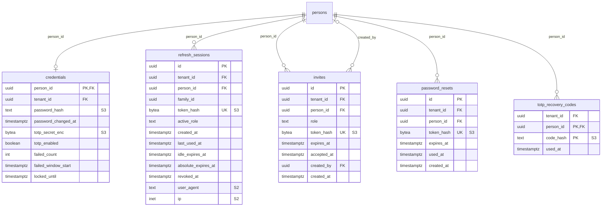
<!-- END GENERATED: diagram-identity -->

<!-- BEGIN GENERATED: dictionary-identity -->
#### `credentials`

Owner: `identity` · RLS: yes

| Column | Type | Null | Key | Class | References | Notes |
|---|---|---|---|---|---|---|
| `person_id` | `uuid` |  | PK/FK | S1 | `persons` |  |
| `tenant_id` | `uuid` |  | FK | S1 | `tenants` |  |
| `password_hash` | `text` | yes |  | S3 |  | argon2id PHC string; NULL until invite accepted |
| `password_changed_at` | `timestamptz` | yes |  | S1 |  |  |
| `totp_secret_enc` | `bytea` | yes |  | S3 |  |  |
| `totp_enabled` | `boolean` |  |  | S1 |  |  |
| `failed_count` | `int` |  |  | S1 |  |  |
| `failed_window_start` | `timestamptz` | yes |  | S1 |  |  |
| `locked_until` | `timestamptz` | yes |  | S1 |  |  |

#### `refresh_sessions`

Owner: `identity` · RLS: yes

| Column | Type | Null | Key | Class | References | Notes |
|---|---|---|---|---|---|---|
| `id` | `uuid` |  | PK | S1 |  |  |
| `tenant_id` | `uuid` |  | FK | S1 | `tenants` |  |
| `person_id` | `uuid` |  | FK | S1 | `persons` |  |
| `family_id` | `uuid` |  |  | S1 |  | rotation family (reuse detection, IDN-04) |
| `token_hash` | `bytea` |  | UK | S3 |  | sha256 of opaque token |
| `active_role` | `text` |  |  | S1 |  |  |
| `created_at` | `timestamptz` |  |  | S1 |  |  |
| `last_used_at` | `timestamptz` |  |  | S1 |  |  |
| `idle_expires_at` | `timestamptz` |  |  | S1 |  |  |
| `absolute_expires_at` | `timestamptz` |  |  | S1 |  |  |
| `revoked_at` | `timestamptz` | yes |  | S1 |  |  |
| `user_agent` | `text` | yes |  | S2 |  |  |
| `ip` | `inet` | yes |  | S2 |  |  |

#### `invites`

Owner: `identity` · RLS: yes

| Column | Type | Null | Key | Class | References | Notes |
|---|---|---|---|---|---|---|
| `id` | `uuid` |  | PK | S1 |  |  |
| `tenant_id` | `uuid` |  | FK | S1 | `tenants` |  |
| `person_id` | `uuid` |  | FK | S1 | `persons` |  |
| `role` | `text` |  |  | S1 |  |  |
| `token_hash` | `bytea` |  | UK | S3 |  |  |
| `expires_at` | `timestamptz` |  |  | S1 |  |  |
| `accepted_at` | `timestamptz` | yes |  | S1 |  |  |
| `created_by` | `uuid` | yes | FK | S1 | `persons` |  |
| `created_at` | `timestamptz` |  |  | S1 |  |  |

#### `password_resets`

Owner: `identity` · RLS: yes

| Column | Type | Null | Key | Class | References | Notes |
|---|---|---|---|---|---|---|
| `id` | `uuid` |  | PK | S1 |  |  |
| `tenant_id` | `uuid` |  | FK | S1 | `tenants` |  |
| `person_id` | `uuid` |  | FK | S1 | `persons` |  |
| `token_hash` | `bytea` |  | UK | S3 |  |  |
| `expires_at` | `timestamptz` |  |  | S1 |  |  |
| `used_at` | `timestamptz` | yes |  | S1 |  |  |
| `created_at` | `timestamptz` |  |  | S1 |  |  |

#### `totp_recovery_codes`

Owner: `identity` · RLS: yes

| Column | Type | Null | Key | Class | References | Notes |
|---|---|---|---|---|---|---|
| `tenant_id` | `uuid` |  | FK | S1 | `tenants` |  |
| `person_id` | `uuid` |  | PK/FK | S1 | `persons` |  |
| `code_hash` | `text` |  | PK | S3 |  | argon2id PHC string of one recovery code |
| `used_at` | `timestamptz` | yes |  | S1 |  |  |
<!-- END GENERATED: dictionary-identity -->

### 3.3 scheduling

Catalog (tracks, levels, offerings, price plans) and the session model. A `series` is a recurring weekly slot; materialisation turns it into `sessions`, and every session writes `calendar_holds` (DOM-10).

<!-- BEGIN GENERATED: diagram-scheduling -->
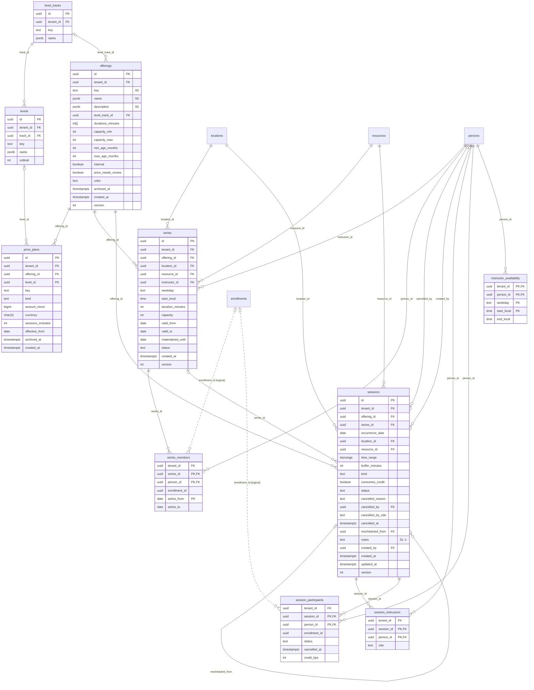
<!-- END GENERATED: diagram-scheduling -->

<!-- BEGIN GENERATED: dictionary-scheduling -->
#### `level_tracks`

Owner: `scheduling` · RLS: yes

| Column | Type | Null | Key | Class | References | Notes |
|---|---|---|---|---|---|---|
| `id` | `uuid` |  | PK | S1 |  |  |
| `tenant_id` | `uuid` |  | FK | S1 | `tenants` |  |
| `key` | `text` |  |  | S1 |  |  |
| `name` | `jsonb` |  |  | S1 |  |  |

#### `levels`

Owner: `scheduling` · RLS: yes

| Column | Type | Null | Key | Class | References | Notes |
|---|---|---|---|---|---|---|
| `id` | `uuid` |  | PK | S1 |  |  |
| `tenant_id` | `uuid` |  | FK | S1 | `tenants` |  |
| `track_id` | `uuid` |  | FK | S1 | `level_tracks` |  |
| `key` | `text` |  |  | S1 |  |  |
| `name` | `jsonb` |  |  | S1 |  |  |
| `ordinal` | `int` |  |  | S1 |  |  |

#### `offerings`

Owner: `scheduling` · RLS: yes

| Column | Type | Null | Key | Class | References | Notes |
|---|---|---|---|---|---|---|
| `id` | `uuid` |  | PK | S1 |  |  |
| `tenant_id` | `uuid` |  | FK | S1 | `tenants` |  |
| `key` | `text` |  |  | S0 |  |  |
| `name` | `jsonb` |  |  | S0 |  |  |
| `description` | `jsonb` | yes |  | S0 |  |  |
| `level_track_id` | `uuid` | yes | FK | S1 | `level_tracks` |  |
| `durations_minutes` | `int[]` |  |  | S1 |  |  |
| `capacity_min` | `int` |  |  | S1 |  |  |
| `capacity_max` | `int` |  |  | S1 |  |  |
| `min_age_months` | `int` | yes |  | S1 |  |  |
| `max_age_months` | `int` | yes |  | S1 |  |  |
| `internal` | `boolean` |  |  | S1 |  |  |
| `price_needs_review` | `boolean` |  |  | S1 |  |  |
| `color` | `text` | yes |  | S1 |  |  |
| `archived_at` | `timestamptz` | yes |  | S1 |  |  |
| `created_at` | `timestamptz` |  |  | S1 |  |  |
| `version` | `int` |  |  | S1 |  |  |

#### `price_plans`

Owner: `scheduling` · RLS: yes

| Column | Type | Null | Key | Class | References | Notes |
|---|---|---|---|---|---|---|
| `id` | `uuid` |  | PK | S1 |  |  |
| `tenant_id` | `uuid` |  | FK | S1 | `tenants` |  |
| `offering_id` | `uuid` |  | FK | S1 | `offerings` |  |
| `level_id` | `uuid` | yes | FK | S1 | `levels` | NULL = all levels; specific level overrides |
| `key` | `text` |  |  | S1 |  |  |
| `kind` | `text` |  |  | S1 |  |  |
| `amount_minor` | `bigint` |  |  | S1 |  |  |
| `currency` | `char(3)` |  |  | S1 |  |  |
| `sessions_included` | `int` | yes |  | S1 |  | for 'package' |
| `effective_from` | `date` |  |  | S1 |  |  |
| `archived_at` | `timestamptz` | yes |  | S1 |  |  |
| `created_at` | `timestamptz` |  |  | S1 |  |  |

#### `series`

Owner: `scheduling` · RLS: yes · a recurring weekly slot ("Voice group, Tue 15:00, Room 2, Ayu")

| Column | Type | Null | Key | Class | References | Notes |
|---|---|---|---|---|---|---|
| `id` | `uuid` |  | PK | S1 |  |  |
| `tenant_id` | `uuid` |  | FK | S1 | `tenants` |  |
| `offering_id` | `uuid` |  | FK | S1 | `offerings` |  |
| `location_id` | `uuid` |  | FK | S1 | `locations` |  |
| `resource_id` | `uuid` |  | FK | S1 | `resources` |  |
| `instructor_id` | `uuid` |  | FK | S1 | `persons` |  |
| `weekday` | `text` |  |  | S1 |  |  |
| `start_local` | `time` |  |  | S1 |  |  |
| `duration_minutes` | `int` |  |  | S1 |  |  |
| `capacity` | `int` |  |  | S1 |  |  |
| `valid_from` | `date` |  |  | S1 |  |  |
| `valid_to` | `date` | yes |  | S1 |  | NULL = open-ended |
| `materialized_until` | `date` | yes |  | S1 |  | last date sessions were generated for |
| `status` | `text` |  |  | S1 |  |  |
| `created_at` | `timestamptz` |  |  | S1 |  |  |
| `version` | `int` |  |  | S1 |  |  |

#### `series_members`

Owner: `scheduling` · RLS: yes

| Column | Type | Null | Key | Class | References | Notes |
|---|---|---|---|---|---|---|
| `tenant_id` | `uuid` |  | FK | S1 | `tenants` |  |
| `series_id` | `uuid` |  | PK/FK | S1 | `series` |  |
| `person_id` | `uuid` |  | PK/FK | S1 | `persons` |  |
| `enrollment_id` | `uuid` | yes |  | S1 | `enrollments` (logical: set by enrollment module (event)) | set by enrollment module |
| `active_from` | `date` |  | PK | S1 |  |  |
| `active_to` | `date` | yes |  | S1 |  |  |

#### `sessions`

Owner: `scheduling` · RLS: yes

| Column | Type | Null | Key | Class | References | Notes |
|---|---|---|---|---|---|---|
| `id` | `uuid` |  | PK | S1 |  |  |
| `tenant_id` | `uuid` |  | FK | S1 | `tenants` |  |
| `offering_id` | `uuid` |  | FK | S1 | `offerings` |  |
| `series_id` | `uuid` | yes | FK | S1 | `series` |  |
| `occurrence_date` | `date` | yes |  | S1 |  | local date of the series occurrence (dedupe) |
| `location_id` | `uuid` |  | FK | S1 | `locations` |  |
| `resource_id` | `uuid` |  | FK | S1 | `resources` |  |
| `time_range` | `tstzrange` |  |  | S1 |  |  |
| `buffer_minutes` | `int` |  |  | S1 |  | snapshot of policy (DOM-10) |
| `kind` | `text` |  |  | S1 |  |  |
| `consumes_credit` | `boolean` |  |  | S1 |  |  |
| `status` | `text` |  |  | S1 |  |  |
| `cancelled_reason` | `text` | yes |  | S1 |  |  |
| `cancelled_by` | `uuid` | yes | FK | S1 | `persons` |  |
| `cancelled_by_role` | `text` | yes |  | S1 |  |  |
| `cancelled_at` | `timestamptz` | yes |  | S1 |  |  |
| `rescheduled_from` | `uuid` | yes | FK | S1 | `sessions` |  |
| `notes` | `text` | yes |  | S1 ⚠ |  |  |
| `created_by` | `uuid` | yes | FK | S1 | `persons` |  |
| `created_at` | `timestamptz` |  |  | S1 |  |  |
| `updated_at` | `timestamptz` |  |  | S1 |  |  |
| `version` | `int` |  |  | S1 |  |  |

#### `session_instructors`

Owner: `scheduling` · RLS: yes

| Column | Type | Null | Key | Class | References | Notes |
|---|---|---|---|---|---|---|
| `tenant_id` | `uuid` |  | FK | S1 | `tenants` |  |
| `session_id` | `uuid` |  | PK/FK | S1 | `sessions` |  |
| `person_id` | `uuid` |  | PK/FK | S1 | `persons` |  |
| `role` | `text` |  |  | S1 |  |  |

#### `session_participants`

Owner: `scheduling` · RLS: yes

| Column | Type | Null | Key | Class | References | Notes |
|---|---|---|---|---|---|---|
| `tenant_id` | `uuid` |  | FK | S1 | `tenants` |  |
| `session_id` | `uuid` |  | PK/FK | S1 | `sessions` |  |
| `person_id` | `uuid` |  | PK/FK | S1 | `persons` |  |
| `enrollment_id` | `uuid` | yes |  | S1 | `enrollments` (logical: set by enrollment module (event)) |  |
| `status` | `text` |  |  | S1 |  |  |
| `cancelled_at` | `timestamptz` | yes |  | S1 |  |  |
| `credit_bps` | `int` | yes |  | S1 |  | make-up credit granted on cancellation (0..10000) |

#### `instructor_availability`

Owner: `scheduling` · RLS: yes

| Column | Type | Null | Key | Class | References | Notes |
|---|---|---|---|---|---|---|
| `tenant_id` | `uuid` |  | PK/FK | S1 | `tenants` |  |
| `person_id` | `uuid` |  | PK/FK | S1 | `persons` |  |
| `weekday` | `text` |  | PK | S1 |  |  |
| `start_local` | `time` |  | PK | S1 |  |  |
| `end_local` | `time` |  |  | S1 |  |  |
<!-- END GENERATED: dictionary-scheduling -->

### 3.4 enrollment

<!-- BEGIN GENERATED: diagram-enrollment -->
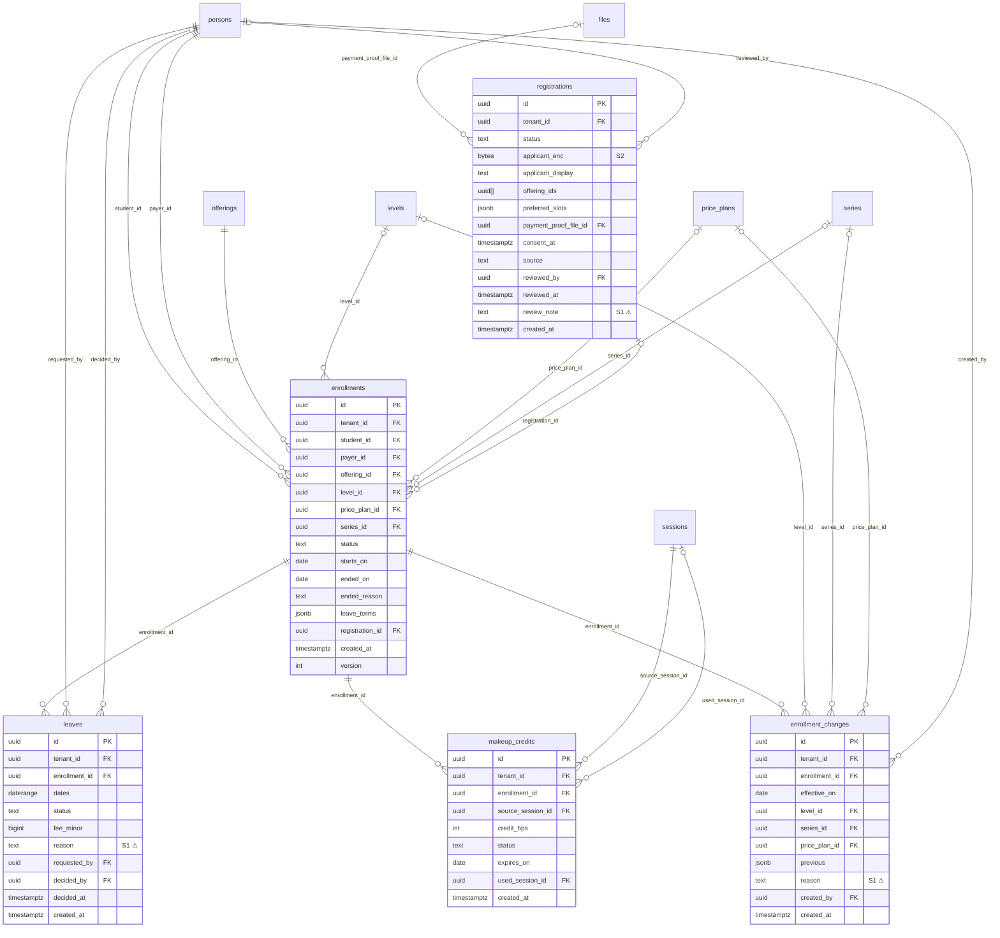
<!-- END GENERATED: diagram-enrollment -->

<!-- BEGIN GENERATED: dictionary-enrollment -->
#### `registrations`

Owner: `enrollment` · RLS: yes

| Column | Type | Null | Key | Class | References | Notes |
|---|---|---|---|---|---|---|
| `id` | `uuid` |  | PK | S1 |  |  |
| `tenant_id` | `uuid` |  | FK | S1 | `tenants` |  |
| `status` | `text` |  |  | S1 |  |  |
| `applicant_enc` | `bytea` |  |  | S2 |  | encrypted JSON: contact + students[] (ENR-03) |
| `applicant_display` | `text` |  |  | S1 |  | display name for lists |
| `offering_ids` | `uuid[]` |  |  | S1 |  |  |
| `preferred_slots` | `jsonb` | yes |  | S1 |  | [{weekday, from, to}] |
| `payment_proof_file_id` | `uuid` | yes | FK | S1 | `files` |  |
| `consent_at` | `timestamptz` |  |  | S1 |  |  |
| `source` | `text` |  |  | S1 |  |  |
| `reviewed_by` | `uuid` | yes | FK | S1 | `persons` |  |
| `reviewed_at` | `timestamptz` | yes |  | S1 |  |  |
| `review_note` | `text` | yes |  | S1 ⚠ |  |  |
| `created_at` | `timestamptz` |  |  | S1 |  |  |

#### `enrollments`

Owner: `enrollment` · RLS: yes

| Column | Type | Null | Key | Class | References | Notes |
|---|---|---|---|---|---|---|
| `id` | `uuid` |  | PK | S1 |  |  |
| `tenant_id` | `uuid` |  | FK | S1 | `tenants` |  |
| `student_id` | `uuid` |  | FK | S1 | `persons` |  |
| `payer_id` | `uuid` |  | FK | S1 | `persons` |  |
| `offering_id` | `uuid` |  | FK | S1 | `offerings` |  |
| `level_id` | `uuid` | yes | FK | S1 | `levels` |  |
| `price_plan_id` | `uuid` | yes | FK | S1 | `price_plans` |  |
| `series_id` | `uuid` | yes | FK | S1 | `series` |  |
| `status` | `text` |  |  | S1 |  |  |
| `starts_on` | `date` |  |  | S1 |  |  |
| `ended_on` | `date` | yes |  | S1 |  |  |
| `ended_reason` | `text` | yes |  | S1 |  |  |
| `leave_terms` | `jsonb` |  |  | S1 |  | snapshot of LeaveRules (POL-05) |
| `registration_id` | `uuid` | yes | FK | S1 | `registrations` |  |
| `created_at` | `timestamptz` |  |  | S1 |  |  |
| `version` | `int` |  |  | S1 |  |  |

#### `leaves`

Owner: `enrollment` · RLS: yes

| Column | Type | Null | Key | Class | References | Notes |
|---|---|---|---|---|---|---|
| `id` | `uuid` |  | PK | S1 |  |  |
| `tenant_id` | `uuid` |  | FK | S1 | `tenants` |  |
| `enrollment_id` | `uuid` |  | FK | S1 | `enrollments` |  |
| `dates` | `daterange` |  |  | S1 |  |  |
| `status` | `text` |  |  | S1 |  |  |
| `fee_minor` | `bigint` |  |  | S1 |  |  |
| `reason` | `text` | yes |  | S1 ⚠ |  |  |
| `requested_by` | `uuid` |  | FK | S1 | `persons` |  |
| `decided_by` | `uuid` | yes | FK | S1 | `persons` |  |
| `decided_at` | `timestamptz` | yes |  | S1 |  |  |
| `created_at` | `timestamptz` |  |  | S1 |  |  |

#### `makeup_credits`

Owner: `enrollment` · RLS: yes

| Column | Type | Null | Key | Class | References | Notes |
|---|---|---|---|---|---|---|
| `id` | `uuid` |  | PK | S1 |  |  |
| `tenant_id` | `uuid` |  | FK | S1 | `tenants` |  |
| `enrollment_id` | `uuid` |  | FK | S1 | `enrollments` |  |
| `source_session_id` | `uuid` |  | FK | S1 | `sessions` |  |
| `credit_bps` | `int` |  |  | S1 |  |  |
| `status` | `text` |  |  | S1 |  |  |
| `expires_on` | `date` |  |  | S1 |  |  |
| `used_session_id` | `uuid` | yes | FK | S1 | `sessions` |  |
| `created_at` | `timestamptz` |  |  | S1 |  |  |

#### `enrollment_changes`

Owner: `enrollment` · RLS: yes

| Column | Type | Null | Key | Class | References | Notes |
|---|---|---|---|---|---|---|
| `id` | `uuid` |  | PK | S1 |  |  |
| `tenant_id` | `uuid` |  | FK | S1 | `tenants` |  |
| `enrollment_id` | `uuid` |  | FK | S1 | `enrollments` |  |
| `effective_on` | `date` |  |  | S1 |  |  |
| `level_id` | `uuid` | yes | FK | S1 | `levels` | NULL = unchanged |
| `series_id` | `uuid` | yes | FK | S1 | `series` | NULL = unchanged |
| `price_plan_id` | `uuid` | yes | FK | S1 | `price_plans` | NULL = unchanged |
| `previous` | `jsonb` |  |  | S1 |  | {level_id, series_id, price_plan_id} before the change |
| `reason` | `text` | yes |  | S1 ⚠ |  |  |
| `created_by` | `uuid` |  | FK | S1 | `persons` |  |
| `created_at` | `timestamptz` |  |  | S1 |  |  |
<!-- END GENERATED: dictionary-enrollment -->

### 3.5 billing

<!-- BEGIN GENERATED: diagram-billing -->
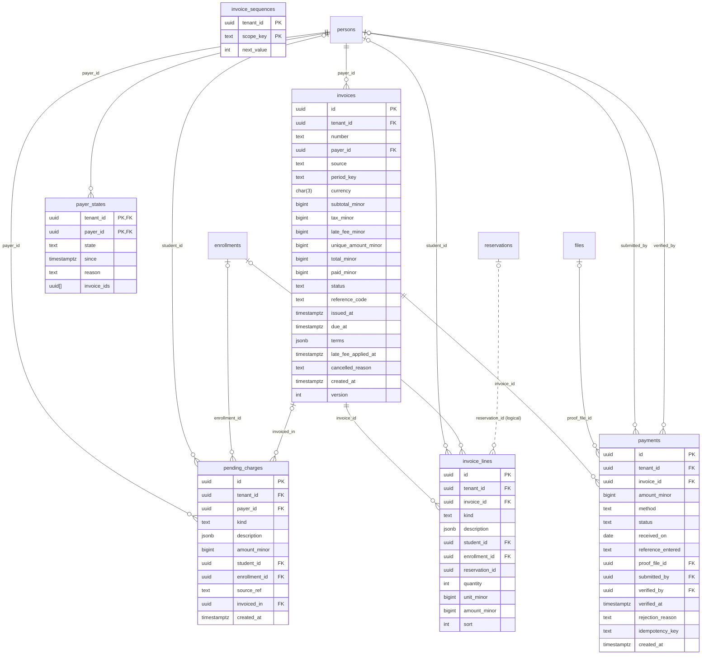
<!-- END GENERATED: diagram-billing -->

<!-- BEGIN GENERATED: dictionary-billing -->
#### `invoices`

Owner: `billing` · RLS: yes

| Column | Type | Null | Key | Class | References | Notes |
|---|---|---|---|---|---|---|
| `id` | `uuid` |  | PK | S1 |  |  |
| `tenant_id` | `uuid` |  | FK | S1 | `tenants` |  |
| `number` | `text` |  |  | S1 |  |  |
| `payer_id` | `uuid` |  | FK | S1 | `persons` |  |
| `source` | `text` |  |  | S1 |  |  |
| `period_key` | `text` | yes |  | S1 |  | e.g. "2026-11" for cycle invoices |
| `currency` | `char(3)` |  |  | S1 |  |  |
| `subtotal_minor` | `bigint` |  |  | S1 |  |  |
| `tax_minor` | `bigint` |  |  | S1 |  |  |
| `late_fee_minor` | `bigint` |  |  | S1 |  |  |
| `unique_amount_minor` | `bigint` |  |  | S1 |  | PaymentReference::UniqueAmount |
| `total_minor` | `bigint` |  |  | S1 |  |  |
| `paid_minor` | `bigint` |  |  | S1 |  |  |
| `status` | `text` |  |  | S1 |  |  |
| `reference_code` | `text` | yes |  | S1 |  | PaymentReference::UniqueCode |
| `issued_at` | `timestamptz` | yes |  | S1 |  |  |
| `due_at` | `timestamptz` | yes |  | S1 |  |  |
| `terms` | `jsonb` |  |  | S1 |  | snapshot {late_fee, overdue, partial_payment, payment_reference} |
| `late_fee_applied_at` | `timestamptz` | yes |  | S1 |  |  |
| `cancelled_reason` | `text` | yes |  | S1 |  |  |
| `created_at` | `timestamptz` |  |  | S1 |  |  |
| `version` | `int` |  |  | S1 |  |  |

#### `invoice_lines`

Owner: `billing` · RLS: yes

| Column | Type | Null | Key | Class | References | Notes |
|---|---|---|---|---|---|---|
| `id` | `uuid` |  | PK | S1 |  |  |
| `tenant_id` | `uuid` |  | FK | S1 | `tenants` |  |
| `invoice_id` | `uuid` |  | FK | S1 | `invoices` |  |
| `kind` | `text` |  |  | S1 |  |  |
| `description` | `jsonb` |  |  | S1 |  | I18nText rendered at issue time |
| `student_id` | `uuid` | yes | FK | S1 | `persons` |  |
| `enrollment_id` | `uuid` | yes | FK | S1 | `enrollments` |  |
| `reservation_id` | `uuid` | yes |  | S1 | `reservations` (logical: rental is optional (MOD-04)) |  |
| `quantity` | `int` |  |  | S1 |  |  |
| `unit_minor` | `bigint` |  |  | S1 |  |  |
| `amount_minor` | `bigint` |  |  | S1 |  | quantity*unit, negative for credit |
| `sort` | `int` |  |  | S1 |  |  |

#### `payments`

Owner: `billing` · RLS: yes

| Column | Type | Null | Key | Class | References | Notes |
|---|---|---|---|---|---|---|
| `id` | `uuid` |  | PK | S1 |  |  |
| `tenant_id` | `uuid` |  | FK | S1 | `tenants` |  |
| `invoice_id` | `uuid` |  | FK | S1 | `invoices` |  |
| `amount_minor` | `bigint` |  |  | S1 |  |  |
| `method` | `text` |  |  | S1 |  |  |
| `status` | `text` |  |  | S1 |  |  |
| `received_on` | `date` | yes |  | S1 |  |  |
| `reference_entered` | `text` | yes |  | S1 |  |  |
| `proof_file_id` | `uuid` | yes | FK | S1 | `files` |  |
| `submitted_by` | `uuid` | yes | FK | S1 | `persons` |  |
| `verified_by` | `uuid` | yes | FK | S1 | `persons` |  |
| `verified_at` | `timestamptz` | yes |  | S1 |  |  |
| `rejection_reason` | `text` | yes |  | S1 |  |  |
| `idempotency_key` | `text` |  |  | S1 |  |  |
| `created_at` | `timestamptz` |  |  | S1 |  |  |

#### `payer_states`

Owner: `billing` · RLS: yes

| Column | Type | Null | Key | Class | References | Notes |
|---|---|---|---|---|---|---|
| `tenant_id` | `uuid` |  | PK/FK | S1 | `tenants` |  |
| `payer_id` | `uuid` |  | PK/FK | S1 | `persons` |  |
| `state` | `text` |  |  | S1 |  |  |
| `since` | `timestamptz` |  |  | S1 |  |  |
| `reason` | `text` |  |  | S1 |  |  |
| `invoice_ids` | `uuid[]` |  |  | S1 |  |  |

#### `invoice_sequences`

Owner: `billing` · RLS: yes

| Column | Type | Null | Key | Class | References | Notes |
|---|---|---|---|---|---|---|
| `tenant_id` | `uuid` |  | PK | S1 |  |  |
| `scope_key` | `text` |  | PK | S1 |  |  |
| `next_value` | `int` |  |  | S1 |  |  |

#### `pending_charges`

Owner: `billing` · RLS: yes

| Column | Type | Null | Key | Class | References | Notes |
|---|---|---|---|---|---|---|
| `id` | `uuid` |  | PK | S1 |  |  |
| `tenant_id` | `uuid` |  | FK | S1 | `tenants` |  |
| `payer_id` | `uuid` |  | FK | S1 | `persons` |  |
| `kind` | `text` |  |  | S1 |  |  |
| `description` | `jsonb` |  |  | S1 |  |  |
| `amount_minor` | `bigint` |  |  | S1 |  | negative for credit |
| `student_id` | `uuid` | yes | FK | S1 | `persons` |  |
| `enrollment_id` | `uuid` | yes | FK | S1 | `enrollments` |  |
| `source_ref` | `text` |  |  | S1 |  | idempotency, e.g. "enrollment_activated:{event_id}" |
| `invoiced_in` | `uuid` | yes | FK | S1 | `invoices` |  |
| `created_at` | `timestamptz` |  |  | S1 |  |  |
<!-- END GENERATED: dictionary-billing -->

### 3.6 attendance

<!-- BEGIN GENERATED: diagram-attendance -->
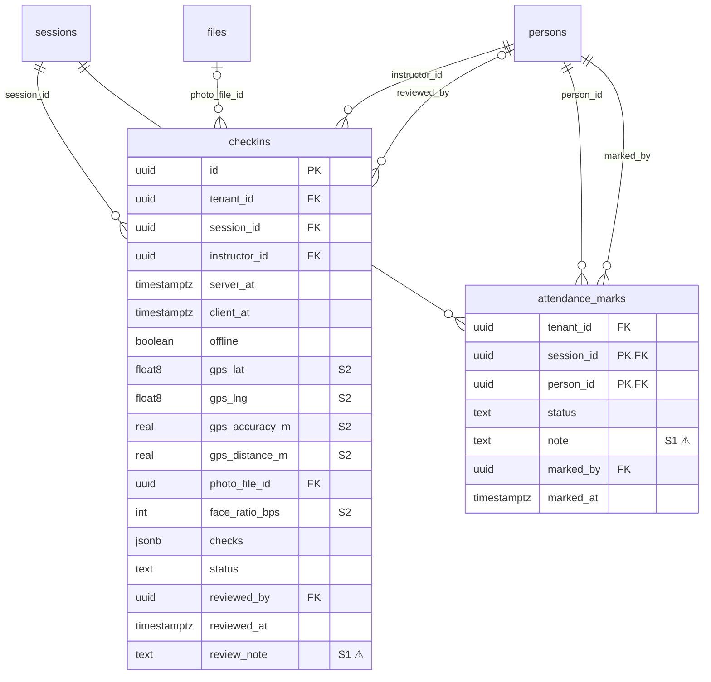
<!-- END GENERATED: diagram-attendance -->

<!-- BEGIN GENERATED: dictionary-attendance -->
#### `checkins`

Owner: `attendance` · RLS: yes

| Column | Type | Null | Key | Class | References | Notes |
|---|---|---|---|---|---|---|
| `id` | `uuid` |  | PK | S1 |  |  |
| `tenant_id` | `uuid` |  | FK | S1 | `tenants` |  |
| `session_id` | `uuid` |  | FK | S1 | `sessions` |  |
| `instructor_id` | `uuid` |  | FK | S1 | `persons` |  |
| `server_at` | `timestamptz` |  |  | S1 |  |  |
| `client_at` | `timestamptz` | yes |  | S1 |  |  |
| `offline` | `boolean` |  |  | S1 |  |  |
| `gps_lat` | `double precision` | yes |  | S2 |  |  |
| `gps_lng` | `double precision` | yes |  | S2 |  |  |
| `gps_accuracy_m` | `real` | yes |  | S2 |  |  |
| `gps_distance_m` | `real` | yes |  | S2 |  |  |
| `photo_file_id` | `uuid` | yes | FK | S1 | `files` |  |
| `face_ratio_bps` | `int` | yes |  | S2 |  |  |
| `checks` | `jsonb` |  |  | S1 |  | {"gps":"pass\|fail\|not_configured\|unavailable\|disabled","time":"pass\|early\|late","photo":"pass\|missing\|invalid\|disabled","face":"pass\|fail\|not_run\|disabled"} |
| `status` | `text` |  |  | S1 |  |  |
| `reviewed_by` | `uuid` | yes | FK | S1 | `persons` |  |
| `reviewed_at` | `timestamptz` | yes |  | S1 |  |  |
| `review_note` | `text` | yes |  | S1 ⚠ |  |  |

#### `attendance_marks`

Owner: `attendance` · RLS: yes

| Column | Type | Null | Key | Class | References | Notes |
|---|---|---|---|---|---|---|
| `tenant_id` | `uuid` |  | FK | S1 | `tenants` |  |
| `session_id` | `uuid` |  | PK/FK | S1 | `sessions` |  |
| `person_id` | `uuid` |  | PK/FK | S1 | `persons` |  |
| `status` | `text` |  |  | S1 |  |  |
| `note` | `text` | yes |  | S1 ⚠ |  |  |
| `marked_by` | `uuid` |  | FK | S1 | `persons` |  |
| `marked_at` | `timestamptz` |  |  | S1 |  |  |
<!-- END GENERATED: dictionary-attendance -->

### 3.7 rental

Reservations share the conflict ledger with sessions (`calendar_holds.owner_kind = 'reservation'`).

<!-- BEGIN GENERATED: diagram-rental -->
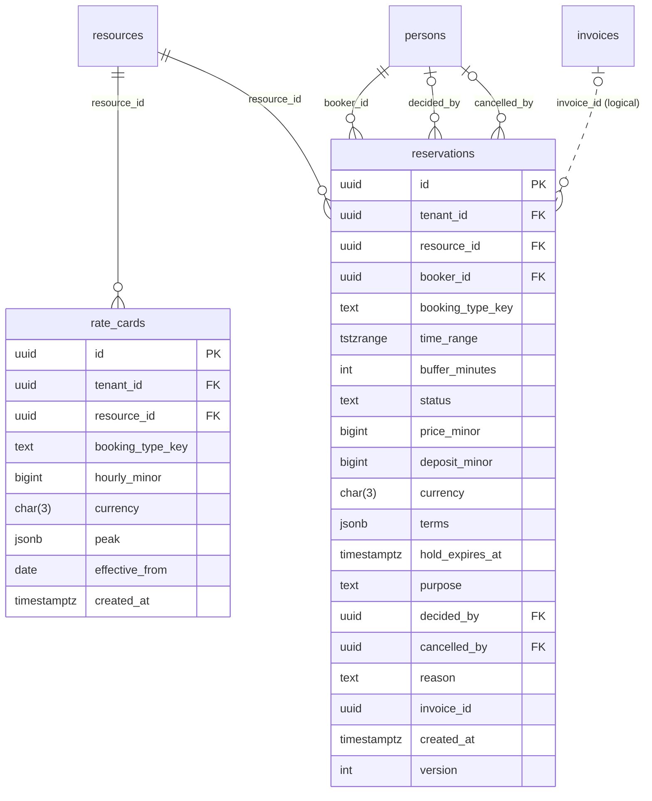
<!-- END GENERATED: diagram-rental -->

<!-- BEGIN GENERATED: dictionary-rental -->
#### `rate_cards`

Owner: `rental` · RLS: yes

| Column | Type | Null | Key | Class | References | Notes |
|---|---|---|---|---|---|---|
| `id` | `uuid` |  | PK | S1 |  |  |
| `tenant_id` | `uuid` |  | FK | S1 | `tenants` |  |
| `resource_id` | `uuid` |  | FK | S1 | `resources` |  |
| `booking_type_key` | `text` |  |  | S1 |  |  |
| `hourly_minor` | `bigint` |  |  | S1 |  |  |
| `currency` | `char(3)` |  |  | S1 |  |  |
| `peak` | `jsonb` | yes |  | S1 |  | optional [{weekdays:[...], start:"HH:MM", end:"HH:MM", hourly_minor}] |
| `effective_from` | `date` |  |  | S1 |  |  |
| `created_at` | `timestamptz` |  |  | S1 |  |  |

#### `reservations`

Owner: `rental` · RLS: yes

| Column | Type | Null | Key | Class | References | Notes |
|---|---|---|---|---|---|---|
| `id` | `uuid` |  | PK | S1 |  |  |
| `tenant_id` | `uuid` |  | FK | S1 | `tenants` |  |
| `resource_id` | `uuid` |  | FK | S1 | `resources` |  |
| `booker_id` | `uuid` |  | FK | S1 | `persons` |  |
| `booking_type_key` | `text` |  |  | S1 |  |  |
| `time_range` | `tstzrange` |  |  | S1 |  |  |
| `buffer_minutes` | `int` |  |  | S1 |  |  |
| `status` | `text` |  |  | S1 |  |  |
| `price_minor` | `bigint` |  |  | S1 |  |  |
| `deposit_minor` | `bigint` |  |  | S1 |  |  |
| `currency` | `char(3)` |  |  | S1 |  |  |
| `terms` | `jsonb` |  |  | S1 |  | snapshot of BookingType + RentalPayment |
| `hold_expires_at` | `timestamptz` | yes |  | S1 |  |  |
| `purpose` | `text` | yes |  | S1 |  |  |
| `decided_by` | `uuid` | yes | FK | S1 | `persons` |  |
| `cancelled_by` | `uuid` | yes | FK | S1 | `persons` |  |
| `reason` | `text` | yes |  | S1 |  |  |
| `invoice_id` | `uuid` | yes |  | S1 | `invoices` (logical: billing is optional (MOD-04)) |  |
| `created_at` | `timestamptz` |  |  | S1 |  |  |
| `version` | `int` |  |  | S1 |  |  |
<!-- END GENERATED: dictionary-rental -->

### 3.8 notify

<!-- BEGIN GENERATED: diagram-notify -->
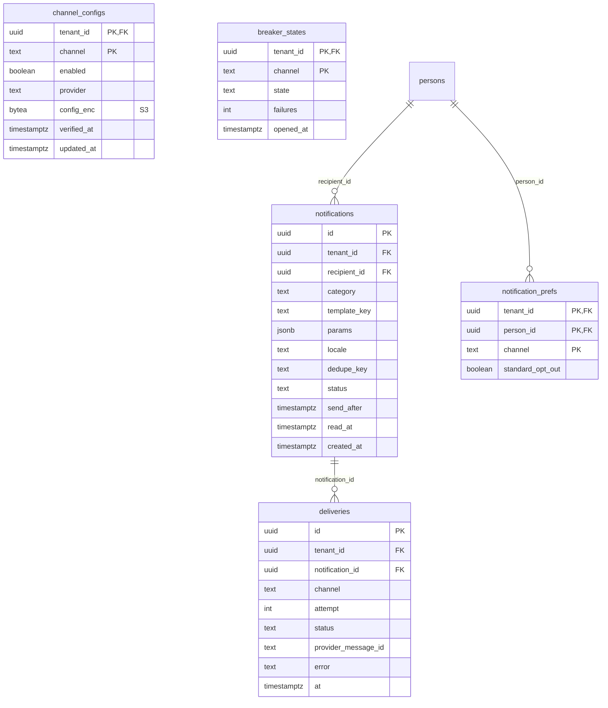
<!-- END GENERATED: diagram-notify -->

<!-- BEGIN GENERATED: dictionary-notify -->
#### `channel_configs`

Owner: `notify` · RLS: yes

| Column | Type | Null | Key | Class | References | Notes |
|---|---|---|---|---|---|---|
| `tenant_id` | `uuid` |  | PK/FK | S1 | `tenants` |  |
| `channel` | `text` |  | PK | S1 |  |  |
| `enabled` | `boolean` |  |  | S1 |  |  |
| `provider` | `text` |  |  | S1 |  | 'smtp' \| 'whatsapp_cloud' \| 'whatsapp_http' |
| `config_enc` | `bytea` |  |  | S3 |  | encrypted JSON (host, user, password, token...) |
| `verified_at` | `timestamptz` | yes |  | S1 |  |  |
| `updated_at` | `timestamptz` |  |  | S1 |  |  |

#### `notifications`

Owner: `notify` · RLS: yes

| Column | Type | Null | Key | Class | References | Notes |
|---|---|---|---|---|---|---|
| `id` | `uuid` |  | PK | S1 |  |  |
| `tenant_id` | `uuid` |  | FK | S1 | `tenants` |  |
| `recipient_id` | `uuid` |  | FK | S1 | `persons` |  |
| `category` | `text` |  |  | S1 |  |  |
| `template_key` | `text` |  |  | S1 |  |  |
| `params` | `jsonb` |  |  | S1 |  |  |
| `locale` | `text` |  |  | S1 |  |  |
| `dedupe_key` | `text` | yes |  | S1 |  |  |
| `status` | `text` |  |  | S1 |  |  |
| `send_after` | `timestamptz` |  |  | S1 |  |  |
| `read_at` | `timestamptz` | yes |  | S1 |  | in-app |
| `created_at` | `timestamptz` |  |  | S1 |  |  |

#### `deliveries`

Owner: `notify` · RLS: yes

| Column | Type | Null | Key | Class | References | Notes |
|---|---|---|---|---|---|---|
| `id` | `uuid` |  | PK | S1 |  |  |
| `tenant_id` | `uuid` |  | FK | S1 | `tenants` |  |
| `notification_id` | `uuid` |  | FK | S1 | `notifications` |  |
| `channel` | `text` |  |  | S1 |  |  |
| `attempt` | `int` |  |  | S1 |  |  |
| `status` | `text` |  |  | S1 |  |  |
| `provider_message_id` | `text` | yes |  | S1 |  |  |
| `error` | `text` | yes |  | S1 |  |  |
| `at` | `timestamptz` |  |  | S1 |  |  |

#### `breaker_states`

Owner: `notify` · RLS: yes

| Column | Type | Null | Key | Class | References | Notes |
|---|---|---|---|---|---|---|
| `tenant_id` | `uuid` |  | PK/FK | S1 | `tenants` |  |
| `channel` | `text` |  | PK | S1 |  |  |
| `state` | `text` |  |  | S1 |  |  |
| `failures` | `int` |  |  | S1 |  |  |
| `opened_at` | `timestamptz` | yes |  | S1 |  |  |

#### `notification_prefs`

Owner: `notify` · RLS: yes

| Column | Type | Null | Key | Class | References | Notes |
|---|---|---|---|---|---|---|
| `tenant_id` | `uuid` |  | PK/FK | S1 | `tenants` |  |
| `person_id` | `uuid` |  | PK/FK | S1 | `persons` |  |
| `channel` | `text` |  | PK | S1 |  |  |
| `standard_opt_out` | `boolean` |  |  | S1 |  |  |
<!-- END GENERATED: dictionary-notify -->

### 3.9 audit and privacy

`audit.entries` is append-only and hash-chained (AUD-03, AUD-04). `actor_id` has no FK on purpose, so the log survives a person's anonymisation.

<!-- BEGIN GENERATED: diagram-audit -->
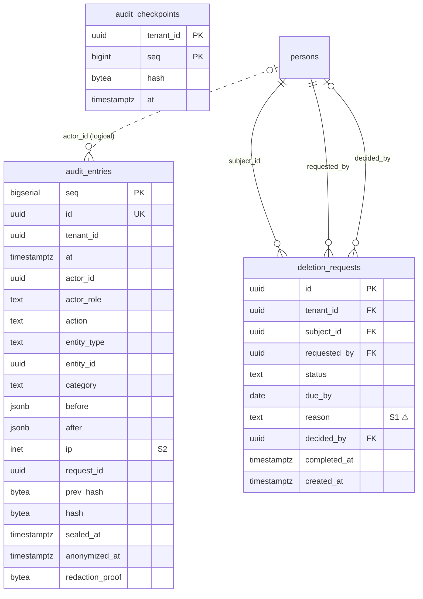
<!-- END GENERATED: diagram-audit -->

<!-- BEGIN GENERATED: dictionary-audit -->
#### `audit.entries`

Owner: `audit` · RLS: yes

| Column | Type | Null | Key | Class | References | Notes |
|---|---|---|---|---|---|---|
| `seq` | `bigserial` |  | PK | S1 |  |  |
| `id` | `uuid` |  | UK | S1 |  |  |
| `tenant_id` | `uuid` |  |  | S1 |  |  |
| `at` | `timestamptz` |  |  | S1 |  |  |
| `actor_id` | `uuid` | yes |  | S1 | `persons` (logical: NULL = system; no FK so audit survives person deletion) | NULL = system |
| `actor_role` | `text` |  |  | S1 |  | owner\|admin\|instructor\|guardian\|student\|system\|platform |
| `action` | `text` |  |  | S1 |  | e.g. "billing.invoice.issued" |
| `entity_type` | `text` |  |  | S1 |  |  |
| `entity_id` | `uuid` | yes |  | S1 | `any aggregate` (logical: by entity_type) |  |
| `category` | `text` |  |  | S1 |  |  |
| `before` | `jsonb` | yes |  | S1 |  |  |
| `after` | `jsonb` | yes |  | S1 |  |  |
| `ip` | `inet` | yes |  | S2 |  |  |
| `request_id` | `uuid` | yes |  | S1 |  |  |
| `prev_hash` | `bytea` | yes |  | S1 |  | filled by sealer (AUD-04) |
| `hash` | `bytea` | yes |  | S1 |  |  |
| `sealed_at` | `timestamptz` | yes |  | S1 |  |  |
| `anonymized_at` | `timestamptz` | yes |  | S1 |  |  |
| `redaction_proof` | `bytea` | yes |  | S1 |  | (added by ALTER, §4.11) |

#### `deletion_requests`

Owner: `audit` · RLS: yes

| Column | Type | Null | Key | Class | References | Notes |
|---|---|---|---|---|---|---|
| `id` | `uuid` |  | PK | S1 |  |  |
| `tenant_id` | `uuid` |  | FK | S1 | `tenants` |  |
| `subject_id` | `uuid` |  | FK | S1 | `persons` |  |
| `requested_by` | `uuid` |  | FK | S1 | `persons` |  |
| `status` | `text` |  |  | S1 |  |  |
| `due_by` | `date` |  |  | S1 |  |  |
| `reason` | `text` | yes |  | S1 ⚠ |  |  |
| `decided_by` | `uuid` | yes | FK | S1 | `persons` |  |
| `completed_at` | `timestamptz` | yes |  | S1 |  |  |
| `created_at` | `timestamptz` |  |  | S1 |  |  |

#### `audit.checkpoints`

Owner: `audit` · RLS: no — spec/06 §4.11

| Column | Type | Null | Key | Class | References | Notes |
|---|---|---|---|---|---|---|
| `tenant_id` | `uuid` |  | PK | S1 |  |  |
| `seq` | `bigint` |  | PK | S1 |  |  |
| `hash` | `bytea` |  |  | S1 |  |  |
| `at` | `timestamptz` |  |  | S1 |  |  |
<!-- END GENERATED: dictionary-audit -->

### 3.10 feedback

<!-- BEGIN GENERATED: diagram-feedback -->
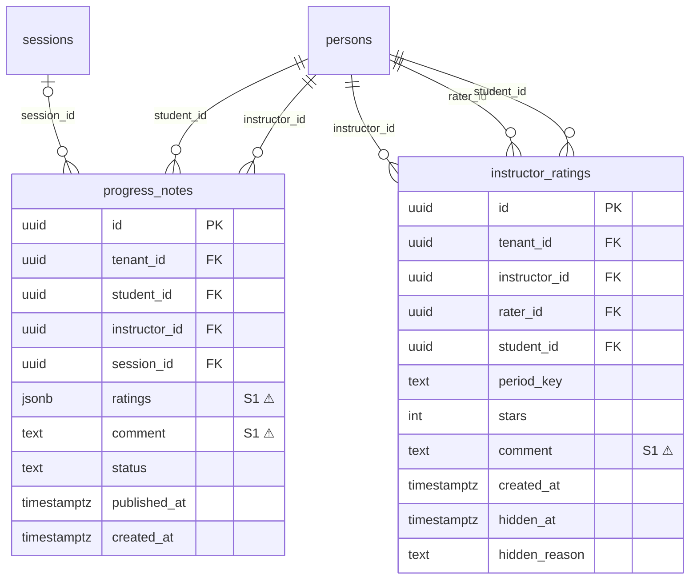
<!-- END GENERATED: diagram-feedback -->

<!-- BEGIN GENERATED: dictionary-feedback -->
#### `progress_notes`

Owner: `feedback` · RLS: yes

| Column | Type | Null | Key | Class | References | Notes |
|---|---|---|---|---|---|---|
| `id` | `uuid` |  | PK | S1 |  |  |
| `tenant_id` | `uuid` |  | FK | S1 | `tenants` |  |
| `student_id` | `uuid` |  | FK | S1 | `persons` |  |
| `instructor_id` | `uuid` |  | FK | S1 | `persons` |  |
| `session_id` | `uuid` | yes | FK | S1 | `sessions` |  |
| `ratings` | `jsonb` |  |  | S1 ⚠ |  | {"progress": 4, "behaviour": 5} |
| `comment` | `text` | yes |  | S1 ⚠ |  |  |
| `status` | `text` |  |  | S1 |  |  |
| `published_at` | `timestamptz` | yes |  | S1 |  |  |
| `created_at` | `timestamptz` |  |  | S1 |  |  |

#### `instructor_ratings`

Owner: `feedback` · RLS: yes

| Column | Type | Null | Key | Class | References | Notes |
|---|---|---|---|---|---|---|
| `id` | `uuid` |  | PK | S1 |  |  |
| `tenant_id` | `uuid` |  | FK | S1 | `tenants` |  |
| `instructor_id` | `uuid` |  | FK | S1 | `persons` |  |
| `rater_id` | `uuid` |  | FK | S1 | `persons` |  |
| `student_id` | `uuid` |  | FK | S1 | `persons` |  |
| `period_key` | `text` |  |  | S1 |  | "2026-11": one rating per rater/instructor/student per month |
| `stars` | `int` |  |  | S1 |  |  |
| `comment` | `text` | yes |  | S1 ⚠ |  |  |
| `created_at` | `timestamptz` |  |  | S1 |  |  |
| `hidden_at` | `timestamptz` | yes |  | S1 |  | (added by ALTER, §4.11) |
| `hidden_reason` | `text` | yes |  | S1 |  | (added by ALTER, §4.11) |
<!-- END GENERATED: dictionary-feedback -->

### 3.11 platform (cloud only)

Compiled only with the `platform` feature (M9). Schema `platform`, no RLS, reachable only through the `eq_platform` role, never from a request handler (SEC-05, CLD-11).

<!-- BEGIN GENERATED: diagram-platform -->
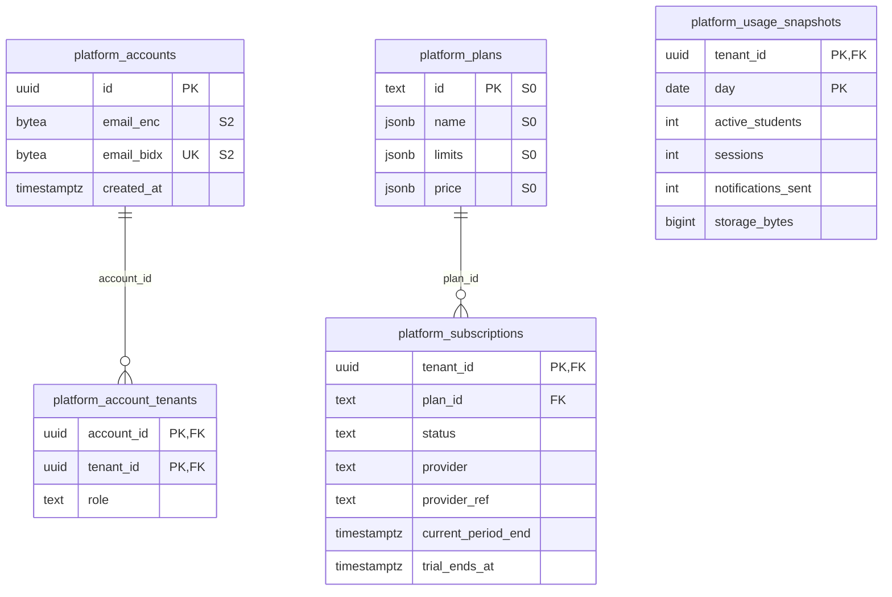
<!-- END GENERATED: diagram-platform -->

<!-- BEGIN GENERATED: dictionary-platform -->
#### `platform.accounts`

Owner: `platform` · RLS: no — platform schema, role eq_platform only

| Column | Type | Null | Key | Class | References | Notes |
|---|---|---|---|---|---|---|
| `id` | `uuid` |  | PK | S1 |  |  |
| `email_enc` | `bytea` |  |  | S2 |  | S2, encrypted with the platform key (SEC-03) |
| `email_bidx` | `bytea` |  | UK | S2 |  | blind index for login lookup (SEC-04) |
| `created_at` | `timestamptz` |  |  | S1 |  |  |

#### `platform.account_tenants`

Owner: `platform` · RLS: no — platform schema, role eq_platform only

| Column | Type | Null | Key | Class | References | Notes |
|---|---|---|---|---|---|---|
| `account_id` | `uuid` |  | PK/FK | S1 | `platform.accounts` |  |
| `tenant_id` | `uuid` |  | PK/FK | S1 | `tenants` |  |
| `role` | `text` |  |  | S1 |  |  |

#### `platform.plans`

Owner: `platform` · RLS: no — platform schema, role eq_platform only

| Column | Type | Null | Key | Class | References | Notes |
|---|---|---|---|---|---|---|
| `id` | `text` |  | PK | S0 |  | 'free' \| 'standard' \| 'pro' \| 'enterprise' |
| `name` | `jsonb` |  |  | S0 |  | I18nText |
| `limits` | `jsonb` |  |  | S0 |  | {active_students, locations, storage_bytes, notifications_per_month} |
| `price` | `jsonb` |  |  | S0 |  | {"IDR": minor, "USD": minor} per month |

#### `platform.subscriptions`

Owner: `platform` · RLS: no — platform schema, role eq_platform only

| Column | Type | Null | Key | Class | References | Notes |
|---|---|---|---|---|---|---|
| `tenant_id` | `uuid` |  | PK/FK | S1 | `tenants` |  |
| `plan_id` | `text` |  | FK | S1 | `platform.plans` |  |
| `status` | `text` |  |  | S1 |  |  |
| `provider` | `text` | yes |  | S1 |  |  |
| `provider_ref` | `text` | yes |  | S1 |  |  |
| `current_period_end` | `timestamptz` | yes |  | S1 |  |  |
| `trial_ends_at` | `timestamptz` | yes |  | S1 |  |  |

#### `platform.usage_snapshots`

Owner: `platform` · RLS: no — platform schema, role eq_platform only

| Column | Type | Null | Key | Class | References | Notes |
|---|---|---|---|---|---|---|
| `tenant_id` | `uuid` |  | PK/FK | S1 | `tenants` |  |
| `day` | `date` |  | PK | S1 |  |  |
| `active_students` | `int` |  |  | S1 |  |  |
| `sessions` | `int` |  |  | S1 |  |  |
| `notifications_sent` | `int` |  |  | S1 |  |  |
| `storage_bytes` | `bigint` |  |  | S1 |  |  |
<!-- END GENERATED: dictionary-platform -->

## 4. Logical references

**ERD-02.** A column that points at another table **without** an FK is a logical reference. There are three reasons, and no others:
1. The target belongs to an **optional** module (MOD-04). An FK would make the owning module's migration depend on a module that may be compiled out. Example: `reservations.invoice_id`.
2. The value is written by **another module** through an event or port (ARC: modules never write each other's tables). Example: `session_participants.enrollment_id`.
3. The target is **polymorphic** (`subject_kind`/`owner_kind`/`entity_type`).

Integrity of a logical reference is the writer's job: it is set only from a value the owner emitted in an event or returned from a port, and it is never joined across modules in SQL (CA-30; reports use `rv_<owner>_<name>` views).

<!-- BEGIN GENERATED: logical-refs -->
| Table.column | Points at | Why there is no FK |
|---|---|---|
| `calendar_holds.subject_id` | `resources | persons` | polymorphic by subject_kind |
| `calendar_holds.owner_id` | `sessions | reservations` | polymorphic by owner_kind |
| `series_members.enrollment_id` | `enrollments` | set by enrollment module (event) |
| `session_participants.enrollment_id` | `enrollments` | set by enrollment module (event) |
| `invoice_lines.reservation_id` | `reservations` | rental is optional (MOD-04) |
| `reservations.invoice_id` | `invoices` | billing is optional (MOD-04) |
| `persons.avatar_file_id` | `files` | set after upload |
| `outbox.aggregate_id` | `any aggregate` | event source |
| `audit.entries.entity_id` | `any aggregate` | by entity_type |
| `audit.entries.actor_id` | `persons` | NULL = system; no FK so audit survives person deletion |
| `attention_items.ref_id` | `any aggregate` | by ref_type |
| `event_receipts.event_id` | `outbox` | dedupe of handled events |
<!-- END GENERATED: logical-refs -->

## 5. Data classes

**ERD-04.** Every column has a data class (SBD-10). The class decides storage, API exposure and logging (`18-security-by-design.md` §2):
- **S3 Secret:** hashed or encrypted, never returned, never logged.
- **S2 Sensitive PII:** encrypted (`*_enc`) with a blind index (`*_bidx`) for lookup, returned only with `read_pii`, never logged. Raw IP addresses, user agents and check-in GPS readings are S2 even though they are stored plaintext: they are kept for a bounded time (refresh-session expiry, audit anonymisation, AUD-05) and never logged or exported without `read_pii`.
- **S1 Internal:** plaintext under RLS, role-scoped. Logs carry ids and counts only.
- **S0 Public:** may be served by `auth: none` endpoints listed in the spec.

The class of a column is fixed here. A task that adds a column states its class (SBD-10); the architect adds it to `scripts/erd.py` together with the DDL.

<!-- BEGIN GENERATED: classes -->
| Class | Columns |
|---|---|
| S3 Secret | `channel_configs.config_enc`, `credentials.password_hash`, `credentials.totp_secret_enc`, `invites.token_hash`, `password_resets.token_hash`, `refresh_sessions.token_hash`, `tenant_keys.dek_enc`, `totp_recovery_codes.code_hash` |
| S2 Sensitive PII | `audit.entries.ip`, `checkins.face_ratio_bps`, `checkins.gps_accuracy_m`, `checkins.gps_distance_m`, `checkins.gps_lat`, `checkins.gps_lng`, `persons.address_enc`, `persons.birth_date_enc`, `persons.email_bidx`, `persons.email_enc`, `persons.legal_name_enc`, `persons.phone_bidx`, `persons.phone_enc`, `platform.accounts.email_bidx`, `platform.accounts.email_enc`, `refresh_sessions.ip`, `refresh_sessions.user_agent`, `registrations.applicant_enc` |
| S0 Public | `offerings.description`, `offerings.key`, `offerings.name`, `platform.plans.id`, `platform.plans.limits`, `platform.plans.name`, `platform.plans.price`, `tenants.name`, `tenants.slug` |
| S1 Internal | every other column |
| ⚠ open (ERD-05) | `attendance_marks.note`, `checkins.review_note`, `deletion_requests.reason`, `enrollment_changes.reason`, `instructor_ratings.comment`, `leaves.reason`, `progress_notes.comment`, `progress_notes.ratings`, `registrations.review_note`, `sessions.notes` |
<!-- END GENERATED: classes -->

**ERD-05. Open classification question (architect + maintainer).** The ⚠ columns are plaintext free text that can describe a minor (a teacher's note, a leave reason, a rating comment). SBD-10 lists "any field about a minor beyond the display name" as S2, but these columns are stored plaintext and searchable. Until this is decided they are **S1 with three extra rules**, which every task that touches them follows: never logged (not even truncated), never in exports without `read_pii`, and included in the anonymisation keys of AUD-05 (`note`, `comment`, `reason`). A decision to make them S2 changes their storage to `*_enc` and is a schema change through spec 06.

## 6. Drift checks

**ERD-03.** Two checks keep the schema honest. Both are in `scripts/erd.py`, need only Python 3, and run in CI with the other guard scripts:

| Command | Fails when | Who runs it |
|---|---|---|
| `scripts/erd.py --check` | `29-erd.md` is stale against the DDL in spec 06 / spec 04 | CI on every PR; the architect after editing spec 06 (`--write` fixes it) |
| `scripts/erd.py --migrations` | A migration creates a table or column that is not in the DDL, a migrated table is missing a DDL column, or a column's type, nullability or FK target differs from the DDL. Tables not migrated yet are reported, not failed | CI on every PR; every task that adds or changes a migration (Definition of done) |

Defaults, CHECK constraints, indexes and RLS are not compared by the script. They are covered by the schema tests of the task that creates the table (for example T-101 `rls_enabled_on_tenant_tables`) and by the isolation suite (TST-06).

## 7. Table → migration → task

**ERD-06.** One migration file per row, created by exactly one task, named `NNNN_<module>_<desc>.sql` (ADR-0012). The numbers leave gaps so a milestone can add a migration without renumbering. A task creates only the tables listed on its row, copied verbatim from spec 06.

| Migration | Task | Creates (spec 06 section) |
|---|---|---|
| `0001_core_bootstrap.sql` | T-003 | roles `eq_app`, extensions `btree_gist`, `pgcrypto`, `pg_trgm`, helper `eq_enable_rls` (no tables) |
| `0002_core_tenancy.sql` | T-101 | `tenants`, `locations`, `resources`, `persons`, `memberships`, `person_links`, `tenant_modules`, `closures` (§4.1) |
| `0003_core_policies_files.sql` | T-101 | `policies` (spec 04 §2), `files`, `drafts` (§4.1), `attention_items`, `consents`, `tenant_keys`, `idempotency_keys` (§4.11) |
| `0004_core_outbox_jobs.sql` | T-107 | `outbox`, `event_receipts`, `jobs` (§4.1) |
| `0005_core_cron_state.sql` | T-108 | `cron_state` (§4.12) |
| `0006_audit.sql` | T-109 | schema `audit`, `audit.entries` (§4.9 with `redaction_proof` from §4.11), `audit.checkpoints` (§4.11) |
| `0007_identity.sql` | T-110 | `credentials`, `refresh_sessions`, `invites`, `password_resets` (§4.2) |
| `0008_identity_totp_recovery.sql` | T-111 | `totp_recovery_codes` (§4.12) |
| `0010_scheduling.sql` | T-201 | `calendar_holds` (§3), `level_tracks`, `levels`, `offerings`, `price_plans`, `series`, `series_members`, `sessions`, `session_instructors`, `session_participants` (§4.3), `instructor_availability` (§4.11) |
| `0012_ics.sql` | T-211 | column `persons.ics_secret_version` (§4.12) |
| `0020_enrollment.sql` | T-401 | `registrations`, `enrollments`, `leaves`, `makeup_credits` (§4.4), `enrollment_changes` (§4.12) |
| `0030_billing.sql` | T-410 | `invoices`, `invoice_lines`, `payments`, `payer_states`, `invoice_sequences` (§4.5), `pending_charges` (§4.11) |
| `0040_attendance.sql` | T-501 | `checkins`, `attendance_marks` (§4.6) |
| `0050_notify.sql` | T-506 | `channel_configs`, `notifications`, `deliveries`, `breaker_states` (§4.8), `notification_prefs` (§4.11) |
| `0060_rental.sql` | T-601 | `rate_cards`, `reservations` (§4.7) |
| `0062_feedback.sql` | T-608 | `progress_notes`, `instructor_ratings` (§4.10, with `hidden_at`, `hidden_reason` from §4.11) |
| `0064_audit_deletion_requests.sql` | T-610 | `deletion_requests` (§4.9) |
| `0066_<owner>_report_views.sql` … | T-606 | read views `rv_<owner>_<name>` only, one migration per owning module (CA-30); no tables |
| `0090_platform.sql` | T-901 | schema `platform`, role `eq_platform`, `platform.accounts`, `platform.account_tenants`, `platform.plans`, `platform.subscriptions`, `platform.usage_snapshots` (§4.12) |

A table in spec 06 with no row here is an error in this document; a row here with no table in spec 06 is an error in spec 06. `scripts/erd.py --migrations` reports both once the migrations exist.
